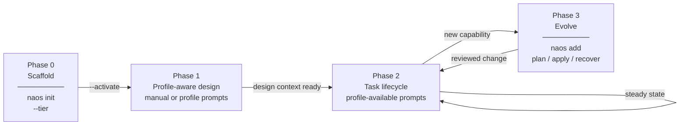

# NAOS Portable Governance Kit — Installation Manual

**Version**: 1.1.0
**Status**: Remediated source candidate; not a new published release
**Last Updated**: 2026-10-18

---

## Overview

This manual guides you through installing and customising the NAOS Portable Governance Kit in a new project repository. The kit provides a portable, tiered AI coding governance layer through repository files and commands. AI-host discovery and loading differ by client and must be configured and verified in the active host.

NAOS is intended for AI-assisted development and long-term maintenance of
complex enterprise software, including highly regulated projects. Select a
profile and configure evidence for the development workflow and review needs
of the project; installation does not establish regulatory compliance.

**Select the matching runtime before following this manual.** The commands and
boundaries below describe the remediated source candidate. The existing public
v1.1.0 release predates these changes, despite sharing the `1.1.0` package version.
Installing that release does not provide the newer provenance inspection,
receiving/rebind, legacy migration, applicability or CI-readiness procedures.
For this candidate, use an artifact whose reviewed build receipt identifies the
source and SHA-256; the version string alone cannot identify it. See
[Artifact acquisition](#artifact-acquisition). Publication of source changes
does not replace an existing release asset or qualify a new artifact.

Installing NAOS activates a profile and scaffolds governance files. It does not cause every capability to become mature immediately. Capability maturity depends on project readiness, configuration, validator outputs, evidence freshness, gatekeeper status, and human review. See [docs/CONTROL_PLANE.md](docs/CONTROL_PLANE.md) for the capability/policy/evidence model, [docs/AUDIT_PLAYBOOK.md](docs/AUDIT_PLAYBOOK.md) for deterministic audit checks, and [docs/ASSURED_PROFILE_ACTIVATION.md](docs/ASSURED_PROFILE_ACTIVATION.md) before relying on the `assured` profile.

---

## Table of Contents

1. [Prerequisites](#prerequisites)
2. [NAOS Lifecycle Overview](#naos-lifecycle-overview)
3. [Installation via `naos-governance init`](#installation-via-naos-governance-init)
4. [Managed Upgrade and Recovery](#managed-upgrade-and-recovery)
5. [Memory Setup (Recommended: Engram)](#memory-setup-recommended-engram)
6. [Progressive Enhancement via `naos add`](#progressive-enhancement-via-naos-add)
7. [Minimum Tooling Requirements](#minimum-tooling-requirements)
8. [Manual Installation](#manual-installation)
9. [Naming Conventions](#naming-conventions)
10. [AGENTS.md Porting Checklist](#agentsmd-porting-checklist)
11. [Profile Reference](#profile-reference)
12. [Claude Code Hooks (Enhancement Layer)](#claude-code-hooks-enhancement-layer)
13. [Customisation Reference](#customisation-reference)
14. [Professional Adoption Engine](#professional-adoption-engine)
15. [Codex Plugin Adapter (Optional)](#codex-plugin-adapter-optional)
16. [Claude Code Plugin Adapter (Optional)](#claude-code-plugin-adapter-optional)
17. [Validate a disposable brownfield overlay](#validate-a-disposable-brownfield-overlay)

---

## NAOS Lifecycle Overview

NAOS uses four phases, but the installed interaction surface depends on the
selected profile. You run `naos init` once. Quickstart uses manual project
context and review with no prompt lifecycle; Lite installs `/naos-design` and
its bounded task prompts; Standard and Assured also install `/naos-specify`
and the full session/cadence catalogue. `naos add` evolves the kit explicitly
as the project grows.



| Phase | Purpose | Key Tool | Once or Repeated |
| ------- | --------- | ---------- | ------------------ |
| 0 — Scaffold | Install governance files | `naos init` | Once per project |
| 1 — Design | Establish project/spec context | Quickstart: manual; Lite: `/naos-design`; Standard/Assured: `/naos-design` and `/naos-specify` | Once; revisit on scope change |
| 2 — Task Lifecycle | Profile-available delivery workflow | Lite: `/naos-task-start`, `@naos-plan`; Standard/Assured add `/naos-d-start` and `/naos-d-end`; Quickstart has no prompt lifecycle | Every task |
| 3 — Evolve | Add new governance artifacts | `naos add` | As needed |

> See [NAOS_CATALOG.md](./NAOS_CATALOG.md) for the complete catalog of all prompts, agents,
> skills, and CLI commands with phase-by-phase usage guidance.

---

## Prerequisites

| Requirement | Notes |
| ------------- | ------- |
| Git repository | Kit is repo-scoped |
| Python ≥ 3.11 | For `naos init` and governance scripts |
| (Optional) Engram MCP server | Local memory provider pattern for authorized `mem_context`, `mem_search`, `mem_save`, compact recovery, and memory-based hooks |
| (Optional) Claude Code | Can use optional hook templates; not required for NAOS core |

> **Platform boundary:** The selected baseline dated 17 October 2026 is
> recorded in [platform implementation and verification](docs/PLATFORM_ADAPTERS.md#selected-current-d5-baseline-17-october-2026).
> Its nine native OS/Python cells were accepted across macOS ARM64/APFS,
> Ubuntu x86_64/ext4 and Windows 11 x64/NTFS with CPython 3.11–3.13. It covers the
> specific installed artifact, ordinary managed-chain and receiving/recovery
> routes listed there; it does not qualify every profile, history or metadata
> branch. Preview generation and package installation alone do not qualify
> filesystem recovery. Any successor requires its own source, artifact and
> installation bindings; qualification is specific to the named artifacts.

### Native command and profile boundaries

Use `python -m naos_governance <command>` in the selected Python environment on
macOS, Ubuntu and Windows 11. Package metadata permits Python ≥ 3.11; managed
filesystem adapters have the narrower CPython 3.11–3.13 boundary above. Check
the [operation and host tables](docs/PLATFORM_ADAPTERS.md#reading-platform-support)
before treating preview or installation success as mutation qualification.

The shared `Makefile.naos` requires GNU Make and a POSIX-compatible recipe shell.
It is optional for the native Python route. On Windows, opening Git Bash alone
does not ensure that Make uses Bash or `sh`; configure the shell explicitly
when choosing that route, for example `SHELL=sh` with `sh` available. WSL is not
required for native commands.

On Windows, `naos init` labels its printed activation command for PowerShell.
The complete line preserves literal arguments, the current directory and the
command's exit code, including on Windows PowerShell 5.1. Use that line in
PowerShell; it is not cmd.exe syntax. On macOS and Ubuntu, the printed line uses
POSIX shell quoting. The source-script fallback uses an absolute path, so it can
be run from another working directory. Kit validation pins [PyYAML 6.0.3](https://pypi.org/project/PyYAML/6.0.3/#files), which
provides wheels for the supported CPython 3.11–3.13 platform combinations.

Automatic stack detection prunes `.git`, `node_modules`, `.venv`, `venv` and
`__pycache__` directories before descent. Their bundled source files do not
establish the project's language or multi-tenancy signals. Normal project code
is inventoried once; the bounded content scan reuses that inventory.

The separate secure-coding P3 Make wrapper uses a Python-only recipe and defaults
to the scaffold's selected Lite, Standard or Assured profile; Quickstart does
not receive it. `NAOS_PROFILE` remains an explicit override. `PYTHON` names one
executable, including an executable path containing spaces, rather than a
command plus flags such as `py -3`. The dispatcher prefers an installed NAOS
package; otherwise it runs `NAOS_P3_SCRIPT` with its existing supporting files.
A broken importable package does not silently fall back. The wrapper alone
does not install that runtime. See [P3 reporting](docs/SECURE_CODING_P3_REPORTING.md#commands).

### Filesystem requirements for managed writes

Use CPython 3.11–3.13 on a qualified native filesystem. Package installation on
another interpreter or an Intel Mac does not enable managed mutation there.
Linux transports only `user.*` source extended attributes; security labels,
privileged attributes, extended/default ACLs and unsupported inherited inode
flags cause a refusal. Existing destination labels are never replaced with
labels from an external preview. See the exact policy and qualification limits
in [platform adapters](docs/PLATFORM_ADAPTERS.md#filesystem-metadata-policy).

On Windows, compression, encryption, reparse points and cloud placeholders are
outside the managed-write contract. A OneDrive folder name alone does not imply
refusal: its actual attributes and security determine eligibility. Prefer a
local NTFS checkout for testing; live OneDrive behavior remains unqualified.
Do not remove security labels, relax permissions or disable security controls
to turn a refusal into a pass.

### Git eligibility

NAOS previews a source-bound `.gitignore` that excludes only its machine-local
`/.naos/upgrade-v1/` and `/.naos/local/managed-content-v3/` stores from Git.
Keep these local files intact; `/.naos/managed-content/v3/` portable provenance
remains versionable. Review the preview before explicit activation and commit the
ignore with the scaffold. An existing unmanaged `.gitignore` is never replaced;
review these exact exclusions alongside adopter rules before the first commit.
No global Git or Windows settings are changed.

### Git line endings

New scaffolds include a `.gitattributes` policy that keeps the selected generated
text files in LF form across operating systems. Review and commit that file with
the scaffold so future clones receive the policy. NAOS reports gaps when Git
selects other rules, including rules in nested `.gitattributes` files or
`.git/info/attributes`.

An existing adopter-owned `.gitattributes` is preserved. A reviewed profile
upgrade can update an unchanged NAOS-managed policy to cover newly generated
paths; local modifications are preserved and reported. NAOS does not change
global Git settings, renormalize existing files, or rewrite recorded hashes.
This checkout policy does not make managed provenance portable to a new machine
or project root.

Before activating a brownfield scaffold or changing its managed profile, review
and stage the adopter-owned policy. Git must select `text eol=lf` for every
generated text path in both the working tree and the index. NAOS also checks
the index without machine-global or system attributes: a local fallback cannot
prove that another clone will receive the same rules. Preview remains available
when these checks refuse activation. NAOS does not amend or stage your policy.

Repository-local `info/attributes`, including a linked worktree's shared Git
directory, needs separate human review. Its presence conservatively refuses
this portability check, even for an empty or comment-only file. Do not remove
it without reviewing the repository's existing policy. An unstaged LF edit
cannot override a conflicting indexed policy for this check. These checks cover
line endings; other Git content transformations require separate review.

Direct completed-task Markdown archives receive a separate byte-preserving
rule so historical raw hashes survive checkout. New completion records declare
CRLF-to-LF digest canonicalization; all other bytes remain significant. Existing
unmarked digests still require exact original bytes. See
[completed-card integrity](docs/COMPLETED_CARD_INTEGRITY.md) before restoring a
historical archive or sharing new records with older NAOS clients.

---

## Installation via `naos-governance init`

### Artifact acquisition

Install the CLI before creating or updating an adopter project. Public PyPI did
not contain `naos-governance` when checked on 2026-09-24. Use a selected artifact
and an independently reviewed SHA-256; do not substitute a branch, `latest`, or
an unqualified package-index command if acquisition fails.

Create a clean environment with your selected Python (3.11 or later):

```text
python -m venv .venv
```

Use `.venv/bin/python` on macOS/Ubuntu or `.venv\Scripts\python.exe` on Windows
in place of `python` below, or activate that environment first. Installation
does not establish native activation/upgrade support; the platform boundary
above still applies. Dependencies and build tools use your configured package
index and are not fully locked by the NAOS artifact hash.

Choose the artifact for the intended workflow:

| Intended use | Artifact requirement |
| --- | --- |
| Follow the remediated procedures in this manual | A compatible candidate wheel or sdist with a reviewed source/build receipt and SHA-256; use the local candidate route below. |
| Reproduce the older published v1.1.0 baseline | The historical archive identified below; it cannot run the candidate-only procedures. |

The older public v1.1.0 archive has this verified acquisition identity:

- Public source commit: `2711cafbef34f7f2c07e1764862d926541efc4e7`.
- Artifact: `naos-public-export.tar.gz` on the
  [v1.1.0 release](https://github.com/mfraile/naos-governance/releases/tag/v1.1.0).
- SHA-256: `cb57448d777560e880b9a9cf7ebbbad38117bf8bc91be63f83c5a0999ec169f8`.

```text
python -m pip install --no-cache-dir "https://github.com/mfraile/naos-governance/releases/download/v1.1.0/naos-public-export.tar.gz#sha256=cb57448d777560e880b9a9cf7ebbbad38117bf8bc91be63f83c5a0999ec169f8"
python -m pip check
python -m naos_governance.cli doctor
```

This installs the published release, **not unreleased remediation commits**.
The checksum binds bytes even if a release asset is replaced; a mismatch must
fail, not cause the expected checksum to be refreshed automatically. The release
page and checksum establish provenance only to the extent that you trust their
publisher; a checksum is not independent review or a signature.

For a locally supplied candidate, retain its source commit, artifact filename
and reviewed checksum from the build receipt. Obtain that artifact and receipt
from the maintainer before continuing; there is no new release download implied
by this manual. Install its absolute file URI
with the same `#sha256=<reviewed-64-hex-digest>` suffix. Obtain a correctly escaped
URI (including spaces and Unicode) with:

```text
python -c "import pathlib,sys; print(pathlib.Path(sys.argv[1]).resolve().as_uri())" "/absolute/path/to/naos_governance-1.1.0-py3-none-any.whl"
python -m pip install --no-cache-dir "<printed-file-uri>#sha256=<reviewed-64-hex-digest>"
python -m pip check
python -m naos_governance doctor
```

Replace the example path with the artifact's native absolute path, such as
`C:\Downloads\naos_governance-1.1.0-py3-none-any.whl` on Windows. Use the same
selected environment's Python for all commands. Retain the receipt with the
installation record. `doctor` diagnoses the environment; it does not validate
the receipt or prove artifact qualification. Before a candidate-only operation,
check its options using `python -m naos_governance upgrade --help`,
`python -m naos_governance add --help` or
`python -m naos_governance ci-readiness --help` as applicable. Available options
confirm the CLI surface, not successful execution of the workflow.

Both `naos` and `naos-governance` launch the installed CLI. `doctor` diagnoses
that environment and command resolution; it does not certify governance or
platform support. Review a preview before a separate supported-host activation.
Installing a newer package does not update managed project files: those use
the separate reviewed `naos upgrade` plan/apply/recover workflow.

Lite, Standard and Assured generate `.github/workflows/naos-control-plane-ci.yml`.
Before enabling that workflow, set repository variables `NAOS_ARTIFACT_URL` to
the approved HTTPS `.tar.gz` or `.whl` URL (without credentials, query or fragment)
and `NAOS_ARTIFACT_SHA256` to its reviewed digest. They select the artifact;
they are not secrets or an authorization boundary against repository writers.
Missing or invalid selectors stop acquisition before governance commands.
The updated workflow also requires an artifact containing the installed
`naos_ci_readiness` runner. The existing public v1.1.0 archive predates that
runner; use a separately reviewed compatible candidate when available, and
do not enable this updated workflow against that older archive. A successful
installation alone does not prove workflow compatibility.
Quickstart generates no default CI. Running hosted CI and uploading its evidence
remain adopter choices with their own cost and data-handling review.

The runner records command arguments and exact exits in the configured reports
directory as `ci_readiness.json`. It resolves both gate report destinations from
the same policy as their consumers, checks them before removing previous gate
outputs, and persists new gate outputs even for invalid input. It then attempts
the evidence pack, dashboard, secure-coding projection, SARIF and PR summary
before returning failure if any command failed or a fresh gate output is absent.
It does not change warn/enforce policy or add strict flags. Other producers
retain their existing freshness contracts; the receipt records execution,
not universal evidence freshness or completeness.

Reports stay in the runner checkout. No upload is enabled by default; hosted
runner deletion would discard them. An adopter requiring durable failure
evidence must separately review its sensitivity and configure retention using
an approved artifact destination. Local rehearsals do not establish hosted
execution or retention.

The recommended installation method is `naos-governance init`, which detects your project structure and scaffolds the selected profile:

```bash
# Detection mode — prompts for or uses the selected profile
naos-governance init .

# Greenfield mode — scaffold mandatory specs for a new project
naos-governance init --new

# Explicit profile selection
naos-governance init . --tier standard
```

> **Greenfield mode** (`--new`): Lite, Standard, and Assured scaffold their
> selected spec files with `[ADAPT: ...]` markers and an empty signal
> set. Lite and above can then use the installed `/naos-design` prompt.
> Quickstart intentionally scaffolds no spec pack and installs no prompts; keep
> its project context manually. See [Minimum Tooling Requirements](#minimum-tooling-requirements)
> if you are not using an AI coding assistant.

`naos init` does the following:

1. Analyses the project (language, frameworks, existing governance files)
2. Uses your explicit profile tier, or prompts you to choose one
3. Copies the selected profile's prevalidated derived `.ai/RULES.md` to your repository
4. Scaffolds the instruction triple (`CLAUDE.md`, `.github/copilot-instructions.md`, `.github/project-context.md`)
5. Writes the optional git-hook file (`.githooks/pre-commit`) without changing
   `core.hooksPath` or activating the hook
6. Writes AI policy config with no secrets; choose disabled, static-only, local Ollama, API-provider, or IDE-agent mode
7. Records memory onboarding state in `configs/naos_memory.yaml` and recommends Engram setup without silently installing anything

The kit source for the selected rules is
`profiles/governance-<tier>/.ai/RULES.md`, where `<tier>` is `quickstart`,
`lite`, `standard` or `assured`. The instruction triple comes from
`templates/instruction-triple/CLAUDE.md`,
`templates/instruction-triple/copilot-instructions.md` and
`templates/instruction-triple/project-context.md`. The hook template is
`templates/rules-chain/.githooks/pre-commit`. These are kit source locations;
installed destinations are listed above.

Review `.github/project-context.md` before using it as architecture evidence.
For a kit-owned v3 hook deliberately made executable, use the separate exact
[activation review](docs/HOOK_ACTIVATION.md) before future upstream updates.
The profile and archetype describe your NAOS configuration; archetype stack and
module guidance are proposals marked `ADAPT`, including when you explicitly
select a preset. Confirm or replace them against your actual project. Missing
detected facts remain `ADAPT` fields. See [Project context facts](docs/PROJECT_CONTEXT_FACTS.md).

`naos init --dry-run` uses a unique preview outside the target and removes it
on exit; it cannot be combined with `--preview-dir`. A persistent preview can
be requested without `--dry-run`, but the destination must be absent. Inside
the target, only the direct `TARGET/.naos-preview` path is supported; other
persistent preview paths must be outside the target. The
initializer refuses to delete or replace an existing preview without
provenance. Default activation uses separate external temporary staging and
leaves a persistent review preview untouched; it regenerates from the current
kit and arguments and is not digest-bound to the earlier preview. For a first
installation, the activation plan is then frozen and applied through the
provenance-bound create-only transaction with an exclusive lock, durable journal,
same-filesystem staging, receipt, and restart recovery. Any unproven existing
destination refuses the complete operation; `--force` is a refused legacy
compatibility flag, not replacement authority. On a valid already managed
project, init activation or a profile change is plan-only and routes to the
content-aware upgrade workflow described below.

For kit maintenance, `configs/profile_rules_source.yaml` is the independent
canonical input for the four shipped profile RULES documents. Run
`python3 -B naos_profile_rules.py --check` for a side-effect-free exact-parity check,
or `python3 -B naos_profile_rules.py --write` only after reviewing an intentional
canonical-source change. The initializer keeps the smaller copy path: it copies
the selected derived artifact that CI, direct control-coherence validation, and
kit-applicable self-check have validated against that source.

The canonical source is a kit/package resource; it is not copied into an adopter
project. Existing adopter files are preserved and cause create-only activation
refusal unless they are already exact, provenance-current outputs of the same
managed request. A project may resolve documented ADAPT stubs or otherwise
maintain authorized local instructions without a kit parity check treating
those edits as corruption. Quickstart does not install the normal script suite.
Lite, Standard, and Assured self-checks report the profile-RULES exact check as
`not_applicable` in an adopter layout; the same check is applicable when run in
the kit or installed-package resource root.

The generated project can later produce `naos/evidence/evidence_pack.json` and `naos/reports/dashboard_summary.json` after validators and dashboard generation run. Missing reports are represented as missing or not configured; they are not treated as passing evidence.

Generated projects also receive `naos/capability_state.yaml` as the adopter-local maturity state declaration. This file is not proof by itself. NAOS evaluates maturity readiness and writes `naos/reports/capability_maturity.json`; it does not automatically promote, certify, or approve maturity. Final maturity decisions remain project governance decisions.

Generated projects also receive `naos/module_header_rules.yaml` as the adopter-local source traceability configuration. NAOS evaluates configured Python source headers and writes `naos/reports/module_header_traceability.json`; it reports missing, legacy, stale, or duplicate headers but does not auto-fix code or prove source correctness.

When an enabled scan finds no applicable Python modules, its report is advisory
and explicitly `not_assessed`, with human review required. This does not prove
coverage for other languages. Malformed configuration, omitted applicable
Python sources and header violations retain the configured profile severity.

Generated lite, standard, and assured projects also receive `specs/spec_manifest.yaml` and a local source copy of the full canonical spec pack under `naos/spec_templates/spec-kit/specs/`. NAOS evaluates deterministic spec-pack template contract conformance and writes `naos/reports/spec_pack_contract.json`. Run `naos spec-pack-contract --profile <profile>` or `make -f Makefile.naos naos-spec-pack-contract` before interpreting spec-cascade evidence when spec templates or generated spec files change. Default structural mode permits `[ADAPT]` placeholders; explicit filled mode reports unresolved placeholders and should be run before treating specs as ready for planning or coding. The report now separates spec-file and support-file counts so `files_expected` cannot hide that the standard profile means ten canonical spec files plus support files. The report does not prove specification quality, requirements completeness, approval, implementation, complete traceability, certification, or compliance.

Before preparing an implementation-ready planning decision, run the spec-pack check in `--mode filled` and the pre-implementation alignment review. Preserve their actual passing report bytes under a baseline-specific directory such as `naos/planning-evidence/PB-001/`. Point `PLANNING_BASELINES.yaml` evidence references to these snapshots before collecting digests and requesting review. The default `naos/reports/` files are working outputs and can change on every run. Keep approved snapshots unchanged; source and live-validation checks still detect changed specs or alignment. A new baseline/evidence binding needs a new decision, and existing approved records are not automatically migrated by this seed change.

Write planning-baseline versions as positive YAML integers. Invalid version types produce schema findings before lineage evaluation; `--strict` makes invalid planning evidence fail the command. Alignment Markdown accepts UTF-8 with or without a leading byte-order mark on all supported OSs; keep each YAML frontmatter delimiter on its own `---` line.

To preview or repair missing profile-required spec templates, run `naos spec-pack-materialize . --profile <profile> --dry-run` or `make -f Makefile.naos naos-spec-pack-materialize` to write `naos/reports/spec_pack_materialization.json` when that adopter report path is configured; kit-repository and other no-output runs return stdout evidence only. Remove `--dry-run` only when you intend to copy missing template files; existing regular files are skipped unless `--force` is explicit. The command validates the manifest schema/profile graph/path inventory and the complete selected source/destination plan, then checks a requested report sink for symlinked in-project ancestors, regular single-link leaf type, and basic writability. It does not cross-check `files[].required_profiles` metadata against every profile-list membership. It blocks without changing spec files when a manifest is invalid, a source is missing or unsafe, a report sink is unsafe or unwritable, a destination escapes the project/is a symbolic link/is not a regular file, or the runtime is outside native macOS/Linux/Windows with CPython 3.11–3.13. `--force` does not bypass those checks. Each leaf uses a same-directory temporary before POSIX link, Windows no-clobber rename, or explicit replacement. Windows junctions and other reparse points are refused; source read-only attributes are retained, destination ACLs are inherited, and an existing read-only destination is not made writable for `--force`. The multi-file operation is sequential and has no rollback, and a runtime filesystem, post-install cleanup, or late report-write failure can occur after the current or earlier files were copied. A target installed before cleanup failure remains counted as copied with a blocking residue finding; a late report failure returns blocked stdout evidence showing the completed copies. This bounded operation does not apply a profile transition. For brownfield adoption, run `naos spec-assembly-worksheet . --profile <profile>` or `make -f Makefile.naos naos-spec-assembly-worksheet` to write `naos/reports/spec_assembly_worksheet.json`, which maps adoption evidence, candidate requirements, and traceability gaps to manifest-declared spec files for human review. These reports do not fill specs, promote candidate requirements, prove applicability, approve requirements, or prove complete traceability.

NAOS also evaluates deterministic spec-cascade coherence across requirements, task registry entries, source headers, and configured source roots. Run `naos spec-cascade --profile <profile>` or `make -f Makefile.naos naos-spec-cascade` to write `naos/reports/spec_cascade_coherence.json`. The report flags structural findings such as orphan headers, stale status links, uncovered requirements, overloaded FRs, and untraced source; it does not prove complete traceability, code correctness, runtime behavior, approval, certification, or compliance.

Generated projects also receive `naos/ac_completion_evidence.yaml` as an empty explicit manifest for declared AC/SCEN completion evidence. Run `naos ac-completion-evidence --profile <profile>` or `make -f Makefile.naos naos-ac-completion-evidence` to write `naos/reports/ac_completion_evidence.json` once completion claims are declared. Missing or empty manifests are non-blocking and not completion proof. The report checks declared evidence paths and outcomes; it does not prove AC correctness, complete test coverage, implementation correctness, approval, hallucination prevention, certification, or compliance.

Generated projects also receive `naos/control_plane_review_rules.yaml` and `naos/control_plane_review_items.yaml`. Add structured items when governance-surface changes or actionable research/autoresearch findings need routing, then run `naos control-plane-review` to write `naos/reports/control_plane_review.json`. The report is routing evidence; it does not prove research completeness, governance correctness, or compliance.

`naos self-check --profile <profile>` performs a live inspection of the real project. Selected checks exchange current derived reports in a temporary workspace; inspection does not start sessions, append audit events or publish project reports, SQLite indexes or claim locks. Required missing evidence and invalid authored inputs remain findings. `--output <path>` publishes only the final self-check report.

Use `naos self-check --profile <profile> --refresh` to explicitly collect persistent derived evidence using the normal producer publication rules. CI readiness selects this collection mode for its downstream gates. Dependency capture and finalization are separate explicit writer operations; they are not inferred from an inspection result. A passing check does not approve the project or establish evidence completeness.

For Lite, Standard, and Assured, the CI readiness chain and explicit self-check refresh
`naos opencode-config-hygiene` before the control-plane consumer. When running
the commands separately, use that same order. A repository's shared `AGENTS.md`
alone does not opt into OpenCode review. It is included when the NAOS review is
enabled/declared or OpenCode-specific local configuration or `.opencode/` surfaces
exist; actual OpenCode surfaces still require review with a disabled declaration.
After reviewing the actual local surfaces, enable that static review explicitly; leave runtime,
provider, model, MCP, memory, hook, and tool-mutation permissions disabled.
Scheduling the producer does not approve a declaration or clear missing,
malformed, or adverse evidence. These Python commands use the same declarations
on macOS, Ubuntu, and Windows; platform qualification still requires the native
acceptance results.

Generated projects also receive `naos/setup_module_catalog.yaml`. Run `naos setup-recommendations` to write `naos/reports/setup_recommendations.json`, which explains module choices with rationale, benefits, warnings, consequences, prerequisites, evidence outputs, commands, human-review boundaries, and deterministic profile guidance. The report is guidance and orientation; it can recommend staying on the selected profile or considering lite/standard/assured, but it does not automatically upgrade, enable modules, approve maturity, certify outcomes, prove compliance, or guarantee readiness.

Project static signals inspect plain local regular-file metadata presence, including TypeScript/JavaScript, Java, Go and other bounded source/test path conventions, plus configured `.claude`, `.codex`, `.cursor`, `.github/agents` and `.github/skills` surfaces. `uses_claude_code` and `uses_codex` mean compatible configuration-family presence only, without exclusive host attribution; shared `AGENTS.md` alone sets only `has_ai_surfaces`. They do not prove readability, valid configuration, a host loaded them, provider execution, adoption, or team intent. CI and `uses_pull_requests` require valid local workflow YAML with an actual `pull_request` or `pull_request_target` event declaration; comments and prose do not qualify. Linked/reparse paths, multi-link files and common generated/dependency directories are excluded. Metadata traversal inspects at most 10001 entries (a 10000-entry budget plus one overflow sentinel) and descends at most 16 directory levels. Reports expose inventory completeness, limits, exclusions and refused subjects. Refused/incomplete inventory cannot establish `greenfield_like`; observed positive presence can still match. Only selected workflow YAML contents are read, with a 1 MiB cap and local leaf checks. This does not claim safety against hostile concurrent ancestor changes or complete framework discovery.

The catalog's `semantics.project_signal_sources` declares detected, profile-derived and reserved/intake-only names. Reports include `detected_signals.provenance`, `refused_subjects`, `inventory` and `catalog_classifications`. Reserved names such as `team_usage_expected`, `multi_user_requested`, `ai_assisted_sdlc` and `uses_spec_kit` remain unresolved: setup recommendations has no CLI intake for them. Custom unknown signal names are explicit `unknown_custom` values and never match automatically. Profile defaults still apply independently of these unresolved names; Quickstart keeps its existing low-noise policy, and all profile changes and module activation remain human decisions.


Catalogue warning text explains risks and prerequisites when choosing modules;
it does not by itself establish a warning finding. The report preserves that
text in `warnings` and counts it as `summary.guidance_warning_count`. Enforcement
uses the severity counts of actual `findings`; retain the guidance and required
human review even when those finding checks pass.

Run `naos governance-bypass-posture --profile <profile>` or `make -f Makefile.naos naos-governance-bypass-posture` to write `naos/reports/governance_bypass_posture.json`. The report summarizes local hook configuration, generated pre-commit hook presence, NAOS CI workflow indicators, recent commit-message bypass markers, and tier/profile mismatch. It is posture evidence only: it does not prevent bypasses, prove CI ran, approve PRs, authenticate/authorize operators, certify controls, or prove compliance.

For Git posture, check `scans.hook.inspection_complete` and
`scans.bypass_commit_message_inspection.complete` before interpreting empty
values. Failed inspection is `read_error`, not an unset hook or proof that no
bypass markers exist. A non-strict warning can exit zero; retain the report's
inspection status and findings when deciding whether observation was complete.

Run `naos external-evidence-ingest --source <scan.sarif> --profile <profile>` or `make -f Makefile.naos naos-external-evidence-ingest EXTERNAL_EVIDENCE_SOURCE=<scan.sarif>` to write `naos/reports/external_evidence_ingest.json`. This parses local SARIF 2.1.0 files and summarizes tool metadata, result counts, levels, rules, and affected paths. JSON byte decoding accepts UTF-8, UTF-16 and UTF-32, with or without a byte-order mark; source identity remains SHA-256 over the exact original file bytes. Malformed encodings or JSON remain visible parse errors and import no results. Imported findings are unverified external review evidence; NAOS does not run scanners, verify findings, approve remediation, attest evidence, certify controls, or prove compliance.

Generated projects also receive memory posture rules:

- `naos/memory_context_rules.yaml`
- `naos/memory_authorization_matrix.yaml`
- `naos/memory_provider_access_rules.yaml`
- `naos/memory_use_policy_rules.yaml`
- `naos/memory_review_items.yaml`

Use the memory commands by review question:

| Command | Report | Reads payloads or writes memory? |
| --- | --- | --- |
| `naos memory-readiness` | `naos/reports/memory_context_readiness.json` | No |
| `naos memory-access` | `naos/reports/memory_provider_access.json` | No |
| `naos memory-use-policy` | `naos/reports/memory_use_policy.json` | No |

Memory remains advisory recall only. Repository evidence and current user
instructions remain authoritative. Instruction-grade memory requires explicit
approval, provenance, scope, reviewer, timestamp, and freshness. Durable writes
require configured, authorized, verified, and memory-use-policy-permitted access
plus human review. CI has no memory access by default, cloud memory is not
enabled by default, and NAOS does not prevent hallucinations or treat memory as
evidence or approval.

Optional selected-byte revalidation and task/session/completion joins are described in [Selected task-context integrity](docs/TASK_CONTEXT_INTEGRITY.md). Use `--freeze-context` only with an explicit selection and a new output; `--check-context` revalidates exact pack bytes without proving host delivery or model use. Existing profile policies and default packs remain compatible.

Generated projects also receive `naos/task_context_pack_rules.yaml`. For a specific exact active or completed task, run `naos task-context --task <TASK-ID> --profile <profile>` and select `--recovery-mode active|completed|auto` where needed. `naos task-lifecycle --task <TASK-ID>` inspects the same canonical lifecycle identity. Add `--write-markdown` when you want the derived `naos/context_packs/<TASK-ID>.md` handoff pack. Task packs are bounded, non-authoritative context aids: repository evidence and current user instructions remain authoritative, memory references are advisory only, CI has no memory access by default, and NAOS does not inject context automatically or prevent hallucinations.

Lite, standard, and assured projects also receive the native completion,
research-record, composed-traceability, completed-history, and attributable
human-decision surfaces. `naos task-complete` accepts only an active or
implementation-complete task and preserves exact identity, acceptance criteria,
references, risks, provenance, and the prior card digest. It records repository
state; it does not approve merge/release or admit evidence. Research records
remain candidate-only, composed links remain structural, and agent review can
only report readiness for a separate named-human decision.

Lite, standard, and assured generated projects also receive
`naos/lane_handoffs/_TEMPLATE.yaml` as an optional input template for declared
parallel lanes. Use task cards and `naos/PRE_IMPLEMENTATION_ALIGNMENT.md` first
to record `parallel_lane_opportunity` and `parallel_lane_decision`. Suggested
values such as `parallel_possible` or `parallel_recommended` do not activate
handoff. Lite does not install `scripts/naos_parallel_lane_handoff.py`; review
its filled template manually. Standard and Assured may pass an explicit
`parallel_lane_decision: declared` plus a filled handoff file with
`parallel_lanes_declared: true` to
`python scripts/naos_parallel_lane_handoff.py --profile <profile> --handoff naos/lane_handoffs/<lane>.yaml`.
For those profiles, the generated report under
`naos/reports/parallel_lane_handoff/` is local review evidence consumed by
`naos control-plane-review`; it does not run tests, dispatch agents, create
worktrees or branches, approve work, merge, release, certify, attest, or prove
compliance.

The pre-onboarding `naos repository-intelligence` lifecycle is separate from
the generated project commands below. It establishes a source-bound SQLite/FTS
generation before brownfield activation and may add optional NetworkX/GraphML
only when executed eligibility supports it. Its operational script and schemas
remain in the installed NAOS package or kit checkout instead of adding 22 files
to every generated profile; the activated generation remains project-local.
The SQLite/FTS baseline has native lifecycle evidence on all three selected OSs
with Python 3.11–3.13. The complete brownfield activation/profile workflow has
separate Python 3.11 evidence; optional GraphML and final artifact qualification
are not implied. See the [support table](docs/PLATFORM_ADAPTERS.md).
The following local context and
graph-context surfaces remain advisory project aids; they do not establish that
pre-onboarding provenance.

Generated projects also receive local context and session rules:

- `naos/local_context_index_rules.yaml`
- `naos/semantic_candidate_layer_rules.yaml`
- `naos/graph_context_rules.yaml`
- `naos/session_lifecycle_rules.yaml`

| Command | Output | Boundary |
| --- | --- | --- |
| `naos context-index --profile <profile>` | `naos/reports/local_context_index.json`, plus generated `naos/context_index/local_context_index.sqlite` | Generated local SQLite/FTS candidate index only. |
| `naos context-query --query "<keywords>" --profile <profile>` | `naos/reports/local_context_query.json` | Bounded candidate references from the generated index. |
| `naos semantic-candidates --profile <profile>` | `naos/reports/semantic_candidate_layer.json` | Readiness posture for future semantic/vector candidates only. |
| `naos graph-context --profile <profile>` | `naos/reports/graph_context_readiness.json` | Future explicit-link traversal guardrails only. |
| `naos graph-query --task <TASK-ID> --profile <profile>` | `naos/reports/graph_context_query.json` | Bounded relationship candidates from explicit indexed/report links. |
| `naos session-start`, `naos session-checkpoint`, `naos session-end` | `naos/reports/session_lifecycle.json` | Bounded lifecycle checklist only. |

These reports are generated, cache-like or checklist-like, and not
authoritative. They do not use sqlite-vec, embeddings, NetworkX, GraphML, graph
databases, graph algorithms, global graph scans, Engram, MCP, private memory
payloads, SQLite extension loading, automatic context injection, memory
write-back, or answer generation.

Generated projects also receive `naos/evidence_attestation_rules.yaml` and
`naos/evidence_review_attestations.yaml`.

| Command | Report | Review purpose |
| --- | --- | --- |
| `naos evidence-attestation` | `naos/reports/evidence_attestation.json` | Local SHA-256 digest coverage, reviewer metadata, gaps, waivers, and limitations. |
| `naos evidence-conflicts --profile <profile>` | `naos/reports/evidence_conflict_detection.json` | Conflicting outcomes, stale attestations, duplicate attestations, missing reviewer/operator metadata, and unrouted conflicts. |

`naos evidence-sign` prepares an optional signable envelope; it does not sign it.
`naos evidence-verify` checks the current artifact digests and any supplied
envelope's decoded manifest root and artifact count. Review
`envelope_payload_validation` separately from `signature_entries_present`:
a matching payload does not authenticate a signature or reviewer. An old
envelope fails binding after a changed manifest is attested again. Preserve that
old evidence and prepare a new envelope only for the newly reviewed manifest.
When attestation is explicitly disabled or not configured, a matching no-payload
envelope report is `not_applicable`; it establishes no integrity or signature
success. Disabling attestation does not make an existing payload valid.

An unsupported-input finding declares `confirmed` provenance only for the
observed parser coverage limitation, with its input path. It does not confirm
that input's assertions or resolve any conflicting review outcomes. The
classification report retains those separate review obligations.

This is bounded evidence only. It is not cryptographic signing, signature
verification, tamper-proof storage, conflict resolution, adjudication,
legal/regulatory approval, compliance approval, authorization-backed task
locking, separation-of-duties proof, or guaranteed integrity. Someone with
repository write access can still edit evidence, reports, reviewer metadata, or
manifests unless external controls such as protected branches, signed commits,
external notarization, or independent archival are used.

Generated projects also receive `naos/task_claims.yaml`. Run `naos task-claim --task <TASK-ID> --profile <profile>` or `make -f Makefile.naos naos-task-claim TASK=T-123` to record local claim coordination, `naos task-release --task <TASK-ID>` or `make -f Makefile.naos naos-task-release TASK=T-123` to release the coordination claim, and `naos task-claims --profile <profile>` or `make -f Makefile.naos naos-task-claims` to write `naos/reports/task_claim_report.json`. Task claims are coordination metadata only: they do not authorize work, approve tasks, prove ownership or separation of duties, mark completion, create exclusive access, resolve evidence conflicts, or prove compliance. Conflicting or stale claims require human review.

Run `naos sarif-export --profile <profile>` after structured NAOS reports exist to write `naos/reports/naos_findings.sarif` and `naos/reports/sarif_export.json`. The generated adopter Make form is `make -f Makefile.naos naos-sarif-export`. SARIF export is for code-scanning/security-tool interoperability only: deterministic findings are exported by default, advisory findings require explicit inclusion, and SARIF does not approve work, certify outcomes, attest evidence, prove compliance, promote maturity, or replace repository evidence.

SARIF results keep producer-specific rule IDs and merge identical finding copies from
that producer, including delegated self-check copies. Missing child reports do
not discard findings retained by self-check. Distinct line, region, severity,
message and occurrence fields remain distinct; producers must supply an occurrence
identifier when otherwise identical records represent separate occurrences.
Summary counts describe exported results; `export_accounting` records collected,
duplicate and excluded advisory counts. Producer labels and carried source hashes
are declared report metadata, not authenticated provenance. Rule IDs and
fingerprints change with this correction, so consumers may initially display
previous findings as new.

When there is no adopter output directory and no `--output`, the command prints
the SARIF document to stdout. With `--json`, stdout retains the summary object
and adds the document under `sarif` with `output_delivery: stdout`; an explicit
`--summary-output` saves the same complete summary. Explicit file output and
adopter-default output continue to write SARIF to the reported file path.

Generated projects also receive `naos/policy_overrides.d/README.md` and
`naos/team_operator_map.yaml` as safe placeholders for adopter-local static YAML
overlays.

Run `naos policy-overrides --profile <profile> --dry-run` or
`make -f Makefile.naos naos-policy-overrides` before relying on overlays.
Static YAML overlays can adapt allowed thresholds, paths, visibility, local
workflow metadata, and optional team/operator configuration scopes.

The merge validates profile control minima against the initially selected policy:
`profiles.severity_by_profile` cannot be lowered, and existing recognized
`fail_on`, `strict_fail_on`, and `transition_fail_on` entries cannot be removed.
Nonweakening additions use recognized severity values; ordinary evidence budgets
and allowlisted customization remain configurable. This is merge validation,
not access control or approval. A human-owned explicitly selected base policy
still defines its own baseline.

Derived output is used by a consumer only when explicitly selected with
`--policy`; overlays are not automatically loaded or installed.
`summary.effective_policy_written` is true only after a successful write in that
invocation. A rejected merge, stale target, dry-run, or failed write leaves it
false. Dry-run does not resolve the unused effective target; requested unsafe or
unwritable targets produce a structured finding. YAML output retains its direct
write semantics and does not claim interruption recovery.

Policy overlays are bounded:

- Executable adopter plugin runtime remains deferred.
- Repo-versioned plugin sources are optional operator adapters over
  project-local NAOS artifacts, not policy overrides or source authority.
- Team/operator overlays are not authentication, authorization, access control,
  identity proof, separation-of-duties satisfaction, or team-specific gatekeeper
  severity.
- Overrides cannot weaken `ADR-0010: Control-Plane Advisory Boundaries` or
  enable memory write-back, MCP/Engram runtime, sqlite-vec, graph runtime,
  LLMGrader runtime, cloud memory, provider credentials, signing, or advisory
  findings as authority.

Generated projects also receive `naos/agent_trace_events.yaml` as an empty placeholder for manually declared agent trace records. Run `naos agent-traces --profile <profile>` or `make -f Makefile.naos naos-agent-traces` to write `naos/reports/agent_trace_validation.json`. Standard and assured projects can add concise optional `action_receipt` metadata inside a trace event when an action involved side effects, approval posture, memory trust, or claim-to-evidence review. Trace events and action receipts are records for StaticGrader and future audit flows; they are not proof, approval, memory writes, runtime capture, permission enforcement, tool-call interception, legal/compliance/regulatory assurance, hallucination prevention, or behavioral safety evidence, and they must not contain secrets or private payloads.

When a repo-local JSONL/NDJSON harness export exists, run `naos harness-trace-import --source <repo-local.jsonl> --profile <profile>` or `make -f Makefile.naos naos-harness-trace-import HARNESS_TRACE_SOURCE=<repo-local.jsonl>` to write `naos/reports/harness_trace_import.json`. Default mode is report-only; explicit `--write-events` appends valid declared records to `naos/agent_trace_events.yaml` for later validation. The importer does not execute harnesses, capture runtime events, activate hooks, call providers/APIs, use the network, write memory, approve work, certify outcomes, or prove behavior.

Run `naos static-grader --profile <profile>` or `make -f Makefile.naos naos-static-grader` to write `naos/reports/static_grader_report.json`. StaticGrader evaluates deterministic structure only: trace schema conformance, source/evidence references, task/spec/capability linkage, forbidden-payload absence, non-claim boundaries, residual risks, and zero-cost posture. It does not run LLMGrader, call models/APIs/providers, execute trace commands, read/write memory, call Engram/MCP, or evaluate semantic behavior, safety, fairness, robustness, explainability, accountability, legal/regulatory posture, or hallucination risk.

Run `naos ai-surface-budget --profile <profile>` or
`make -f Makefile.naos naos-ai-surface-budget` to write
`naos/reports/ai_surface_context_budget.json`.

The report measures static AI/governance instruction-surface health across
profile/generated `.ai/RULES.md`, prompts, agents, skills, instructions,
workflows, manuals, quick references, and configured governance documents. It
checks standalone and combined context pressure, required anchors, and optional
approved-baseline drift.

StaticGrader, grader assessment, gate status, evidence pack, and dashboard can
consume the report. Autoresearch results do not automatically tune thresholds or
update the baseline. Baseline changes require explicit human/project review.
When posture is `warning` or `degraded`, standard/assured adopters can use the
`ai-surface-health-review` skill to slim always-loaded surfaces while preserving
anchors and routing residual risk.

Run `naos duplicate-function-hygiene`, `naos secret-hygiene`, `naos test-quality-hygiene`, `naos dependency-integrity`, `naos package-reality`, `naos api-symbol-reality`, and `naos pr-risk-classify` to write deterministic local hygiene and PR-risk reports under `naos/reports/`. Generated projects receive adopter-local rules files; lite and higher receive the matching schema/script bundle. These checks detect normalized duplicate Python function bodies, obvious secret-like local findings, weak assertion evidence, undeclared/unresolved Python imports, package reality from local manifests, lock-style pins, configured local CycloneDX SBOM/provenance/hash evidence, explicitly declared Python API symbols from local source inspection, protected-path/workflow/dependency/AI-surface changes, prompt-injection-like text, and secret-like added lines without model, provider, sandbox, target import, or runtime execution. Package registry metadata checks are off by default and require explicit `--registry-mode online --allow-network`. They are review evidence only; they are not PR approval, not security proof, and do not prove semantic correctness, secret-free code, behavioral correctness, API behavior, package safety, vulnerability absence, SBOM completeness, provenance authenticity, supply-chain assurance, approval, certification, compliance, or runtime safety.

Dependency and duplicate checks use `scan_roots: inferred` by default: flat Python
files, top-level Python packages and common source roots, including `packages/`
and `services/`. Existing explicit selections remain supported. Inspect omitted
inputs and coverage gaps in the reports; a successful selected Python scan does
not verify other languages or unknown layouts. `naos context-index` uses the same
source scope for bounded Python symbol metadata and supports concrete package
roots declared in supported setuptools, Poetry and Hatch fields. Other supported
source languages receive path/suffix/size/hash context metadata, without raw
bodies or language analysis. Unsupported declarations remain visibly unassessed.
Excluded directory records do not claim their descendants were enumerated.

Run `naos grader-assessment --mode audit --profile <profile>` or `make -f Makefile.naos naos-grader-assessment MODE=audit` after StaticGrader to write `naos/reports/grader_assessment.json`. Audit mode is deterministic review input, drift mode compares deterministic reports without semantic drift inference, and assess mode summarizes posture rather than certification. The command is zero cost by default, has no LLMGrader runtime, calls no model/API/provider, and does not create behavioral compliance determination, approval, attestation, or maturity promotion.

Run `naos model-policy --profile <profile>` or `make -f Makefile.naos naos-model-policy` to write `naos/reports/model_provider_policy.json`. This reviews local declarations in `naos/model_provider_policy.yaml`, optional `naos_model_role` frontmatter, and future-readiness references for model roles, provider kind, alias posture, obvious literal secret-like values, data-exposure posture, and disabled runtime posture. It does not call providers, start local models, validate credentials, recommend models, maintain provider catalogs, route runtime calls, approve work, certify controls, prove compliance, or activate LLMGrader/autoresearch/semantic behavior.

The agent sponsor registry is not installed by any default profile. Standard and
Assured adopters that have an owner-reviewed need for per-agent build-time
sponsor declarations can preview and explicitly confirm it:

```bash
naos add setup-module agent_sponsor_registry --profile standard --dry-run
naos add setup-module agent_sponsor_registry --profile standard --confirm
naos agent-sponsor-registry --profile standard
naos control-plane-review --profile standard
```

The empty seed assigns nobody and will route all current agents until one
reviewed record exists per normalized `CAP-A-*` id. Use only opaque
project-local references and never store names, email addresses, tokens, keys,
certificates, endpoints, or credential values. The report checks declaration
coverage and registry-review expiry; it does not verify identity, credentials,
credential lifetime, authentication, authorization, or runtime behavior.
Only two safely absent registry/report leaves are not applicable. Directories,
broken symbolic links, symbolic-link ancestors, traversal-bearing or
out-of-root paths, malformed timestamps, future generation timestamps, and
content mismatches route to G2/G6 review. The local digest detects change but
does not authenticate the report or its timestamp.

The AIVSS arithmetic verifier is also absent from every default profile.
Standard and Assured adopters may install it only after reviewing the local
decision to use assessor-supplied AIVSS-Agentic v0.8 arithmetic:

```bash
naos add setup-module aivss_arithmetic_verification --profile standard --dry-run
naos add setup-module aivss_arithmetic_verification --profile standard --confirm
naos aivss-verify --profile standard
naos control-plane-review --profile standard
```

The module uses the published v0.8 PDF pinned by URL and SHA-256, exact Decimal
intermediates, and final round-half-up. High/Critical score prompts and separate
arithmetic/integrity prompts are advisory G2/G6 review input only. Installation
does not calculate CVSS, validate assessor judgement, discover vulnerabilities,
assess risk, prove security or compliance, or grant approval, blocking,
priority, merge, release, risk-acceptance, or publication authority.

Run `naos opencode-config-hygiene --profile <profile>` or `make -f Makefile.naos naos-opencode-config-hygiene` only when a project explicitly has repo-local OpenCode surfaces to review. It writes `naos/reports/opencode_config_hygiene.json` from local declarations and existing project files. It does not create, install, run, or configure OpenCode; inspect global user config; activate MCP or memory; call providers/models; validate credentials; create plugins; mutate tools; approve work; certify controls; or prove compliance.

Run `naos llm-grader-readiness --profile <profile>` or `make -f Makefile.naos naos-llm-grader-readiness` to write `naos/reports/llm_grader_readiness.json`. This is readiness-only governance posture: runtime is disabled by default, no provider/model/API dependency or credential handling is enabled, cost is 0.0 by default, StaticGrader remains primary, and future advisory use requires budget controls, data exposure review, bias/drift limitations, residual-risk review, and human approval. It cannot approve, certify, prove compliance, promote maturity, or replace deterministic controls and human review.

Run `naos behavioral-readiness --profile <profile>` or `make -f Makefile.naos naos-behavioral-readiness` to write `naos/reports/behavioral_governance_readiness.json`. This is deterministic readiness and impacter review only: it reads local reports, rules, and optional human-created baseline metadata; it does not create baselines, grade behavior, call models/providers/APIs, infer semantic drift, calculate N-run statistics, approve, certify, prove compliance, publish, authorize releases, or promote maturity.

Run `naos ai-code-provenance --profile <profile>` or `make -f Makefile.naos naos-ai-code-provenance` to write `naos/reports/ai_code_provenance.json` from optional `naos/ai_code_provenance.yaml` declarations, AI artifact reports, and adjacent local evidence. This is review packaging only: it does not provide legal opinions, authorship proof, ownership proof, infringement clearance, proof of copyright compliance, AI-output detection, line-level attribution, signing, approval, certification, publication authority, release authority, or proof of compliance.

Run `naos compliance-posture --profile <profile>` or `make -f Makefile.naos naos-compliance-posture` to write `naos/reports/compliance_posture.json` from optional `naos/compliance_posture.yaml` declarations and adjacent local evidence. This is adopter-declared review packaging only: it does not provide legal advice, legal opinions, regulatory applicability decisions, compliance pass/fail, compliance scores, certification, conformity assessment, audit opinions, operational-resilience execution, model-risk approval, signing, publication authority, release authority, or proof of compliance.

Quickstart stays intentionally low friction. It installs the smallest working governance surface and does not copy the full policy/capability seed set. Lite, standard, and assured projects receive the policy and capability seeds needed to mature the control plane through project-local configuration and evidence.

The governance completeness audit (`python scripts/naos_governance_audit.py`) counts only applicable file-presence and structural-count checks. Optional semantic configuration absence is `not_applicable` and excluded from scoring. The score does not prove enforcement or governance effectiveness. Capability-contract validation in `naos self-check` selects `<naos_root>/capabilities` first, then a complete executing kit's `capabilities` directory (installer and source declaration present); copied adopter helpers cannot use the product-root fallback. Unrelated product-root `capabilities` are outside this check. An empty selected directory or malformed selected card remains a finding.

For lite, standard, and assured projects, the generated `Makefile.naos` includes
control-plane support targets grouped by review need:

- Core evidence: `make -f Makefile.naos naos-self-check`,
  `make -f Makefile.naos naos-evidence-pack`,
  `make -f Makefile.naos naos-dashboard`.
- Control-plane review: `make -f Makefile.naos naos-control-plane-review`,
  `make -f Makefile.naos naos-setup-recommendations`,
  `make -f Makefile.naos naos-governance-bypass-posture`,
  `make -f Makefile.naos naos-external-evidence-ingest EXTERNAL_EVIDENCE_SOURCE=<scan.sarif>`.
- Context and memory: `make -f Makefile.naos naos-memory-readiness`,
  `make -f Makefile.naos naos-memory-access`,
  `make -f Makefile.naos naos-memory-use-policy`,
  `make -f Makefile.naos naos-task-context TASK=<TASK-ID>`,
  `make -f Makefile.naos naos-context-index`,
  `make -f Makefile.naos naos-context-query QUERY="..."`.
- Optional candidate layers: `make -f Makefile.naos naos-semantic-candidates`,
  `make -f Makefile.naos naos-graph-context`,
  `make -f Makefile.naos naos-graph-query TASK=<TASK-ID>`.
- Source, AI-surface, and hygiene review:
  `make -f Makefile.naos naos-module-headers`,
  `make -f Makefile.naos naos-spec-pack-contract`,
  `make -f Makefile.naos naos-spec-pack-materialize`,
  `make -f Makefile.naos naos-spec-assembly-worksheet`,
  `make -f Makefile.naos naos-spec-cascade`,
  `make -f Makefile.naos naos-agent-traces`,
  `make -f Makefile.naos naos-harness-trace-import HARNESS_TRACE_SOURCE=<repo-local.jsonl>`,
  `make -f Makefile.naos naos-ai-surface-budget`,
  `make -f Makefile.naos naos-static-grader`,
  `make -f Makefile.naos naos-duplicate-function-hygiene`,
  `make -f Makefile.naos naos-secret-hygiene`,
  `make -f Makefile.naos naos-test-quality-hygiene`,
  `make -f Makefile.naos naos-dependency-integrity`,
  `make -f Makefile.naos naos-package-reality`,
  `make -f Makefile.naos naos-api-symbol-reality`,
  `make -f Makefile.naos naos-pr-risk-classify`.
- Readiness and handoff review:
  `make -f Makefile.naos naos-grader-assessment MODE=audit`,
  `make -f Makefile.naos naos-model-policy`,
  `make -f Makefile.naos naos-opencode-config-hygiene`,
  `make -f Makefile.naos naos-llm-grader-readiness`,
  `make -f Makefile.naos naos-behavioral-readiness`,
  `make -f Makefile.naos naos-ai-code-provenance`,
  `make -f Makefile.naos naos-compliance-posture`.
- Evidence integrity, coordination, and export:
  `make -f Makefile.naos naos-evidence-attestation`,
  `make -f Makefile.naos naos-evidence-conflicts`,
  `make -f Makefile.naos naos-task-claim TASK=T-123`,
  `make -f Makefile.naos naos-task-release TASK=T-123`,
  `make -f Makefile.naos naos-task-claims`,
  `make -f Makefile.naos naos-sarif-export`,
  `make -f Makefile.naos naos-policy-overrides`.

The installed `naos` CLI exposes thin wrappers for the same review surfaces,
including `naos task-lifecycle`, `naos task-complete`, `naos research-record`,
`naos composed-traceability`, `naos behavioral-readiness`,
`naos ai-code-provenance`, and `naos compliance-posture`. These commands
support the profile-available prompt/agent lifecycle. Quickstart installs no
prompts and only `@naos-research`; Lite installs design/task prompts and
`@naos-plan`, `@naos-implement`, `@naos-review`, and `@naos-research`;
Standard/Assured install the full catalogue. The wrappers do not replace a
prompt or agent that the selected profile actually installs.
Use `make -f Makefile.naos <target>` unless the adopter project intentionally
wires `Makefile.naos` through its own root `Makefile`.

Lite is the first CI-friendly tier. Quickstart remains advisory and does not
install CI by default. Lite, standard, and assured projects receive a public-safe
`naos-control-plane-ci.yml` workflow that runs the deterministic readiness chain
with read-only repository permissions. It surfaces findings for review; it does
not certify maturity, approve waivers, prove compliance, deploy, publish, or
upload artifacts.

For a task-scoped local run, pass the same task and context to the complete
readiness chain. Replace the example task, query and indexed source path with
your project's actual inputs:

```text
python -m naos_governance.scripts.naos_ci_readiness --profile standard --task T-123 --query "bounded context" --graph-path src/component.py
```

The runner forwards these inputs to self-check and the context producers;
`--graph-path` selects the graph query's literal indexed path. The task also
defaults from `TASK` or `NAOS_TASK` when set. Without a query override, the
readiness runner retains its `governance` query. Standalone self-check has no
implicit query. An invocation lacking query or graph context preserves any
prior scoped receipt but reports the current missing context as unresolved;
preservation does not validate the old receipt. Session inspection remains
read-only. Command success and semantic gate readiness are separate results.

Session IDs must use the portable 8–128-character lowercase ASCII grammar in
[platform adapters](docs/PLATFORM_ADAPTERS.md#portable-commands-identifiers-and-report-paths).
Existing noncanonical records and case aliases are preserved for explicit
reviewed migration; no automatic rename or merge occurs. Index replacement
retries Windows access-denied (5) or sharing/lock errors (32/33), with four
attempts and 350 ms total backoff at most. Error 5 can mean a held target or a
permission denial; retries do not change permissions, attributes or ownership.
Persistent denial refuses. This does not provide multiwriter locking.

Repository-intelligence status can diagnose integrity-valid exact runtime or
implementation drift as `stale`. Setup requires refresh/revalidation before
continuation. This grants no migration or rebind authority: use only an
already-supported explicitly reviewed engine/public-reader refresh, restore the
bound environment, or obtain separately qualified explicit migration/rebind.
Corrupt state and root/provenance mismatch remain `invalid`; strict validation,
query, apply and refresh bindings are unchanged.

Configuration-only context reports can still require explicit review. The gate
output exposes `configuration_posture_review_subject` for the supported reports;
it does not fill in a reviewer or approval. Record the reviewed snapshot and
supporting evidence using the [configuration review contract](docs/CONFIGURATION_POSTURE_REVIEW.md).
This satisfies only that configuration-review requirement: unrelated failures,
stale evidence and runtime enablement remain unresolved.

Governance-surface changes should be reviewed through the same control plane.
If specs, agents, skills, prompts, instructions, workflows, module headers,
policies, capabilities, gatekeepers, validators, evidence semantics, or
dashboard semantics change, route the finding to the relevant capability,
policy, gate, evidence pack, dashboard, waiver, or next action. If
`specs/04-architecture.md` changes, check linkage to specs 01-03,
`TASK_REGISTRY.yaml`, `TRACEABILITY_MATRIX.md` where present, affected
capabilities, gate/evidence expectations, known gaps, and residual risks.
Run or recommend `naos spec-pack-contract`, `naos spec-pack-materialize --dry-run`,
`naos spec-assembly-worksheet`, and `naos spec-cascade` when specs, profile-required
spec files, task registry entries, module headers, brownfield evidence, or source
traceability changed.
This is a review/routing rule unless an implemented validator or gate enforces it.

> **Security note**: `naos init` makes **no network calls**. Preview generation writes to an absent operator-selected preview directory or to unique external temporary staging; activation destinations under the target are not written until you pass `--activate`. Activation is create-only: an existing unproven destination refuses the complete plan, and `--force` is refused. Before apply, NAOS binds the complete destination topology and source inventory, then uses the managed-content lock, journal, receipt, and recovery path.

For an initial brownfield installation blocked by existing files such as
`CLAUDE.md`, `.github/copilot-instructions.md`, or `CONTRIBUTING.md`, the activation
output includes a complete **NAOS MANUAL COLLISION REVIEW**. It lists every
blocked path, its planner action and generated source identity, including paths
beyond the short error summary. Generate an absent external `--preview-dir`
without `--activate` to compare the proposed content. Record a decision for each
ordinary file to keep it, draft a merge externally, or defer it. Link, type,
metadata and permission refusals require their stated control review instead.
The project remains preserved: this diagnostic grants no write or ownership
authority, and manually merging a file does not clear the create-only collision
or authorize another activation attempt. Managed projects retain the separate
reviewed upgrade-plan and digest-bound apply workflow.

### Minimal Smoke Path

After installation, run these advisory checks before relying on evidence outputs:

```bash
python -m naos_governance.cli doctor
naos-governance first-run --profile quickstart --mode greenfield
```

If `naos-governance` is missing but `python -m naos_governance.cli doctor`
reports the package is importable, reinstall NAOS in the active Python
environment. If bare `naos` opens another tool or prints non-NAOS help, stop
and fix PATH or use `naos-governance ...` / `python -m naos_governance.cli ...`
until command resolution is clear.

`first-run` performs doctor, adoption dry-run, setup recommendations,
profile-baseline setup-module dry-run, evidence pack, and dashboard generation.
Review dry-run output before copying optional modules. `validate-all` runs the
validators installed for the selected tier and skips intentionally absent
tier-specific scripts. On a fresh Standard/Assured scaffold, first run
`make -f Makefile.naos gov-refresh` and review the generated-file diff; a dashboard
placeholder contains no metrics to validate. Fresh Assured projects can stop at
the draft planning-baseline check before dashboard generation. `naos dashboard
--profile assured` can render the current blocked observations; its nonzero
status does not approve implementation or bypass that check. Validation may
still report review findings that require
adaptation or waiver before the run should be treated as clean. Dry-run
adoption does not install `Makefile.naos`; run installed-project validators only
after NAOS files have been activated or materialized intentionally. Smoke output
is review evidence only; it is not approval, certification, proof of
compliance, secure-code proof, or proof of runtime safety.

The task-registry validator uses the installed schema and refuses validation if
the schema or its validation dependency is unavailable. Existing explicit
`REGISTRY_SCHEMA` and legacy per-task schema overrides retain their precedence.
The truth-table check compares four registry-derived values: task total,
verified delivery count, task percentage and distinct task phases. Its output
lists other metrics as unchecked. Update the reviewed truth-table snapshot when
these task values change; a passing command does not validate requirement,
specification or test totals, other documents, or a human review date.

Additional advisory checks:

```bash
naos claims --profile quickstart
naos-governance setup-recommendations --profile quickstart
naos memory-readiness --profile quickstart
naos memory-use-policy --profile quickstart
naos task-context --task T-001 --profile quickstart   # when an active task card exists
naos context-index --profile quickstart
naos context-query --query "governance" --profile quickstart
naos semantic-candidates --profile quickstart
naos graph-context --profile quickstart
naos graph-query --task T-001 --profile quickstart       # when indexed links exist
naos evidence-attestation --profile quickstart
naos capability-maturity --profile quickstart
naos systemic-impact --profile quickstart
naos module-headers --profile quickstart
naos spec-pack-contract --profile quickstart
naos spec-pack-materialize . --profile quickstart --dry-run
naos spec-assembly-worksheet . --profile quickstart
naos spec-cascade --profile quickstart
naos control-plane-review --profile quickstart
naos ai-surface-budget --profile quickstart
naos self-check --profile quickstart
naos roadmap-crosswalk --profile quickstart
naos function-index-health --profile quickstart
naos test-evidence-map --profile quickstart
naos test-evidence --profile quickstart
naos ac-completion-evidence --profile quickstart
naos duplicate-function-hygiene --profile quickstart
naos secret-hygiene --profile quickstart
naos test-quality-hygiene --profile quickstart
naos dependency-integrity --profile quickstart
naos package-reality --profile quickstart
naos api-symbol-reality --profile quickstart
naos pr-risk-classify --profile quickstart
naos gate-status --profile quickstart
naos gate-evaluate --profile quickstart
naos evidence-pack --profile quickstart
naos dashboard --profile quickstart --json-output naos/reports/dashboard_summary.json
```

Inside an adopter project, generated outputs use `NAOS_ROOT` paths such as
`naos/reports/` and `naos/evidence/`. The dashboard command writes the canonical
JSON summary to `naos/reports/dashboard_summary.json`; redirecting stdout keeps
first-run terminals readable. Inside the NAOS kit repository, scripts should
not create a root generated-project `naos/` directory by default; use explicit
`--output`, `--json-output`, or temporary paths for source-repo smoke checks.

Systemic review templates start unresolved. To record an actual family review,
use `naos systemic-impact --family-review-record <record> --family-review-template <new-path>`,
complete the declared review with its supporting local evidence, then rerun
with the record only. Shipped rules separate exact derived report outputs from
durable review inputs; this prevents recursive report invalidation without
satisfying missing, stale or adverse evidence. Older project rules retain their
existing byte bindings until explicitly updated and reviewed. See
[current-state review](docs/CONTROL_PLANE.md#systemic-impact-review) for the
record and policy-selection contract.

Deterministic Conformance Review is implemented today through `naos-conformance` / `autoresearch/runner.py --conformance`. Autoresearch Readiness is routing/configuration posture, not automatic web or LLM research. Behavioral Governance Readiness is deterministic baseline-readiness and impacter review; the default kit does not grade AI behavior, produce behavioral scores, create baselines automatically, require provider setup, or require API keys.

---

## Managed Upgrade and Recovery

For a valid already managed project, normal upgrade and `--dry-run` are the
same plan-only operation. Persist the reviewed plan outside the adopter project,
then apply only that exact digest in a separate invocation:

```bash
naos upgrade /path/to/project --tier assured --plan-out /tmp/assured-plan.json
naos upgrade /path/to/project --apply-plan /tmp/assured-plan.json --expect-plan-digest SHA256
naos upgrade /path/to/project --recover
```

Planning does not modify the adopter project. Apply regenerates the exact fixed
sources, revalidates provenance and current state, and replaces only unchanged
`kit_owned_derived` regular files. Adopter-owned, modified, ambiguous, unsafe,
and out-of-scope content is preserved. Managed `naos init --activate` requests
route to planning and cannot bypass the separate apply command; blanket
`--force` is permanently refused.
On an already-managed project, `init --activate` returns exit code `3` even
when planning succeeds: no activation was performed. A planner failure retains
its own failure code. Ordinary successful planning without `--activate` returns
`0`. Managed init prints a compact JSON routing summary with `mutation_authorized: false` and `plan_saved: false`; it does not print or save the approval plan body.
Persist the full plan with `naos upgrade PROJECT --tier T --plan-out EXTERNAL_FILE`, review it, then use the separate digest-bound apply command.
The init summary cannot be used as an apply plan.

Without managed initialization evidence, Windows emits a diagnostic-only plan
using native file observations and explicitly labeled default candidate inputs.
It does not infer the project's previous choices or ownership. You may save
that plan outside the project for review, but it cannot authorize apply.

For portable v3 history, `naos upgrade PROJECT --inspect-provenance` reads the
referenced owner, manifest, receipts, policies, mode inventories and base bytes
without creating local state. Exit 0 means that history is internally consistent;
the JSON explicitly reports `mutation_eligible: false`, with local binding and
current working files not assessed. Compare the returned `manifest_sha256` with
the intended reviewed revision before any future rebind. Self-hashes do not
authenticate authorship. This command neither migrates legacy history nor enables
v3 enrollment or rebind. Mutation requires the separate supported local-history
and approved-plan route below.

A moved or cloned v3 checkout with **no local or legacy store** can now use an
explicit receiving plan. Select the owner and head digests from the intended
reviewed history and choose a new 32-character lowercase hexadecimal binding ID.
The inspector's self-consistency result alone does not establish trusted origin.
Save the plan outside the checkout:

```text
naos upgrade PROJECT --plan-rebind --expected-owner-sha256 OWNER_SHA256 --expected-head-sha256 HEAD_SHA256 --binding-id NEW_BINDING_ID --plan-out EXTERNAL_PLAN.json
naos upgrade PROJECT --apply-plan EXTERNAL_PLAN.json --expect-plan-digest SAVED_FILE_SHA256
```

Approval uses the SHA-256 of the complete saved plan file on every OS. Apply
rechecks the captured state and preserves portable history, adopter edits and
deletions. If this receiving operation needs recovery, use
`naos upgrade PROJECT --recover --expect-plan-digest SAVED_FILE_SHA256`.
Recovery rolls back before binding publication and completes forward afterward;
partial or unknown records refuse and remain available for inspection. A failed
recovery after a write reports `recovery_required`, not `NOT_APPLIED`.
Do not delete an existing local or legacy store to force this route. Receiving a
foreign populated store uses the separate completed-store route below. Legacy migration uses the separate
explicit route below. This absent-store public receiving route has source-level evidence on macOS and
Windows for Python 3.11–3.13. Ubuntu and installed-artifact qualification remain
pending for this route; the selected D5 receiving-to-Quickstart J2 route in the
platform guide is separate and does not qualify absent-store rebind.

For a completed same-root v3 J1 rebind and supported subsequent completed
operations, the profile-update route uses an external reviewed v3 plan and its
exact SHA-256 approval. Previously approved public v2 plans retain their original
semantics. Apply rechecks generated content, checks and native state before
publication. Historical paths outside the current generated selection are
preserved; omission does not authorize removal.

An unchanged request returns `no_changes` without creating a receipt or journal.
Reapplying an exact previously committed plan returns `already_completed` based
on validated history; it does not assert that current files are unchanged.
A rolled-back plan cannot be reapplied as though it had committed.

If apply returns `recovery_required`, preserve the project and private evidence,
then run `naos upgrade PROJECT --recover`; do not assume the project is unchanged.
Recovery reverses publication before the new portable head and finishes forward
afterward. For the same completed, bound v3 history, managed `init` is always
plan-only, including `--activate`; `--new` cannot re-enroll that project. Profile-independent
overrides must match recorded choices. Managed `add` and `add setup-module` also
produce a review rather than directly installing files: save it with `--plan-out
EXTERNAL_FILE`, then use `naos upgrade PROJECT --apply-plan EXTERNAL_FILE
--expect-plan-digest SHA256`. Use the SHA-256 of the complete saved v3 file on
every OS. Apply rechecks the selected request, source, catalogue, activation gates
and current native state. Setup preserves the recorded profile; unrelated historical
content and adopter edits are carried forward without becoming overwrite authority.

Foreign populated-store receiving uses the explicit route below; managed removals remain unfinished.
The managed-command integration has focused macOS evidence; its combined native
OS/Python qualification remains pending. Native history/replay bounds and executed coverage
are described in [platform adapters](docs/PLATFORM_ADAPTERS.md). Focused operation
tests do not replace complete generated-profile or installed-workflow qualification.

For a moved or copied checkout that **retains a completed local v3 store**, keep
that evidence in place. The separate completed-store receiving route checks the
retained history and preserves adopter edits and deletions:

If `naos init` refuses transition planning after a move or copy, it keeps the
original failure reason and points to receiving-store inspection. This diagnostic
does not approve a rebind. Do not delete local or legacy history to retry init.

```text
naos upgrade PROJECT --inspect-receiving-store
naos upgrade PROJECT --plan-receive-store --expected-owner-sha256 OWNER_SHA256 --expected-head-sha256 HEAD_SHA256 --expected-store-inventory-sha256 INVENTORY_SHA256 --binding-id NEW_BINDING_ID --plan-out EXTERNAL_PLAN.json
naos upgrade PROJECT --apply-plan EXTERNAL_PLAN.json --expect-plan-digest SAVED_FILE_SHA256
```

Select the intended owner and portable head independently. Compare the complete
store inventory digest reported by inspection, choose a fresh 32-character
lowercase hexadecimal binding ID, and review the saved external plan before
approving its complete-file SHA-256. Inspection proves internal consistency,
not authorship or permission. The old binding, completed records and retained
payloads remain evidence; their former native identities do not authorize writes
on the receiving machine. New mutation requires current native checks and the
explicit plan approval.

For interrupted receiving, preserve the project and use the **same external
plan and digest**:

```text
naos upgrade PROJECT --recover --apply-plan EXTERNAL_PLAN.json --expect-plan-digest SAVED_FILE_SHA256
```

Recovery completes forward once the receiving transaction is durably selected.
Unknown, partial, active or altered imported history refuses without cleanup.
A reported `recovery_required` means mutation was attempted; do not discard the
store or create a different plan to hide it. After completed receiving, ordinary
managed add/profile operations retain their separate review and approval step.
Receiving requires the local control store to already satisfy the receiving
user's native private-storage policy. An ordinary copy can lose those protections
on Windows and must then refuse; this command does not repair ACLs or take
ownership. Preserve refused copies. A verified security-preserving transfer is
required before treating a copied store as a supported receiving input; transfer
between different user accounts is not yet qualified.

Earlier source runs passed three macOS Python 3.13 scenarios and 25 receiving-suite
tests on each Ubuntu Python 3.11–3.13. Their Windows receiving failures and the
macOS migration-origin managed-update custody failure remain historical evidence.
Source-bound installed receiving/rebind acceptance recorded on 2026-10-13 covers
managed-project clone, controlled same-path restore and same-checkout Python-minor
transitions on macOS, Ubuntu and Windows. Those later selected-route results do not
by themselves establish resolution of the exact earlier failure cases. The selected
D5 baseline in the platform guide adds only its named current receiving-to-Quickstart
J2 route and its recorded interruption cuts. Broader history and metadata branches remain outside that qualification.
Any successor requires its own source, artifact and installation bindings;
qualification is specific to the named artifacts.

The explicit raw `--plan-migration` route is implemented; its native qualification is
still in progress. It does not infer ownership or choose historical evidence for
you. The default input and plan schema aliases select path-free full replay. This
route retains authority v2 for small transcripts and
uses deterministic authority-v4 storage for larger ones. Existing size and
replay limits apply; large-format native qualification remains pending.
Supply an external canonical JSON inputs file with schema
`naos.upgrade.legacy_migration_inputs.v2` (the new default, path-free full replay)
or explicitly select `naos.upgrade.legacy_migration_inputs.v1` (historical raw
projection, retaining its historical location-bearing privacy limitation),
`source_format` (`posix` or `windows`),
`original_project_id`, `new_project_id`, `binding_id`, `approved_lineage_sha256`,
`expected_owner_sha256`, `expected_scope_sha256`, `expected_head_sha256`,
`expected_source_policy_sha256`, `expected_modes_sha256`, `source_policy_file`
and `mode_inventory_file`. Select these expectations from the intended reviewed
legacy history and retain the original policy and mode-inventory bytes. Relative
evidence paths resolve against the inputs file. The inputs file is bounded to
64 KiB; policy/mode records and the raw plan retain their separate 16 MiB bounds.

```text
naos upgrade PROJECT --plan-migration --migration-inputs EXTERNAL_INPUTS.json --plan-out EXTERNAL_PLAN.json
naos upgrade PROJECT --apply-plan EXTERNAL_PLAN.json --migration-inputs EXTERNAL_INPUTS.json --expect-plan-digest SAVED_FILE_SHA256
naos upgrade PROJECT --recover --apply-plan EXTERNAL_PLAN.json --migration-inputs EXTERNAL_INPUTS.json --expect-plan-digest SAVED_FILE_SHA256
```

Review and approve the complete raw plan SHA-256. The inputs file alone grants
no mutation authority. Recovery requires the same plan, inputs and original
evidence: it rolls back before portable-head publication and completes forward
afterward. Unknown or partial records refuse without cleanup. Preserve the local
journal and retained legacy original/fence; do not delete them to retry. This
interface does not enroll a foreign populated store or establish full installed
workflow qualification.

The v2 route retains exact raw lineage, policy and mode evidence in the private
migration journal, separate from its derived portable transcript. It refuses
unsupported location-bearing data before preparation; larger admitted
transcripts use authority-v4 storage under unchanged replay and I/O limits.
Explicit v1 inputs remain supported for planning, apply and recovery. Existing
v1 records and approved plans retain their exact version-bound interpretation
and bytes. The path-free raw migration-input default is implemented; its native and artifact
qualification remain open. The selected D5 receiving-to-Quickstart J2 route does
not execute this default route or qualify large authority-v4 transcripts. See
[recovery boundaries](docs/UPGRADE_RECOVERY_BOUNDARIES.md).

Managed mutation uses same-filesystem staging and ordered atomic leaf operations
on Darwin; the Linux adapter uses descriptor-relative `renameat2`. Bounded native
Ubuntu/ext4 lifecycle and process-interruption recovery checks have passed on
CPython 3.11–3.13. Extended ACLs and unsupported metadata are refused.
The supported xattr inventory is compared before and after staging; this is not
a claim of arbitrary ACL, DACL or alternate-stream preservation. Windows uses
held native handles, protected staging and ordered no-overwrite moves, with
content and evidence published before the manifest. The selected D5 routes are
qualified only as scoped in the platform guide; the broader operation/profile
matrix remains incomplete.
No adapter promises globally atomic multi-file visibility,
cryptographic reviewer authentication, hostile-validator isolation or network denial.

On Windows, initialize managed provenance before using `add` or `add setup-module`.
Setup catalogue source and destination paths must be relative under both POSIX
and Windows path rules, regardless of the current host. Rooted, drive-relative,
UNC, parent-traversal, colon/alternate-stream and NUL-containing paths refuse
before source or destination access. Use portable slash-separated relative paths.
For legacy managed provenance, direct add creates absent files or reports unchanged files; an existing update
requires an external plan and a separate digest-bound apply. Use the plan's
`digest_sha256` field on Windows (`plan_sha256` in POSIX content plans). Windows
recovery uses its own journal format and preserves unknown or incomplete staging.
A failed greenfield attempt can leave an owned root or partial control directory;
keep it for diagnosis and run recovery. Do not delete or adopt residue by name.

Recovery preserves unpublished `.preparing-*` transactions because the
legacy preparation format does not bind every created object's identity. These
return `recovery_required`, including on repeated recovery, with target content
unchanged. Keep the residue for review; do not delete it based only on its name.
Published transactions retain their recorded rollback and commit recovery paths.

---

## Memory Setup (Recommended: Engram)

NAOS recommends Engram as the local provider pattern for durable session memory, but memory remains optional and advisory. Standard and Assured workflows benefit from authorized memory for cognitive checkpoints, compact recovery, cross-agent handoffs, and cross-project learning; repository evidence and current user instructions remain authoritative.

Recommended path:

```text
Engram provider data in ENGRAM_DATA_DIR (default ~/.engram)
Derived database: <data-dir>/engram.db
```

If you already have Engram installed or configured, start with a read-only check:

```bash
naos memory check
```

If you are setting it up for the first time, preview the recommended configuration before writing anything:

```bash
naos memory explain
naos memory setup --disposition configure-local
naos memory setup --disposition configure-local --write
naos memory check
```

Everything is local by default. NAOS records `replication_profile: local` and does not configure Git memory sync. An `~/engram-memories` checkout, where present, is an optional management toolkit and is not the live database. Do not store credentials, API keys, tokens, connection strings, customer data, regulated data, or PII in memory. Run `naos memory-readiness --profile <profile>` for policy posture, `naos memory-access --profile <profile>` before agents claim memory/MCP access or durable write authority, and `naos memory-use-policy --profile <profile>` before any memory reference is treated as supporting context or instruction-grade.

An external Engram database is storage metadata, not prohibited storage or verified access. Its presence does not block an unconfigured, disabled or deferred project. An actively configured external database produces an advisory observation; configured access remains unverified at the selected profile severity. Storage resolving inside the project still requires review, including symlink targets and case aliases established by the native filesystem. Database contents are never read by this check.

When one Engram installation serves multiple repositories, use a registry-approved project identity. Dynamic clients should verify `mem_current_project` at session start; fixed workspace adapters may declare `ENGRAM_PROJECT` only when the explicit value agrees with the approved repository mapping. Never derive identity from a folder name or set one process-global project for every workspace.

If you defer or disable memory, NAOS still works in degraded mode using task cards, compact files, git state, repo governance files, and deterministic reports. Warning: `mem_context`, `mem_search`, `mem_save`, and `mem_session_summary` may be unavailable until Engram, MCP access, write authorization, and memory-use policy are configured, authorized, verified, and permitted.

See [docs/ENGRAM_SETUP.md](docs/ENGRAM_SETUP.md) for the full local, optional-toolkit, and project-identity setup guide.

---

## Progressive Enhancement via `naos add`

After the initial `naos init`, use `naos add` to deploy additional governance artifacts
(instructions, agents, specs, skills, and explicit setup modules) one at a time as your project needs them.

```bash
# List all available artifacts not yet deployed in this project
naos add --list

# Add an instruction file
naos add instruction database
naos add instruction graph-database

# Add an agent definition
naos add agent naos-research

# Add a profile-conditional spec file
naos add spec 05

# Add a skill
naos add skill cognitive-checkpoint

# Review and apply explicit setup-module actions
naos add setup-module --list
naos add setup-module read_only_ci_readiness --profile lite --dry-run
naos add setup-module deterministic_conformance_review --profile lite --dry-run

# Preview without writing (dry run)
naos add instruction graph-database --dry-run

# Blanket replacement is deliberately refused
naos add instruction database --force

# An eligible proven kit-owned collision uses an external immutable plan
naos add instruction database --plan-out /tmp/database-plan.json
naos upgrade . --apply-plan /tmp/database-plan.json --expect-plan-digest SHA256
```

A new skill add plans its exact legacy `.github/skills/<name>/` tree together
with `.agents/skills/naos-portable-<name>/`, the Claude command wrapper at
`.claude/commands/naos-portable-<name>.md`, its explicit-invocation policy, and
relative support files. One governed request handles all destinations. Any
existing collision follows the normal reviewed content-plan/refusal path;
`--force` grants no replacement authority. Root `AGENTS.md` is preserved.

Use `naos add skill cognitive-checkpoint --dry-run` to inspect the selected
paths. For a persisted plan, use `--plan-out` with an external destination and
the existing separate digest-bound `naos upgrade --apply-plan` flow. Changed
renderer, templates, profile or referenced project inputs require a fresh plan.
Historical tree-only requests regenerate only their original legacy paths.

Portable skills are explicit manual workflows, not subagents. Adding an agent
keeps its existing `.github/agents/` role contract; no cross-host permission or
native subagent translation is implied. Where root routing instructions are
absent, review the added files by their explicit paths before using them.


For one exact add request, `naos add instruction database --dry-run
--applicability-json` provides one JSON object on stdout; diagnostics (including
portable v3 review details) use stderr only in this opt-in mode. The report
requires `--dry-run` and cannot combine with `--list`, `--recommended` or
`--plan-out`. `ready` describes an eligible prospective change for its declared
`execution_route`, `blocked` a completed route-specific refusal, `noop` an
already-satisfied request, and `unknown` an incomplete assessment. Ordinary
exit codes are preserved: an advisory blocked dry-run can return `0`, while
preflight refusals still fail. Neither `0`, `ready`, nor `direct_add_allowed`
is approval; `mutation_authorized` is always false. V3 add remains review-only
and requires the separate reviewed, digest-bound apply workflow. Without this
option, existing output and external-plan behavior are unchanged. This report
is not installed-host or native filesystem qualification.

For setup modules, dry-run first. `naos add setup-module` reads
`naos/setup_module_catalog.yaml`, explains choice, rationale, benefit, warning,
consequence, and next action, and applies only explicit `install_actions`.
Readiness-only or deferred modules refuse active installation. Quickstart
remains low-noise; CI, deterministic conformance assets, and seed repairs are
explicit choices, not silent defaults.

Omit `--profile` to use the project's recorded initialization profile. An explicit
different profile is refused before action selection; use the dedicated profile
transition workflow to change it. Before initialization, the project policy's
default applies when present; otherwise explicit selection or the historical
Lite planning default is used. Invalid provenance is not a fallback to Lite.

The kit catalogue supplies minimum activation checks and confirmation requirements
for known modules. A project catalogue can add stricter checks and customize
actions, but cannot remove those minimum checks. Renaming a module that installs
a protected activation asset does not remove its gate. Direct apply and saved-plan
regeneration both recheck the required controls and recorded profile. Plans created
before this control binding must be regenerated. These are deterministic local
checks, not authentication of a human approval or protection from a writer who
modifies the executing kit itself.

`naos add` is provenance-bound. It creates genuinely absent file or tree leaves
through the managed transaction and treats exact current leaves from the same
request as already satisfied. An eligible unchanged kit-owned collision can be
written as an external immutable plan and applied only through the central
digest-bound `naos upgrade` command. Adopter-owned or modified files, including
`AGENTS.md` and configuration, are preserved with manual-action findings;
`--force` never bypasses that rule. Every apply uses the same exclusive lock,
same-filesystem staging, durable journal, receipt, rollback, and
restart-recovery path as initial activation. Multi-action setup modules are one
managed transaction. The workflow does not claim globally atomic visibility,
network-filesystem behavior, Windows metadata support, or ACL/xattr
preservation. If an installed package resource carries an installation-specific
group such as `wheel`, NAOS does not treat that GID as adopter-project
ownership. The transaction records the GID of its actual planned source and
creates the managed leaf under the executing user's digest-bound primary group.

`naos add` uses the same template context as `naos init` for template artifacts
— placeholders like `${project_name}` are substituted from the active project's
signals.

---

## Minimum Tooling Requirements

The NAOS kit is designed for file-first portability, but AI-host discovery,
loading, and feature support vary and require client-specific verification.

| Feature | Minimum Tooling | With AI Assistant |
| --------- | ---------------- | ------------------- |
| Governance files (RULES.md, instructions) | Any text editor | AI can consume the guidance; human review remains necessary |
| `naos init` scaffolding | Python ≥ 3.11 | Same |
| `naos add` progressive deployment | Python ≥ 3.11 | Same |
| `/naos-design` spec elicitation | **AI coding assistant required** | Full PM-quality elicitation |
| `/naos-specify` FR/NFR generation | **AI coding assistant required** | Structured requirement IDs |
| `@naos-plan` task breakdown | **AI coding assistant required** | Story cards + WI decomposition |
| Session lifecycle hook templates | Claude Code only | Optional templates; NAOS does not activate or prove host hook behavior |
| Engram memory | Engram MCP server | Cross-session context persistence |

### Working Without an AI Assistant

If you are not using an AI coding assistant (e.g., setting up governance for a team member):

1. Run `naos-governance init --new` with Lite, Standard, or Assured to scaffold that profile's spec files. Quickstart intentionally creates no spec pack.
2. For Lite and above, open each generated spec file — unfinished sections use `[ADAPT: ...]` markers. Keep unsupported mappings visibly unresolved and the document Draft until the necessary decisions and filled checks exist.
3. Fill those markers manually using the generated spec files as structured templates; for Quickstart, maintain the applicable project context directly.
4. The generated hook behaves consistently across tools when the adopter activates it. `RULES.md` supplies policy/human-review posture; only installed, configured consumers enforce executable checks.

> **Design intent**: The governance layer (**RULES.md**, instruction files, agent definitions)
> is fully independent of AI tooling. You get value from the structural constraints even
> without AI assistance.

---

## Manual Installation

For a manually reviewed setup, generate a persistent preview with the selected
profile and project inputs using the initialization procedure above. Review the
complete generated inventory before a separate supported activation. Raw template
files are authoring inputs: copying only the instruction triple does not render
profile availability, detected facts, routes or their required guidance.

1. Review root `AGENTS.md`, `CLAUDE.md`, `.github/copilot-instructions.md`,
   `.github/project-context.md` and the selected `.ai/RULES.md` together.
2. Include the generated `.github/naos-guidance/` directory. The compact core keeps
   approval, security, evidence and memory boundaries; the applicable detailed
   protocols must be read before implementation, completion or governance decisions.
3. Review only the roles and workflows listed by the selected profile. The agent
   role index, when present, is `.github/NAOS_AGENTS.md`, outside native agent
   discovery. Missing profile tooling requires the documented manual fallback.
4. Review hooks separately. Copying a hook, executable permission, Git configuration
   and actual execution are separate steps. Preserve existing effective hook paths,
   including global/worktree settings, and default hooks.
5. Use the supported create-only activation and recovery procedure after review.
   A manual filesystem copy does not create a managed provenance receipt. Activation
   regenerates from the current kit and arguments; it does not apply arbitrary
   edits made to an earlier preview.

---

## Naming Conventions

### Agent Names (`@naos-*`)

The NAOS kit uses the `@naos-*` prefix for AI agent roles. The table is a
source-catalogue sample, not a promise that every profile installs each role.
Quickstart installs only `@naos-research`; Lite installs plan, implement,
review, and research; Standard/Assured install all seven catalogue agents.
The prefix is the **canonical portable name** and should be used in new
projects without change.

| Agent | Role | Invocation |
| ------- | ------ | ----------- |
| `@naos-plan` | Planning & task breakdown | `@naos-plan think deeply about...` |
| `@naos-implement` | Code generation & editing | `@naos-implement T-123` (use the exact registered task ID) |
| `@naos-review` | Code and governance-evidence review | `@naos-review the changes in...` |
| `@naos-debug` | Debugging & root-cause analysis | `@naos-debug why is X failing` |
| `@naos-research` | Document & codebase research | `@naos-research how does X work` |

> **Cross-tool boundary**: `@naos-*` is a NAOS naming convention carried as
> portable text. Whether a host recognizes or loads a named-agent file depends
> on that host's configuration; copying the files does not prove discovery.

### Prompt Directory (`/naos-*`)

For profiles that install workflows, legacy prompt files remain under
`.github/prompts/naos-*`. Generated root `AGENTS.md` lists the selected profile's
portable `.agents/skills/naos-workflow-*` routes and manual Claude commands under
`.claude/commands/`. Choose a listed route supported by your host, or read its
file explicitly. VS Code Local and Agent Host have different loading behavior;
see [generated project host routes](docs/TOOL_NEUTRAL_USAGE.md#generated-project-host-routes).

### Project Management Directory (`naos/` or a command-specific root)

`naos init` does not accept `--naos-root`, and `NAOS_ROOT` does not relocate its scaffold. Choose the profile and adoption inputs, then inspect the complete generated preview for the actual paths before activation.

Individual governance report commands may select a different project-management root. For example, `naos gate-status` accepts `--naos-root` (defaulting to `NAOS_ROOT` when set):

```bash
naos gate-status --naos-root pm --profile standard
```

This selects the gate-status root; it does not create or move the init scaffold. See [Config Path Parameterisation](#config-path-parameterisation) for a standalone script example.

---

## AGENTS.md Porting Checklist

Generated root `AGENTS.md` routes the selected profile's installed guidance.
The separate `.github/NAOS_AGENTS.md` is the portable agent-role index when
installed. References to agent definitions in this checklist mean that index;
keep them separate from the root router. Use this checklist when porting from
another system (e.g., Copilot Workspace, Claude Projects, or a pre-NAOS custom setup).

> **Background**: NAOS uses a repository-owned `AGENTS.md` convention for
> portable agent-role guidance. Adoption counts and native host support are not
> asserted here; verify the active host's current instruction-file behavior.

### Before You Start

- [ ] Read your current AI setup (prompt files, system instructions, agent configurations)
- [ ] Identify Which agents/modes exist (review, plan, implement, debug, research…)
- [ ] Note any model assignments (GPT-4, Claude, Gemini Pro, custom…)
- [ ] Note any tool permissions (file access, web search, code execution…)

### Porting Steps

1. **Inventory existing agents**
   - [ ] List all named agents/personas from your current setup
   - [ ] Map each to the nearest NAOS role (`@naos-plan`, `@naos-implement`, etc.)
   - [ ] Identify custom roles that do not map; add reviewed host-specific definitions under `.github/agents/<name>.agent.md` when that host supports them, and list them in `.github/NAOS_AGENTS.md`

2. **Map model assignments**
   - [ ] Keep `model:` omitted by default; map each agent's `naos_model_role` to the generated `naos/model_provider_policy.yaml`
   - [ ] If an explicit selector is needed, verify the active host's supported syntax and review the actual provider, availability, cost and data exposure before adding it to that agent's `.agent.md` frontmatter
   - [ ] Note which agents use local models vs API-hosted models

3. **Port governance constraints**
   - [ ] Compare existing constraints with the selected profile's `.ai/RULES.md` and installed instruction files; retain any project-specific constraints not covered there
   - [ ] Move project-specific rules to ADAPT stubs in `.ai/RULES.md`
   - [ ] Flag rules that need human customisation with `# ADAPT: <description>`

4. **Port handoff protocols**
   - [ ] Describe existing handoff triggers and required evidence in the relevant role files; the default handoff remains human-mediated
   - [ ] Verify each named handoff target exists in the installed profile's agent roster
   - [ ] Preserve advisory `next_action` hints where they clarify the next command or agent target
   - [ ] Record skipped handoffs and their rationale in the task or review record; no automatic dispatcher is implied

5. **Port skill definitions** (if applicable)
   - [ ] List existing reusable instruction fragments (prompt templates, system prompt snippets)
   - [ ] Use the documented `naos add skill <name> --dry-run` route for kit skills; review the resulting host routes before applying
   - [ ] For custom skills, use the active host's supported discovery location and link them from the relevant `.agent.md` role files and portable index where installed; editing the root router alone does not install a skill

6. **Validate**
   - [ ] Run `make -f Makefile.naos validate-all` (if installed for the selected profile)
   - [ ] Review model declarations with `python -m naos_governance model-policy --profile <profile>` when installed; this does not authorize provider calls or enforce the host's model picker
   - [ ] Manually test each agent invocation (one representative task per agent)
   - [ ] Verify the root `AGENTS.md` router and selected role/skill files are actually loaded by your primary AI tool

### Cross-Tool Compatibility Notes

| Tool | Shipped behavior | Additional configuration boundary |
| ------ | ------------------ | ------- |
| GitHub Copilot / VS Code | Custom agent files are installed under `.github/agents/*.agent.md`; the role index is `.github/NAOS_AGENTS.md` outside that discovery directory | Confirm current custom-agent discovery in the active client |
| Claude Code | Root `CLAUDE.md` explicitly imports `@AGENTS.md`; Lite+ also receives manual `.claude/commands` routes | Read listed portable guidance when needed; no native subagent or permission translation is generated |
| Cursor | Root `AGENTS.md`, portable `.agents/skills` routes for Lite+, and existing Cursor rules | Confirm discovery and invocation in the active client; read the listed file when unavailable |
| Gemini CLI | Root `GEMINI.md` explicitly imports `@./AGENTS.md` | Skill activation remains host-controlled; use explicit file reading when needed |
| Codex | Root `AGENTS.md` and Lite+ `.agents/skills` routes with implicit invocation disabled | Select a listed skill explicitly; generated files do not qualify the installed client |
| Other hosts | Root router and portable role/workflow files provide explicit reading routes | Confirm supported instruction locations and invocation behavior |

See the current [Claude Code memory documentation](https://code.claude.com/docs/en/memory#agentsmd)
and [Gemini CLI context-file documentation](https://google-gemini.github.io/gemini-cli/docs/cli/gemini-md.html)
before configuring those hosts.

### Universal Baseline vs Claude Code Enhancement

The NAOS kit has two governance tiers:

| Tier | What It Is | Works In |
| ------ | ----------- | --------- |
| **Portable Baseline** | Pre-commit hook plus repository prompt/instruction files | Git behavior is explicit; AI-host loading is manual or host-dependent |
| **Claude Code Enhancement** | Session lifecycle hooks (`SessionStart`, `PreCompact`, `SessionEnd`, etc.) | Claude Code only |

Document applicable layers in the relevant role and integration files. Label
Claude Code-only hooks explicitly in their instructions; NAOS does not translate
them into another host's permissions or enforce a custom portability flag.

Prompt and handoff `next_action` hints are portable text, but a host must first
load the containing file. They remain advisory and are not tool-specific hooks.

---

## Profile Reference

### governance-lite

Minimum viable governance for exploratory or solo projects.

| Metric | Value |
| -------- | ------- |
| Active rules | 9 (RULES-01/02/05/07/10/19/20/24/26) |
| Blocking-posture rules | 3 (01, 02, 10) |
| Advisory rules | 6 |
| AI-surface budget | Measure with `naos ai-surface-budget`; no universal fixed value |

**Best for**: Side projects, prototypes, internal tools, learning projects.

### governance-standard

Production-grade governance for team projects.

| Metric | Value |
| -------- | ------- |
| Active rules | 19 (26 index rows: 19 active + seven ADAPT) |
| Blocking-posture rules | 13 |
| Advisory/conditional rules | 4 advisory + 2 conditional |
| AI-surface budget | Measure with `naos ai-surface-budget`; no universal fixed value |

**Best for**: Production services, open-source projects, consulting engagements.

### governance-assured

Evidence-heavy governance profile for teams that need stronger review evidence.

| Metric | Value |
| -------- | ------- |
| Active rules | Same 19 active IDs as Standard; seven ADAPT and PGR 27–29 headings are separate |
| Blocking-posture rules | All active rules have blocking posture |
| Human sign-off gates | 4 (architecture decisions, new dependencies, drift regression, rule exceptions) |
| AI-surface budget | Measure with `naos ai-surface-budget`; no universal fixed value |

**Best for**: Regulated or enterprise contexts where evidence-backed review, exception approval, and human sign-off are expected. This profile does not prove legal/regulatory compliance by itself.

These profile counts describe configured rule posture, not the number of
installed executable checks. The generated hook contains no licence scanner,
and initialization does not install the optional `license-scan.yml` workflow.

---

## Claude Code Hooks (Enhancement Layer)

The Claude Code integration templates under `templates/integrations/claude-code/` provide optional session lifecycle hook references for Claude Code users. The kit does **not** ship or activate a root `.claude/settings.json` file by default; the universal file-first baseline works without hooks.

This bundle targets Claude Code's hook settings. Compatibility with other hosts
is not established by these templates. Native Claude registration and Windows
execution still require host-specific validation.

### Hook Summary

| Hook | Trigger | Purpose |
| ------ | --------- | --------- |
| `SessionStart` | New session begins | Run `naos session-id`, then `naos operator-attribution` |
| `PreToolUse` | Before `Edit`, `Write`, or `MultiEdit` | Run `naos task-claims --action list` |
| `PreToolUse` | Before `Bash` or `PowerShell` | Run `naos gate-status` |
| `PostToolUse` | After `Edit`, `Write`, or `MultiEdit` | Run `naos self-check` |
| `PreCompact` | Before context compaction | Run `naos session-checkpoint` when `NAOS_TASK_ID` or `TASK` is set |
| `SessionEnd` | Session terminates | Run `naos session-end` when `NAOS_TASK_ID` or `TASK` is set |

These reviews are advisory; their results do not approve work or block tools.
The bundle does not ship `Stop`, `PostCompact` or `TaskCompleted` handlers.
`SessionEnd` generates the existing lifecycle end checklist/report, session
context/report references and audit event. It does not pass `--close-session`
or automatically close NAOS session state. Its settings timeout is 20 seconds
and the child command remains bounded to 15 seconds; no global timeout setting
is changed.

When migrating an existing installation, remove the old NAOS `Stop` reference
before merging the reviewed `SessionEnd` entry. Preserve unrelated hooks and
permission rules. Legacy `stop` dispatcher calls and `stop.sh` now only print
an advisory reminder and never invoke a NAOS command, even with a task id.
This prevents a per-response event from writing lifecycle end records. No hook
settings are edited automatically.

The per-tool gate-status and self-check reviews remain separately selectable
entries in this optional manual merge. They retain report writes on each
matched tool event and can add repeated work. Review which entries to select
and their cost; run the same checks manually when not selected. This does not
waive manual governance duties or claim measured hook performance.

### Installing Hook Templates

```bash
# Preview adopter-local hook templates without writing
naos add setup-module claude_code_hooks --profile standard --dry-run

# Copy templates under naos/integrations/ after review
naos add setup-module claude_code_hooks --profile standard --confirm
```

The setup module copies templates only. It does not overwrite
`.claude/settings.json`, activate hooks, inject context, write memory, approve
work, push commits, deploy, or create releases. Through your explicit project
process, review and merge **only the `hooks` object** into active settings;
the remaining top-level fields are NAOS template metadata. Preserve existing
hooks and permission rules. Neither shipped template supplies a `permissions`
override. The configured `python` executable must resolve to an interpreter
with `naos_governance` installed; use its absolute path if necessary. Active
settings invoke the Python dispatcher directly; the `.sh` files are POSIX
compatibility wrappers. See the [bundle README](templates/integrations/claude-code/README.md)
for argument, environment and timeout details.

### Fallback Behaviour

Missing commands, nonzero results and timeouts produce advisory warnings. They
do not enforce a gate or automatically run a fallback. Run the corresponding
CLI command from the table manually, using the intended profile and task, and
review its report. The dispatcher discards child output, so its successful exit
does not establish a successful governance check. Existing independently
configured governance controls remain responsible for their own enforcement.

---

### Registry changes and Git staging

Native task completion edits only the selected task's completion fields and the
registry schema/version fields. Other task entries, comments and formatting stay
in place. Existing LF or CRLF registry line endings are retained; newly generated
completion history uses LF on all three operating systems. The candidate registry
must parse to exactly the intended update before files are replaced. Duplicate
keys or aliases that cannot preserve that meaning are refused without mutation;
review those structures explicitly instead of relying on automatic reformatting.
The existing task-identity, verification and rollback checks still apply.

When `TASK_REGISTRY.yaml` is staged, the generated pre-commit hook reminds you
to review derived files. It does not run registry synchronization or add files
to the Git index. Partially staged edits and untracked derived files remain
under your control, including when another hook check rejects the commit.

When you intend to regenerate derived files, first preserve any manual edits,
then run `python scripts/workflows/sync_from_registry.py` from the generated
project root using your selected interpreter. Review the diff and explicitly
stage only the intended changes. Use your reviewed workflow path if you have
customized the generated layout. Existing installed hooks require a reviewed
update before this behavior takes effect; NAOS does not overwrite them here.

## Customisation Reference

For existing team agents, skills and instructions with host-specific metadata,
use the exact-path declaration in [AI metadata scope](docs/AI_METADATA_SCOPE.md).
It applies consistently to the catalogue, validators and autoresearch while
retaining strict checks by default. A declared host file is recorded separately;
it is not a NAOS capability or evidence of host compatibility.

### ADAPT Stubs

Throughout `.ai/RULES.md`, you will find sections marked:

```markdown
## Rule XX — Rule Name [ADAPT]

> **ADAPT THIS STUB** — The following rule covers project-specific infrastructure.
> Replace the content below with your project's equivalent paths, schemas, and patterns.
```

These stubs mark **project-specific governance** that the NAOS core cannot pre-fill. Common adaptations:

| ADAPT area | What to fill in |
| ----------- | ---------------- |
| Database schema conventions | Your table schema, naming conventions, multi-tenancy model |
| Architecture boundary rules | Your module structure, forbidden import paths |
| Spec alignment protocol | Your requirements file paths, requirement ID format |
| Event bus / messaging | Your messaging system, schema evolution rules |
| External service SSRF rules | Your allowed external domains/IP ranges |

### Config Path Parameterisation

Commands that support a configurable project-management root read `NAOS_ROOT`
or the corresponding CLI option. Verify the specific command before relying on
path relocation:

```bash
# Default: uses naos/ as the project management directory
python scripts/naos_code_quality_audit.py --generate-index

# Custom: uses pm/ as the project management directory
NAOS_ROOT=pm python scripts/naos_code_quality_audit.py --generate-index
```

### Instruction and AI-Surface Budget

The generated pre-commit hook does not count instruction lines or enforce fixed
400/450-line thresholds. Rule 18's ≤400L value is documented review posture.
For deterministic context-health evidence, run the separate profile-aware
validator; its active thresholds come from the installed budget-rules file:

```bash
naos ai-surface-budget --profile <profile>
```

The resulting report is context-health evidence, not proof that an AI consumed
the right instructions or avoided overload or hallucination.

---

## Professional Adoption Engine

Use `naos adopt` when installation needs a connected adoption record rather than isolated setup commands. It coordinates preflight, intake, local inventories, install planning, challenge reports, brownfield baselines, candidate requirements, traceability gaps, and an install/adoption decision record.

Typical greenfield path:

```bash
naos-governance init /path/to/new-project --new --tier standard --archetype custom --backend static_only --activate
cd /path/to/new-project
naos preflight . --profile standard
naos intake . --answers naos/intake_answers.yaml --profile standard
naos adopt . --mode greenfield --profile standard --no-prompt
```

Typical brownfield path:

```bash
naos repository-intelligence plan . --profile standard --component-mode baseline --output /tmp/naos-ri-enrollment.json
# Review the plan and use its exact plan_sha256 below.
naos repository-intelligence enroll . --profile standard --plan /tmp/naos-ri-enrollment.json --confirm-plan-sha256 PLAN_SHA256 --reviewer-id REVIEWER
naos repository-intelligence plan . --profile standard --component-mode baseline --output /tmp/naos-ri-activation.json
naos repository-intelligence apply . --profile standard --plan /tmp/naos-ri-activation.json --confirm-plan-sha256 PLAN_SHA256 --reviewer-id REVIEWER
naos repository-intelligence validate . --profile standard
naos-governance init . --tier standard --archetype custom --backend static_only --dry-run
naos-governance init . --tier standard --archetype custom --backend static_only --activate
naos existing-resource-inventory . --profile standard
naos ai-artifact-inventory . --profile standard
naos memory-resource-inventory . --profile standard
naos mcp-resource-inventory . --profile standard
naos repo-context-challenge . --mode brownfield --profile standard
naos plan-challenge . --challenge-mode implementation-plan --profile standard
naos decision-probe . --challenge-mode decision --profile standard
naos planning-gate-review . --challenge-mode gate --profile standard
naos brownfield-baseline . --mode brownfield --profile standard
naos requirements-reconstruct . --mode brownfield --profile standard
naos traceability-gap-register . --mode brownfield --profile standard
naos install-decision-record . --profile standard
naos adopt . --mode brownfield --profile standard --no-prompt
```

Review `naos/reports/mcp_resource_inventory.json` before any MCP activation.
The static descriptor review uses `naos/memory_mcp_inventory_rules.yaml` and
fails closed on declaration or policy drift. The shipped Figma rule covers the
exact repo-local remote VS Code workspace declaration subset only and can report
`allowlisted_pending_activation`; it does not configure a client, start the
server, authenticate, verify remote identity or tools, or authorize reads or
writes. Unknown declarations and the Figma desktop endpoint require a separate
risk-owner review.

The baseline generation requires a host SQLite build with FTS5; activation and
query fail closed when it is unavailable. Select `--component-mode graph` only
when an executed relationship model is eligible
and the optional NetworkX dependency is installed; GraphML is then a derived
navigation artifact, not source authority. `sqlite-vec`, embeddings, and
provider calls remain inactive without a separately defined workload.

Standard activation creates the complete initial governance surface, including
specs 01–10, the task registry, dashboard seed, rules, and managed provenance.
It does not turn template content or adoption candidates into project-specific
requirements. A human reviewer must accept, reject, defer, or edit candidates,
fill the specifications and task plan, and then run the generated validators
and the project's native tests. Profile choice and declared L0–L5 maturity
guide that review; neither authorizes activation or approves maturity.

A candidate or gap finding marked `confirmed` may confirm only the generated
review obligation. Read its `classification_scope` and reason: candidate truth,
validity, approval and gap closure remain separate. Provenance classification
does not remove blocking gaps or promote reconstructed requirements. See
[Evidence classification boundaries](docs/BEHAVIORAL_AUDIT_ENABLEMENT.md).

Before generating a complete evidence pack, prepare the selected validator
results input from actual executions. The default location is
`naos/reports/validator_results.json` (subject to the configured NAOS root and
policy); the generated template is
`naos/evidence/_TEMPLATE/validator_results.json`. Record only validators that
actually ran, their outcomes, source/report references and coverage limits.
Alternatively select that input with `naos evidence-pack --profile <profile> --validator-results <path>`. The readiness runner retains command outcomes and
runs the AC-reference check for Standard and Assured, but does not assemble this project-specific
validator-results input. An AC-reference pass alone is not proof that all tests
or validators passed. Missing required evidence remains visible; placeholders
and an unexecuted template are not successful validation evidence.

An opt-in dependency-finalization protocol is available in
`naos ci-readiness --profile standard --finalize-dependencies`. It retains the
initial diagnostics, captures the previous full self-check and evidence pack,
then verifies a new full self-check before final gate evaluation. Final gate
commands keep the previous report readable during evaluation and must publish
new report bytes; an unchanged output cannot count as success. It does not
create missing project evidence or approve reviews. The opt-in mode supports
Lite, Standard and Assured with current maturity L0–L2 and targets through L3;
Quickstart and current L3–L5 remain unsupported. Lite's enabled L0 behavioral
capability permits only a reproduced inert inspection: its missing-conformance
warning and `not_ready` status remain visible, with no baseline readiness or
human approval established. A stronger behavioral declaration cannot use that
inspection contract. Integrated/native and installed-artifact qualification
remain pending. Final collection for Lite and Standard follows the validated
enforcing gate projection and preserves valid advisory gaps; Assured also
requires all selected gates to be ready. Earlier diagnostic evaluations do not
replace the designated final evaluation. Default readiness behaviour is unchanged. See the Quick
Reference's dependency-finalization section for the lower-level commands.

The generated Makefile exposes equivalent wrappers such as `make -f Makefile.naos naos-adopt MODE=brownfield`, `make -f Makefile.naos naos-context-challenge`, `make -f Makefile.naos naos-plan-challenge`, `make -f Makefile.naos naos-decision-probe`, `make -f Makefile.naos naos-planning-gate-review`, and `make -f Makefile.naos naos-install-decision-record`.

Challenge commands create reports and do not edit project files. Candidate FRs
and NFRs remain candidates until a human reviewer promotes, rejects, or defers
them. Candidate NFRs can be suggested from security/privacy docs, tests,
workflows, source indicators, or explicit intake answers, but they do not prove
security, compliance, runtime safety, or requirements completeness. AI artifact
reconciliation records collision details and selected dispositions without
silently overwriting, merging, deleting, quarantining, or creating files.
Memory, Engram, and MCP findings remain advisory unless the adopter separately
configures and authorizes active usage.

---

## Codex Plugin Adapter (Optional)

The NAOS kit repository includes a canonical Codex plugin source at:

```text
plugins/naos-governance/
```

Use the optional adapter setup-module only to copy project-local guidance:

```bash
naos add setup-module codex_plugin_adapter --profile standard --dry-run
naos add setup-module codex_plugin_adapter --profile standard
naos adapter-coherence --profile standard
```

Adapter coherence also reads `naos/adapter_propagation_state.yaml` when present
or the kit seed otherwise. If mapped NAOS skills, instructions, workflows,
agents, docs, or command maps changed without a reviewed propagation record, the
report flags stale or unreviewed plugin guidance instead of silently updating
plugin files.

The setup-module does not install Codex, mutate Codex plugin caches, edit
personal marketplace files, activate hooks, call MCP, write memory, or approve
work. See `docs/CODEX_PLUGIN_AND_MCP.md` for the architecture and phased MCP
boundary.

---

## Claude Code Plugin Adapter (Optional)

The NAOS kit repository includes a canonical Claude Code plugin source at:

```text
plugins/naos-governance-claude-code/
```

The plugin v1 is skills-only. It does not package hooks, MCP servers, agents,
monitors, binaries, LSP configuration, themes, default settings, or provider
configuration.

Use the optional adapter setup-module only to copy project-local guidance:

```bash
naos add setup-module claude_code_plugin_adapter --profile standard --dry-run
naos add setup-module claude_code_plugin_adapter --profile standard
naos adapter-coherence --profile standard
```

Adapter coherence uses the same propagation-state critic for Claude Code plugin
skills and references. It can show that plugin guidance was reviewed against
current NAOS source hashes, but it does not prove the live Claude Code plugin
cache was refreshed.

For local testing from the kit repository, Claude Code can load the canonical
source directly:

```bash
claude --plugin-dir plugins/naos-governance-claude-code
```

The setup-module does not install Claude Code, mutate Claude plugin state, edit
`.claude/settings.json`, activate hooks, call MCP, write memory, or approve
work. See `docs/CODEX_PLUGIN_AND_MCP.md` for the shared adapter architecture.

---

*Generated by NAOS Portable Governance Kit (v1.1.0)*
*For updates, see: <https://github.com/mfraile/naos-governance>*

### Readiness language applicability

Readiness separates lifecycle prerequisites from code-control language applicability.
`READY` is not evidence that language-specific detectors executed or were effective.
See [Readiness and language coverage](docs/LANGUAGE_COVERAGE.md) for Python-only
control limits, mixed-language projects and source-root configuration.


## Validate a disposable brownfield overlay

Run `naos overlay-coexistence TARGET --profile lite --expected-commit FULL_SHA --json`
to test a pinned committed tree without installing into TARGET. The command
materializes a Git archive in temporary storage, creates a synthetic private Git
index, and runs the real repository-intelligence plan/enroll/re-plan/apply/validate
sequence there before attempting activation. The original commit is recorded
separately; synthetic Git state is not original history. These temporary plans use
`disposable-overlay-validation` as the automation identifier, not a human approval.

An `activated_in_disposable_checkout` outcome means the selected profile was
activated in that temporary copy. A `blocked_before_activation` outcome means the
actual compatibility guard refused activation and its boundary snapshots remained
unchanged; a passing prevention check does not mean the overlay was installed or
compatible. Collisions refer to paths present in the initial archive, not files
created by prerequisite preparation or activation.

For a trusted verification command, prefer `--verification-argv` with a JSON array
of exact arguments, for example `--verification-argv '["python", "verify.py", "argument with spaces"]'`.
Use your shell's quoting rules to pass that JSON as one argument. This preserves
Windows backslashes and paths with spaces; `--verification-command` retains its
legacy POSIX quoting rules. Verification runs before preparation and after the
activation attempt, without a shell. It has the caller's privileges: a temporary
working directory is not a security sandbox. Both verification exits must be zero.

The report compares Git-visible source files, index bytes and references before
and after the operation. Ignored caches and concurrent changes are outside its
non-atomic observation guarantee. Git optional locking is disabled. Source
materialization follows Git archive attributes, not uncommitted working-tree edits.
Unsafe archive links and archived managed state that cannot authorize the new root
produce specific refusals; this command does not migrate or rebind managed state.
An optional `--output` report must be outside TARGET. Temporary files are removed
when validation exits normally; process termination can leave temporary residue.

### Local context collection capacity

`context-index` retains the configured artifact bound (500 by default) and existing lexical path order. Optional `collection_coverage` v1 metadata distinguishes capacity-deferred paths from other exclusion records. Capacity omissions produce an explicit policy finding and advisory or human-review posture; they are not content-read or privacy-checked files. JSON reports and atomically published SQLite metadata retain this coverage; query results and task-pack context expose it. Legacy SQLite indexes remain readable with unknown coverage until rebuilt. Complete-within-configured-bounds means no capacity omission in that run, never complete discovery, relevance or repository assurance. Review omitted paths directly before relying on a no-result query.

### Adopter and maintainer validation scopes

Generated Standard/Assured documentation and tutorial validators default to project scope when the declared generated record is present under `NAOS_ROOT`. They validate real local links and tutorial indexing; they do not require the kit's public manuals or template tree. Malformed or foreign generated contracts grant no baseline exclusions. The exact legacy object `{"schema":"naos.profile_generated_surface_contract.v1"}` remains supported. Structured records require supported version 1 and the declared four-profile/member/command shape; malformed fields or duplicate JSON keys grant no exclusions. Invoke the standalone documentation/tutorial validator with `--scope kit` to deliberately run maintainer checks; canonical kit sources cannot use `--scope project` to suppress those checks. The composite wrapper uses the caller's working directory and retains its explicit maintainer/opt-in exclusions.

`naos adapter-coherence . --scope project --naos-root governance` reviews the selected project's declared host surfaces. Generated `make -f Makefile.naos naos-adapter-coherence` selects that scope explicitly, including remapped copied-script layouts. Canonical plugin and propagation mappings are reported as **not assessed**, and copied maintainer review state is never adopter evidence. Use `naos adapter-coherence . --scope kit --kit-root /absolute/kit/source` for the separate canonical source review; its nine propagation links still require exact source/target hashes and reviewed dispositions. Reports identify the chosen scope and source roots. A bounded/incomplete local inventory remains a finding, not a complete host-runtime assessment.

Lite ships only the shared context helper and its package initializer for the adapter reviewer; the full validator tree remains Standard/Assured. Structurally valid customized host lists remain supported. A structured selected profile with no host obligations produces an incomplete-review finding; the legacy identity-only form explicitly declares no host obligations. Neither is evidence of complete generated host coverage.

Copied evidence documents preserve named kit-only dependencies as explicit `kit://` references. These identify separately acquired upstream NAOS sources, not installed adopter files or satisfied evidence. Generated local-link checks still refuse broken project links and malformed upstream paths; source acquisition and applicable human review remain separate obligations.
