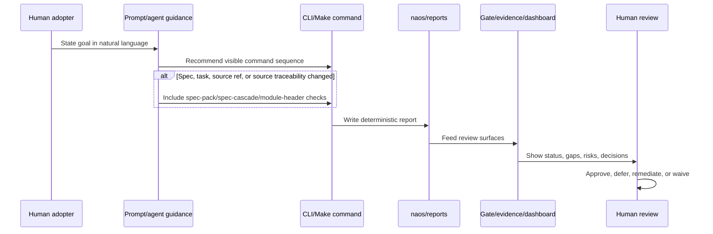
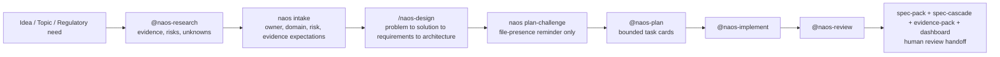
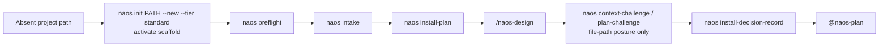
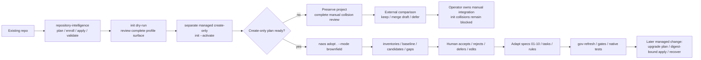
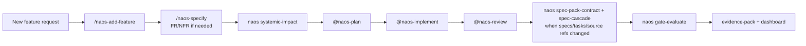
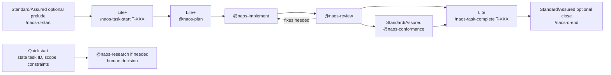
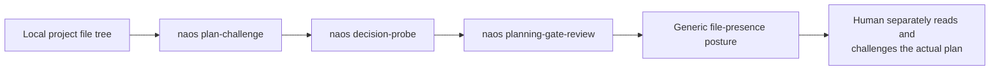
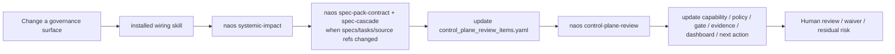
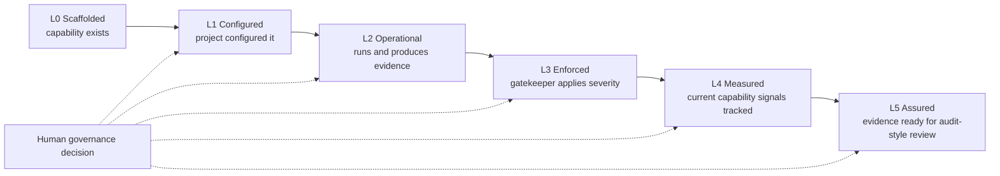

# NAOS Quick Reference

**Reference Schema Version**: 3.0
**NAOS Kit Compatibility**: v1.0.0+
**Status**: Active generated-project reference
**Purpose**: A practical, workflow-first front door for NAOS — how to take an idea, topic, repo, feature, or task and move it through the governed lifecycle. The complete prompt/agent/skill/CLI inventory lives in `NAOS_CATALOG.md` (a NAOS kit document, see note below); this file is the daily workflow map.

> **About file references in this guide.** `NAOS_CATALOG.md` and the `docs/…` files ship with the NAOS kit (the upstream package/repo) and are not copied into every generated project — open them in the kit source. `naos/gatekeepers.yaml` and `naos/maturity_levels.yaml` are seeded for the `lite` tier and above; `quickstart` projects do not include them. `naos/capability_state.yaml` is seeded for all tiers.

> **Profile availability.** Quickstart installs no prompts and only the
> `@naos-research` agent. Lite installs the bounded design/task prompts and the
> research/plan/implement/review agents. Standard/Assured install the full
> prompt and agent catalogue. A route below applies only when its file exists in
> `.github/prompts/` or `.github/agents/`; otherwise use the stated plain-language
> or deterministic-command fallback.

**Host entry point.** Start with root `AGENTS.md` for the selected profile's
installed routes. `CLAUDE.md` and `GEMINI.md` explicitly import that router.
Lite+ also installs `.agents/skills/naos-workflow-*` and
`.agents/skills/naos-portable-*`, with manual Claude commands in
`.claude/commands/`. Choose one supported route or read its file explicitly;
generation does not prove client discovery or authorize execution. Quickstart
keeps its research-only scope. See `docs/TOOL_NEUTRAL_USAGE.md` in the kit for
host-specific boundaries and fallbacks.

**Inspect or collect.** `naos self-check --profile standard` is an example; replace `standard` with the selected project profile. It evaluates live inputs using temporary derived reports and leaves project state unchanged. Use `--refresh` when you intend to publish current evidence for gates or dashboards. For example, `--output naos/reports/self_check_inspection.json` alone saves only the final inspection report. The Make wrapper accepts `SELF_CHECK_ARGS=--refresh` for the same explicit collection. Missing evidence and unresolved reviews remain findings.

**Native writes.** Use a qualified local filesystem and CPython 3.11–3.13.
Installation or preview success does not qualify mutation. Linux source security
labels/privileged attributes, extended ACLs and unsupported inherited flags
refuse; Windows cloud placeholders, reparse points and compressed/encrypted paths
refuse. Do not relax security controls to bypass a refusal. See the kit's
`docs/PLATFORM_ADAPTERS.md` filesystem metadata policy for exact scope.

NAOS is a file-first governance control plane for AI-assisted SDLC. It keeps AI-assisted work tied to specs, tasks, code, tests, evidence, and review decisions. It produces evidence and findings; **humans decide durable outcomes**. NAOS does not prove legal or regulatory compliance, does not prove runtime safety, does not prove complete test coverage, does not guarantee secure code, and does not replace human review.

---

**Team-owned host metadata:** if unrelated agents, skills or instructions do not
use NAOS-specific fields, declare their exact paths in
`naos/ai_metadata_scope.yaml` (`schema_version: 1`, `host_paths: [...]`). See
`docs/AI_METADATA_SCOPE.md` in the kit for the complete example. Undeclared files
remain strict; declared host records confer no NAOS capability or sponsor status.

## 1. What NAOS Helps You Do

Bring NAOS an idea, topic, repo, requirement, or task. NAOS helps you:

1. research the context,
2. structure the problem,
3. define the solution,
4. derive requirements,
5. shape architecture,
6. challenge assumptions,
7. create bounded tasks,
8. implement with AI assistance,
9. collect deterministic evidence,
10. prepare human review.

The natural-language ("vibe") surface is the entry point: tell NAOS what you are trying to do, in prompts and agents. Behind it, the deterministic control plane records structure, evidence, traceability, and review posture. Both layers stay honest about what is `missing`, `not_configured`, `stale`, `waived`, or `experimental`.

> Research is not truth. Candidate requirements are not approved requirements. Generated specs are not approved until human-reviewed. CLI reports are deterministic evidence, not approval.

---

## If You Only Read One Page

Use this file as a router from plain-language intent to explicit NAOS
commands. Prompts and agents can help phrase the work, but the CLI/Make layer
records deterministic evidence and humans decide durable outcomes.

| You say... | Route | First explicit step | Review output |
| --- | --- | --- | --- |
| "I have a new project" | Greenfield setup | `naos adopt . --mode greenfield --dry-run` | adoption summary and decision record |
| "I have an existing repo" | Brownfield adoption | `naos repository-intelligence plan . --component-mode baseline` | source-bound plan before create-only activation and adoption reports |
| "My specs are ready; can implementation planning start?" | Implementation-readiness baseline (Lite+) | update `naos/PLANNING_BASELINES.yaml`, record an attributable `planning_baseline` decision, then run `naos plan-coherence` | live profile-aware readiness, digest, task-coverage, lineage, and decision findings |
| "I want to start a task" | Daily task lifecycle | `/naos-task-start TASK_ID` when installed; Quickstart: state task ID, scope, constraints, and evidence explicitly | task context and review handoff |
| "This task might be split across lanes" | Parallel lane planning | record `parallel_lane_opportunity` and `parallel_lane_decision` in the active card or `PRE_IMPLEMENTATION_ALIGNMENT.md`; if declared, run the handoff script and control-plane review | advisory lane posture, optional handoff report, HITL reason codes |
| "I am reviewing a PR" | PR/release evidence | `naos spec-pack-contract`, `naos spec-cascade`, `naos gate-evaluate`, `naos evidence-pack`, `naos dashboard` | template contract, traceability, gate, evidence, dashboard, PR-risk reports |
| "I am designing or changing UI" | UI evidence review | Standard/Assured: `/naos-ui-design-start`; otherwise state the UI scope explicitly; if enabled, run `naos design-traceability` and `naos ui-experience-quality` | object-identity evidence, quality-evidence gaps, human-review posture |
| "I changed governance files" | Systemic wiring | `naos systemic-impact`, `naos control-plane-review`; add `naos spec-pack-contract` and `naos spec-cascade` when specs/tasks/source refs changed | routed findings and next actions |
| "I need to compare missing Standard spec templates" | Spec-pack materialization | `naos spec-pack-materialize . --profile standard --dry-run` | bounded missing-file preview; not profile-transition evidence |
| "I have brownfield evidence to map" | Spec assembly worksheet | `naos spec-assembly-worksheet . --profile standard` | review-only candidate-to-spec worksheet |
| "AI-surface budget is degraded" | Context-health remediation | `naos ai-surface-budget`; use `ai-surface-health-review` skill where installed | slimmed surfaces, preserved anchors, residual-risk routing |
| "We may use model/provider-specific AI later" | Model-provider declaration review | `naos model-policy` | role declarations, mixed-tool bindings, cost/data posture, disabled-runtime review |
| "We have local model-use telemetry" | Model telemetry evidence review | `naos model-telemetry`; then `naos control-plane-review` when findings exist | session/task/model-role links, cost/latency exceptions, payload/credential field risks |
| "We have repo-local OpenCode config to review" | OpenCode config hygiene review | `naos opencode-config-hygiene`; then `naos control-plane-review` when findings exist | local config/instruction hygiene, MCP/plugin/model drift findings, no runtime activation |
| "We learned something that should change future behavior" | Governed learning lifecycle | `naos learning-loop-review`; use `governed-learning-lifecycle` skill where installed | candidate/active/history learning posture |
| "I changed Codex/Claude/plugin/IDE adapter guidance" | Adapter coherence | `naos adapter-coherence`; add `naos learning-loop-review` when learning drove the change | adapter drift, propagation, and non-claim findings |
| "I need stronger assurance" | Profile/gate/maturity | profile chooser, gate commands, maturity report | readiness posture and human decisions |

For `gate-status` and `gate-evaluate`, profile resolution order is `--profile`,
then `NAOS_PROFILE`, then the generated policy default. Initialization persists
the selected `lite`, `standard`, or `assured` tier in the generated project
policy, so bare calls to those gate commands use that project tier;
`quickstart` retains its `quickstart` fallback because it does not include the
full policy.

Gate evaluation follows that profile's warn/enforce policy. `--strict` applies
strict severities; `--strict-required` fails required-but-unresolved gates.
Inspect `readiness`, `unresolved_evidence` and `enforcement` in the JSON output.
File presence alone does not establish report validity or a clean check.
Configured rule/gate posture is distinct from effective gate severity. Mapped capability maturity can lower that severity; inspect `maturity_gated`, `pre_maturity_severity` and `maturity_dependency` as well. The text output states an applied maturity ceiling and the gate-evaluation exit reason.



---

## 2. The Control Triad: Profiles · Gates · Maturity

Three concepts wire the natural-language flow to governance:

| Concept | What it answers |
| --- | --- |
| **Profile** | How strict should this project be right now? |
| **Gate** | What evidence must converge before moving forward? |
| **Maturity** | How developed is this capability in this project? |

Readiness `READY` confirms lifecycle prerequisites, not execution or effectiveness
of code controls. Its language section labels Python-only dependency, duplicate,
package and symbol checks separately from Java, Node and Go code. Unsupported
languages need adopter-owned detectors and executed evidence; existing gates
still apply. The installation manual links the detailed language-coverage guide.

Before relying on `.github/project-context.md`, confirm or replace its `ADAPT`
fields and proposed archetype guidance. Selecting a preset records a NAOS
configuration choice; it does not establish the application's actual stack.

> Profile controls severity. Gate checks evidence. Maturity describes readiness. **Human review decides durable outcomes.**

Advisory controls may *challenge* deterministic controls, but they may not *replace* them. Run deterministic primary controls first; treat optional semantic similarity, graph analytics, memory discrepancy detection, or LLMGrader-style second opinions as candidate/discrepancy inputs for human review. Advisory controls cannot approve work, certify outcomes, prove compliance, promote maturity, or become sole pass/fail authority.

---

## 3. Start From Your Situation

Managed activation targets native macOS, Ubuntu and Windows 11 with CPython
3.11–3.13. Darwin has local execution evidence; native Ubuntu/ext4 recovery
probes and bounded native Windows recovery checks have run on all three Python
versions. Final artifact and complete command-workflow qualification remain pending. Use an absent external `--preview-dir`
to inspect generated content without activation. On Windows, initialize managed
provenance before add/setup. Existing updates require an external `--plan-out`
and a separate `naos upgrade --apply-plan` with `--expect-plan-digest`; use the
legacy Windows plan's `digest_sha256` value; v3 approval uses the SHA-256 of the complete saved plan file on every OS. Preserve interrupted-operation residue and
run `naos upgrade PROJECT --recover` before attempting another mutation.

For v3 history only, `naos upgrade PROJECT --inspect-provenance` returns its
validated manifest digest without changing files. A successful inspection is
internal history consistency, not checkout ownership or permission to update.
It does not migrate legacy history or enroll a receiving checkout. On a completed,
same-root bound v3 history, managed `init` (including `--activate`) and `add/setup`
are plan-only. Save an external review and apply its exact digest through `upgrade`;
`--new` never re-enrolls an existing v3 project. Combined native qualification of
these command routes remains pending; populated-store receiving has a separate
explicit interface described below. Legacy migration has the explicit interface below, with native
qualification in progress.

For supported legacy history, supply independently selected expectations and
original policy/mode evidence through an external canonical migration inputs file:
`naos upgrade PROJECT --plan-migration --migration-inputs INPUTS.json --plan-out PLAN.json`.
New migration defaults select inputs v2 for path-free full replay with exact
originals kept locally. Explicit inputs v1 retain the historical raw projection
and its privacy limitation. Native and installed-artifact qualification remain
pending. Unsupported path-bearing content
refuses before preparation. Small transcripts retain authority v2; larger
ones use deterministic authority-v4 storage under existing limits. Large-format
native qualification remains pending.
Apply with `--apply-plan PLAN.json --migration-inputs INPUTS.json --expect-plan-digest SHA256`;
recover with those same arguments plus `--recover`. Approval selects the complete
raw plan file. Preserve interrupted journals and retained originals; unknown or
partial records refuse without cleanup. See the installation manual for required
inputs and bounds. This is separate from foreign populated-store receiving.

For a receiving v3 checkout with no local or legacy store, use
`naos upgrade PROJECT --plan-rebind --expected-owner-sha256 OWNER_SHA256 --expected-head-sha256 HEAD_SHA256 --binding-id NEW_BINDING_ID --plan-out EXTERNAL_PLAN.json`.
Select the intended history independently, review the saved file, and apply its
complete-file SHA-256 through `--apply-plan` / `--expect-plan-digest`.
Receiving recovery additionally requires that same digest:
`naos upgrade PROJECT --recover --expect-plan-digest SAVED_FILE_SHA256`.
Existing edits/deletions are preserved. Never remove local evidence to force this
route. Foreign populated stores are not covered; final native qualification of
this new public receiving route remains pending.

For a completed populated v3 store copied or moved with the checkout, preserve
it and inspect with `naos upgrade PROJECT --inspect-receiving-store`. Plan with
`--plan-receive-store --expected-owner-sha256 OWNER_SHA256 --expected-head-sha256 HEAD_SHA256 --expected-store-inventory-sha256 INVENTORY_SHA256 --binding-id NEW_BINDING_ID --plan-out EXTERNAL_PLAN.json`.
Review independently selected history and the saved plan. Apply through
`--apply-plan EXTERNAL_PLAN.json --expect-plan-digest SAVED_FILE_SHA256`; receiving
recovery needs those same arguments plus `--recover`. Keep old records and any
interrupted state. Local controls must already meet receiving-user private
storage policy; ordinary Windows copying may lose this protection and refuse.
Receiving does not repair ACLs or take ownership. Bounded macOS and Ubuntu
Python 3.11–3.13 source evidence is recorded; Windows, migration-origin subsequent
updates, cross-account secure transfer and final artifact qualification remain
pending. See the installation manual before use.

Generated Git hooks use Git's Bash. On Git for Windows, set `NAOS_PYTHON` to
the selected native interpreter's absolute path using forward slashes, for
example `C:/project/.venv/Scripts/python.exe`. Paths with spaces are supported;
command strings require a wrapper script. POSIX keeps its existing `python`
default. Review existing hooks before explicitly activating the generated hook.

Staging `TASK_REGISTRY.yaml` produces a reminder, not an automatic sync or
`git add`. Preserve manual edits before explicitly running the project's
registry-sync command; review and stage only the derived changes you intend.
The hook preserves partial staging and untracked derived files.

Native task completion preserves unrelated registry comments, entries and
formatting, including the registry's existing LF/CRLF line endings. Generated
completion history uses LF. If an ambiguous YAML structure cannot be edited
without changing other content, completion refuses it before writing; inspect
the reported structure and retry after an explicit correction.

| If you have… | Start with | Then use | Main outputs |
| --- | --- | --- | --- |
| A vague idea or topic | `@naos-research` | `/naos-design` only where generated; otherwise stop at a reviewed candidate record | Profile-proportionate research record and, where available, specs |
| A new greenfield project | `naos-governance init /path/to/new-project --new --tier <tier> --archetype custom --backend static_only --activate` | `naos intake`, `/naos-design`, then human plan review; `naos plan-challenge` is a file-presence reminder only | Specs, adoption reports, task plan |
| An existing repo | `naos preflight`, inventory commands | `naos requirements-reconstruct --mode brownfield`, `naos traceability-gap-register --mode brownfield` | Candidate FR/NFRs, gaps, adoption decision |
| A feature request | `/naos-add-feature` where installed; Quickstart uses an explicit plain-language request | `@naos-plan` where installed, then `naos systemic-impact` | Requirement section, task card, impact report |
| A coding task | `/naos-task-start T-XXX` | `@naos-plan` → `@naos-implement` → `@naos-review` | Code, tests, evidence |
| A PR / release review | `@naos-conformance` on Standard/Assured; otherwise applicable deterministic commands plus human review | `naos gate-evaluate`, `naos evidence-pack`, `naos dashboard` where generated | Review evidence |
| A governance-surface change | Installed wiring skill under `.github/skills/` where present | `naos systemic-impact`, `naos control-plane-review` | Routed findings and residual risks |
| A lesson that may affect future action | `governed-learning-lifecycle` skill | `naos learning-loop-review`; add `naos ai-surface-budget` if AI surfaces change | Candidate/active/history learning findings |

---

## 4. Core Workflows

Each workflow is a horizontal journey. The natural-language prompts/agents drive the work; the CLI/Make commands record deterministic evidence. Gates and profiles apply underneath (see §7–§9).

### 4.1 Topic / Idea → Research → Specs → Plan

**When to use:** you have an idea, market topic, regulatory obligation, or rough product direction and need to convert it into a governed project structure.



- **Natural-language start:** *"Use `@naos-research`. Research this topic: [topic]. Identify evidence, assumptions, counterevidence, risks, contradictions, and unknowns. Do not write code. Prepare a candidate research record. Route to `/naos-design` only if that surface is present in `naos/profile_generated_surface_contract.json`."*
- **Human checkpoint:** approve the applicable profile inputs before an implementation-ready baseline. Lite requires requirements but does not require or synthesize architecture; Standard/Assured require requirements and architecture.
- **Current CLI boundary:** `naos plan-challenge` does not read or challenge the plan; the human review supplies that substantive assessment.
- **Do not claim:** research is not truth; candidate requirements are not final requirements.

#### Implementation-ready planning boundary (Lite+)

Draft and discovery plans may evolve before implementation. Use hybrid planning
with vertical delivery as the default. A horizontal foundation is allowed only
when it names a consuming vertical slice and the consumed result it changes.

1. Complete the applicable specifications: Lite binds `03-requirements.md` and
   marks architecture not applicable; Standard/Assured bind both
   `03-requirements.md` and `04-architecture.md`.
2. Complete the task registry and Pre-Implementation Alignment, then run the
   spec-pack check in `--mode filled` and the alignment-review check. Preserve
   their actual passing report bytes under `naos/planning-evidence/PB-001/`
   and point the baseline's `evidence_refs` there. Keep these review snapshots
   separate from the mutable `naos/reports/` outputs.
3. Run `naos plan-coherence` while the baseline is draft and copy the reported
   `implementation_readiness.digest_candidates` into the ledger.
4. Record an attributable `planning_baseline` human-decision record, set the
   baseline to `implementation_ready`, and rerun `naos plan-coherence`.

5. Create a superseding baseline when requirements, applicable architecture,
   task decomposition, alignment, or bound evidence changes. Routine task
   status progress alone does not require replanning.

Do not overwrite approved snapshots or refresh their digests automatically.
Later report runs may update `naos/reports/` without changing the approved
evidence. Source changes still trigger live validation and digest checks; a
changed baseline or evidence requires a new review decision. Existing baselines
are not migrated by changing the seed.

G2 evaluates this readiness live. A present but stale/failing report is not
enough. The result is structural evidence only: it does not approve
implementation, close tasks, merge results, release, or publish.

### 4.2 Greenfield Project Setup

**When to use:** a brand-new project that should be governed from the start.



- **Install vs adopt vs activate:** `init` puts NAOS files/CLI wrappers in the project; intake/preflight/install-plan *understand and plan* the project; `--activate` and explicit setup modules *enable* controls; prompts/agents/validators *operate* during delivery.
- **Human checkpoint:** review the install plan and decision record before treating setup as complete.
- **Cross-platform checkout:** review and commit the generated `.gitattributes` with the scaffold. Resolve reported LF-policy gaps in your Git rules; NAOS preserves existing or locally modified attributes and does not renormalize files or recorded hashes.
- **Completed-card integrity:** new history digests declare `canonicalization: crlf-to-lf-v1`; only CRLF pairs become LF for hashing. Archived bytes and exact task ownership are preserved. Historical unmarked digests remain raw-byte hashes: restore only an original or reconstructed candidate whose raw SHA-256 exactly matches the recorded value. Never relabel or recompute a historical digest to accept changed content. Review checkout rules for future `completed/*.md` cards; path-specific `-text -filter -ident -working-tree-encoding` preserves historical raw bytes, while an LF rule is safe only when it already matches those bytes. Preserve existing adopter attributes and review effective Git overrides before cross-host checkout. No automatic historical migration or restoration is performed.
- **Do not claim:** installation is not adoption; scaffolded files are not configured controls.

### 4.3 Brownfield Project Adoption

**When to use:** an existing repository you want to bring under NAOS governance.



- **Natural-language start:** *"Use `@naos-research`. Reconstruct candidate FR/NFRs from docs, source, tests, and workflows. Classify each as confirmed, supported, inferred, or hypothesized. Do not promote candidates without human review."*
- **Human checkpoint:** candidate requirements and traceability gaps need explicit disposition; generated specs/tasks are seeds until adapted to the project.
- **Existing-file collisions:** initial activation preserves the project and prints a complete `NAOS MANUAL COLLISION REVIEW`. Compare ordinary files in an absent external preview without `--activate`; record keep, external merge draft, or defer decisions for every path. Review link, type, metadata and permission refusals through their control procedure. The diagnostic grants no writes or ownership, and a manual merge does not clear an init collision. Already managed projects use the separate upgrade plan and digest-bound apply route.
- **Do not claim:** reconstructed candidates are not approved requirements; baselines and optional GraphML navigation do not prove correctness or improved onboarding.

### 4.4 Add a Feature

**When to use:** adding a capability to an already-governed project.



- **Human checkpoint:** confirm the feature is linked to specs/tasks/traceability before implementation.
- **Do not claim:** an elicited feature spec is not an accepted requirement until reviewed.

### 4.5 Daily Task Lifecycle

**When to use:** routine bounded work against an existing task.



- Make/CLI commands are operational wrappers; they do not replace installed lifecycle prompts/agents. Lite routes directly from review corrections to native task completion because `@naos-conformance`, `/naos-d-start`, and `/naos-d-end` are not generated for Lite. Quickstart has no prompt lifecycle.
- **Human checkpoint:** close a task only after review and conformance evidence are handled.

### 4.5.1 Parallel Lane Planning And Handoff

**When to use:** a task has independent acceptance criteria, distinct path
scopes, dependency-unlocked chunks, frontend/backend/tests/docs split, high
context load, or a team wants explicit lane coordination.

Record the advisory posture first:

```yaml
parallel_lane_opportunity: parallel_possible
parallel_lane_decision: deferred   # sequential | declared | deferred
```

`parallel_possible` and `parallel_recommended` are suggestions only. They do
not activate handoff. For a solo developer, lanes can be logical checkpoints.
For teams, declared lanes should also have task claims, planned paths,
dependency/unlock evidence, tests/checks, and operator/session metadata.

`naos task-claim`, `naos task-release`, and `naos task-claims` serialize updates
in one local checkout on macOS, Linux, and Windows. Keep the adjacent
`task_claims.yaml.lock` file in place while commands run. A busy lock reports
`blocked` after ten seconds without changing shared claims/reports; retry after
the other command finishes. Use `--strict` when automation needs a nonzero exit
for that result. Invalid YAML, list structure, schema or status values are
preserved for repair. Separate
clones are not synchronized by this local lock; claims remain advisory metadata.

When the project explicitly chooses `parallel_lane_decision: declared`, copy
`naos/lane_handoffs/_TEMPLATE.yaml` to a lane-specific file and run:

```bash
python scripts/naos_parallel_lane_handoff.py --profile standard --handoff naos/lane_handoffs/<lane>.yaml
naos control-plane-review --profile standard
```

The handoff report and control-plane route are review evidence. They do not
create lanes automatically, dispatch agents, create branches/worktrees, run
tests, approve work, merge, close tasks, release, certify, attest, activate
runtime/MCP/memory/provider/model surfaces, or prove compliance.

### 4.6 Lightweight Context Posture Before Human Plan Review

**When to use:** before a human reviews an implementation plan or significant decision, as a file-presence reminder only.



- **Natural-language start:** *"Run the lightweight context-posture commands, then separately review this plan's assumptions, architecture, evidence, risks, scope, and acceptance criteria."*
- **Current limitation:** these commands enumerate local file-path signals. They do not accept, read, or substantively evaluate a draft plan, decision record, gate state, source-file contents, or prior reports.
- **Human checkpoint:** the reviewer—not these generic reports—identifies and resolves plan-specific decisions.
- **Do not claim:** a challenge report has assessed or approved the plan.

### 4.7 PR / Evidence / Review Handoff

**When to use:** preparing changed code and tests for governed review.


- **Do not claim:** CI/evidence output is review evidence, not PR approval, security proof, deployment authorization, or proof of compliance.

### 4.8 Governance-Surface Change

**When to use:** you change a prompt, agent, skill, policy, validator, gate, dashboard, spec, capability, or instruction surface.



Installed NAOS skills live under `.github/skills/<skill-name>/SKILL.md` and
are profile-gated. For governance-surface changes, use
`.github/skills/systemic-capability-wiring/SKILL.md` when installed
(assured/full catalogue or explicitly added); otherwise use
`.github/skills/systemic-wiring/SKILL.md` where installed plus
`naos systemic-impact` / `naos control-plane-review` for the same review
obligation. Do not claim a named skill was loaded if its file is absent. When
`ai-surface-budget` reports `warning` or `degraded`, including for
profile/generated `.ai/RULES.md`, use `ai-surface-health-review` where
installed to slim loaded surfaces without deleting anchors or inflating
thresholds. When a lesson may change future behavior, use
`governed-learning-lifecycle` where installed and keep candidate, active, and
historical learning separated.

---

## 5. Minimal Command Recipes

Three lanes by intent. Examples use `standard`; change the profile deliberately
to `quickstart`, `lite`, `standard`, or `assured`. Add `--naos-root`,
`--policy`, `--json`, `--strict`, or output paths where supported.

**First run (install evidence route):**
```bash
python -m naos_governance.cli doctor
naos-governance first-run --profile standard --mode greenfield
```

`first-run` performs doctor, adoption dry-run, setup recommendations,
profile-baseline setup-module dry-run, evidence pack, and dashboard generation.
Review dry-run outputs before enabling modules. Dry-run adoption does not
install `Makefile.naos`; run installed-project validators only after NAOS files
have been activated or materialized intentionally. Smoke output is review
evidence only; it is not approval, certification, proof of compliance,
secure-code proof, or proof of runtime safety.

**Smoke (after install / quick orientation):**

For task-scoped validation, use
`naos self-check --profile standard --task T-123 --query "bounded context" --graph-path src/component.py`
with your actual task and indexed source path. The installed
`python -m naos_governance.scripts.naos_ci_readiness` runner accepts the same
flags. Missing context remains unresolved and does not replace an earlier
scoped query receipt or count it as validated.

If a gate requests configuration-only context review, its evidence result
includes `configuration_posture_review_subject`. After explicit review, record
the snapshot, supporting notes and declaration in the policy-selected
`evidence_review_attestations.yaml`, following
`schemas/naos/configuration_posture_review.schema.json`. Generating the subject
does not approve it; unrelated failures and stale evidence remain unresolved.

```bash
PROFILE=standard
naos claims --profile "$PROFILE"
naos setup-recommendations --profile "$PROFILE"
naos governance-bypass-posture --profile "$PROFILE"
naos external-evidence-ingest --profile "$PROFILE"          # add --source scan.sarif when available
naos ai-surface-budget --profile "$PROFILE"
naos learning-loop-review --profile "$PROFILE"
naos self-check --profile "$PROFILE"
naos spec-pack-contract --profile "$PROFILE"
naos spec-pack-materialize . --profile "$PROFILE" --dry-run
naos spec-assembly-worksheet . --profile "$PROFILE"
naos spec-cascade --profile "$PROFILE"
naos gate-status --profile "$PROFILE"
naos plan-coherence --profile "$PROFILE"
naos dashboard --profile "$PROFILE" --json-output naos/reports/dashboard_summary.json
```

**Task work (active card):**
```bash
PROFILE=standard
TASK_ID=T-001
naos task-context --task "$TASK_ID" --profile "$PROFILE"
naos test-evidence-map --profile "$PROFILE"
naos test-evidence --profile "$PROFILE"
naos ac-completion-evidence --profile "$PROFILE"
naos harness-trace-import --source naos/harness_traces/example.jsonl --profile "$PROFILE"
naos duplicate-function-hygiene --profile "$PROFILE"
naos secret-hygiene --profile "$PROFILE"
naos test-quality-hygiene --profile "$PROFILE"
naos dependency-integrity --profile "$PROFILE"
naos package-reality --profile "$PROFILE"
naos api-symbol-reality --profile "$PROFILE"
naos pr-risk-classify --profile "$PROFILE"
naos plan-coherence --profile "$PROFILE"
naos model-telemetry --profile "$PROFILE"            # when optional local model telemetry evidence is enabled
naos opencode-config-hygiene --profile "$PROFILE"    # when optional repo-local OpenCode config hygiene is enabled
naos design-traceability --profile "$PROFILE"        # when optional UI object identity is enabled
naos ui-experience-quality --profile "$PROFILE"      # when optional UI quality evidence is enabled
naos spec-pack-contract --profile "$PROFILE"
naos spec-pack-materialize . --profile "$PROFILE" --dry-run
naos spec-assembly-worksheet . --profile "$PROFILE"
naos spec-cascade --profile "$PROFILE"
naos gate-evaluate --profile "$PROFILE"
naos evidence-pack --profile "$PROFILE"
```

Dependency/duplicate checks infer common Python source layouts, flat files and
top-level packages by default. Explicit `scan_roots` selections remain supported;
omitted inferred inputs and unassessed selected files require review. Context
indexing uses Python symbol metadata from the same scope, including supported
concrete `pyproject.toml` package declarations. Other supported source languages
receive path/suffix/size/hash metadata only. Check the reports' coverage limits;
metadata retrieval does not establish language semantics or unknown-layout coverage.

**Reviewer / assured handoff:**
```bash
PROFILE=assured
SCAN_SARIF=scan.sarif
naos evidence-attestation --profile "$PROFILE"
naos evidence-sign --profile "$PROFILE"
naos evidence-verify --profile "$PROFILE"
naos evidence-conflicts --profile "$PROFILE"
naos governance-bypass-posture --profile "$PROFILE"
naos external-evidence-ingest --source "$SCAN_SARIF" --profile "$PROFILE"
naos ai-surface-budget --profile "$PROFILE"
naos capability-maturity --profile "$PROFILE"
naos control-plane-review --profile "$PROFILE"
naos spec-pack-contract --profile "$PROFILE"
naos spec-pack-materialize . --profile "$PROFILE" --dry-run
naos spec-assembly-worksheet . --profile "$PROFILE"
naos spec-cascade --profile "$PROFILE"
naos pr-risk-classify --profile "$PROFILE"
naos pr-governance-summary --profile "$PROFILE"
naos plan-coherence --profile "$PROFILE"
naos sarif-export --profile "$PROFILE"
```

Quickstart is advisory and installs no CI by default. Lite is the first CI-friendly tier (`.github/workflows/naos-control-plane-ci.yml`). Standard and assured run the same chain with stronger profile/policy behavior. CI surfaces findings; humans still decide maturity movement, waivers, residual risks, remediation, and release readiness.

Treat `pr-risk-classify` results with `classification_status: inconclusive` and
`risk_tier: unknown` as missing comparison evidence. Resolve the reported Git
input problem before using the result. A valid empty diff is a separate case.
Existing adopter path-rule customizations are retained; review new hook/MCP
path rules when updating them.

Local indexing excludes selected credential-like content before storing chunks;
model-telemetry output redacts matching metadata. These filters do not establish
that a repository is free of secrets.

---

## 6. Evidence Status and Human Review Boundaries

| Status | Meaning | Action |
| --- | --- | --- |
| `ready` | Evidence appears available for review | Human reviews |
| `missing` | Expected artifact absent | Generate or explain |
| `not_configured` | Capability not configured | Configure or accept scope |
| `stale` | Evidence older than its source/config | Refresh |
| `waived` | Known gap accepted temporarily | Review residual risk |
| `experimental` | Advisory/future posture | Do not treat as authority |

Do not manually greenwash `missing`, `not_configured`, `stale`, `waived`, or `experimental` evidence into a pass. Do not silently delete, merge, or rewrite security, encryption, authentication, authorization, database, public-API, or regulatory-control code without human/profile-based approval. Waivers and residual risks stay visible.

`assured` is a profile name, not certification, proof of compliance, approval, or proof of runtime safety. Public reviewer guidance lives in `docs/AUDIT_PLAYBOOK.md`, `docs/NAOS_THREAT_MODEL.md`, `docs/ASSURED_PROFILE_ACTIVATION.md`, and `docs/BEHAVIORAL_AUDIT_ENABLEMENT.md` — guidance, not approval.

Exported findings (e.g. SARIF via `naos sarif-export`) carry deterministic findings by default; advisory findings require explicit inclusion and remain candidate/discrepancy records, not authority.

Dashboard requirement completion counts explicit status declarations under H2
or H3 FR/NFR headings in `specs/03-requirements.md`. Missing, unknown and negative
statuses remain unresolved; an empty specification cannot imply completion.
The displayed percentage does not prove test execution, delivery or approval.

---

## 7. Profiles in Practice

| Profile | Workflow feel | Evidence expectation | Gate behavior |
| --- | --- | --- | --- |
| `quickstart` | Explore and learn quickly | Scaffolded evidence is enough to start | Advisory |
| `lite` | Lightweight team discipline | Basic config and warnings | Warning |
| `standard` | Normal governed SDLC | Reports should exist and be current | Required where configured |
| `assured` | Reviewer/audit-style handoff | Evidence, waivers, owners, exceptions explicit | Blocking where configured |

Same workflow, different profile: as the profile strengthens, the *same* steps move from advisory hints toward required/blocking evidence — but human approval is always required for durable decisions. Canonical profile/enforcement definitions live in `naos/maturity_levels.yaml` (seeded for the `lite` tier and above; not present in `quickstart` projects).

---

## 8. Gate Checkpoints by Workflow

NAOS gates summarize what evidence should converge. Canonical definitions live in `naos/gatekeepers.yaml` (seeded for the `lite` tier and above; not present in `quickstart` projects).

| Gate | Name | Main question |
| --- | --- | --- |
| G0 | Install Readiness | Can NAOS run basic checks? |
| G1 | Context Readiness | Is project/AI governance context present? |
| G2 | Planning Gate | Are planning, roadmap/spec routing, and context evidence ready? |
| G3 | Scope Gate | Is task scope explicit before implementation? |
| G4 | Code Gate | Is source/module/function-index evidence present? |
| G5 | Test Evidence Gate | Is source-to-test evidence present where configured? |
| G6 | Evidence Gate | Are claims, reports, waivers, risks, and the evidence pack ready? |
| G7 | Behavioral Gate | Is behavioral readiness/impacter review tracked without overclaiming? |
| G8 | Advanced Architecture Readiness Gate | Are Tier 3/runtime/graph/digital-twin tracks explicit and advisory? |

For roadmap or crosswalk items marked implemented or shipped, supply a
project-relative regular evidence file, such as `evidence/test-results.json`.
Directories, paths outside the project, symlink/reparse paths, and external URLs
with only `verified: true` do not satisfy this check. A list may include external
context alongside local support. This checks the reference boundary; reviewers
must still judge whether the file's contents support the implementation claim.

Markdown crosswalks declare a single exact state in a `Status` or `State`
table column, or with `Status: planned` / `State: implemented` after the item
ID. Negated or competing prose such as `planned; not yet done` is reported as
`invalid_state` for review; YAML/JSON explicit states retain their existing
contract.

The standalone `validate_traceability_headers.py` checks Python (`.py`) files
only; non-Python sources are not evaluated. Its `Task:` header must use the
exact canonical registry ID (`T-001` or `TEAM-T-001`), case-normalized for
lookup. Legacy labels such as `T-1` or `GOV-1` require explicit correction;
NAOS does not rewrite them. Shared lifecycle states allow active code, require
code for implementation-complete/completed or delivered tasks, and reject
planned tasks with code. Unsupported or malformed registry states require
review, and a missing registry returns exit code 2 even with no Python files.
`__init__.py` remains exempt. A human may adapt the validator's `EXEMPT` set
for intentional exclusions. Generated validators carry exact path, byte-size,
and SHA-256 commitments for the tooling copied in their scaffold. Only exact
content matches under project-relative `scripts` or `naos_tools` receive a
`NOT_ASSESSED` tool-content exclusion. The actually invoked validator at its
generated control path is separately excluded as the selected control; no
same-name file elsewhere gets that exemption. This trusts the selected
generator and executable validator; content identity is not authenticated
origin, author identity, or safety assessment. Markers and adopter-writable
manifests never supply exclusions. New, modified, or independently added raw
tools undergo ordinary header and task validation; add/setup do not refresh
the table from adopter bytes. Regenerate tooling and its validator coherently
when changing the scaffold or profile. LF/CRLF application headers still parse;
changing line endings in committed tool content changes its byte identity.
Run the generated control from the initialized adopter root with
`python scripts/validators/validate_traceability_headers.py`. If the scaffold
was relocated, set `SCRIPTS_ROOT` to `naos_tools` in the process environment
and run `python naos_tools/validators/validate_traceability_headers.py`.
An external kit-source validator has no generated content table and assesses
copied tooling as ordinary Python source; use the generated entrypoint for
scaffold tooling exclusions.

**Workflow → gate map:**

| Workflow | Main gates |
| --- | --- |
| Install / initialize | G0, G1 |
| Topic research → specs | G1, G2, G6 |
| Greenfield setup | G0, G1, G2, G6 |
| Brownfield adoption | G1, G2, G3, G6 |
| Add feature | G2, G3, G4, G5, G6 |
| Daily implementation | G2, G3, G4, G5 |
| PR review | G4, G5, G6 |
| Assured handoff | G0–G6, sometimes G7/G8 |
| Advanced/experimental work | G7, G8 (advisory/readiness unless configured) |

---

## 9. Maturity in Practice



| Level | Name | Practical question | Example evidence |
| --- | --- | --- | --- |
| L0 | Scaffolded | Does NAOS provide the capability? | Template, schema, capability card |
| L1 | Configured | Has this project configured it? | Config, owners, profile, policy |
| L2 | Operational | Is applicable supporting evidence resolved for review? | Typed producer reports or explicitly bounded manual material |
| L3 | Enforced | Do resolved, linked gates apply profile severity? | Validated `gate_status.json` and `gate_evaluation.json` |
| L4 | Measured | Are this capability's current signals tracked? | Selected adopter dashboard projection; trends need separate evidence |
| L5 | Assured | Is evidence complete enough for audit-style review? | Evidence pack, attestations, waivers, reviewer metadata |

Use `naos capability-maturity --profile standard` to produce readiness evidence. **NAOS evaluates maturity readiness; it does not automatically promote, certify, or approve maturity.** Final maturity decisions remain project governance decisions (see `naos/capability_state.yaml`).

Refresh L4 evidence in this order: maturity snapshot → dashboard → maturity
review. Report age and file availability do not establish current-source
freshness. Failed or malformed reports cannot qualify just because they exist,
and a dashboard cannot substitute for L2 operational evidence.

Read each result at its own scope: maturity readiness does not clear other
reports, promote levels or complete human approval. Gate severity can be reduced
by current maturity even when the policy transition is `enforce`; inspect the
reported effective severity. A provenance-classification pass does not close
candidate review obligations, blocking gaps or failed inspections.

---

## 10. Where To Go Next

In the NAOS kit (not copied into generated projects — open in the kit source):

- **`NAOS_CATALOG.md`** — complete prompt/agent/skill/CLI inventory and usage scenarios (canonical).
- **`docs/CONTROL_PLANE.md`** — governance architecture: capability contracts, policy, gates, validators, evidence, dashboard.
- **`docs/ADOPTION_GUIDE.md`** — greenfield/brownfield/non-developer adoption strategy.
- **`docs/tutorials/PROFESSIONAL_ADOPTION_ENGINE.md`** — connected preflight → intake → inventory → challenge → baseline → decision-record walkthrough.

In your generated project:

- **`naos/capability_state.yaml`** — adopter capability-state declarations (all tiers).
- **`naos/gatekeepers.yaml`**, **`naos/maturity_levels.yaml`** — canonical gate and maturity definitions (seeded for `lite` tier and above; not present in `quickstart`).

---

## 11. Governance Reference

Compact reference for the governance invariants that operate underneath every workflow above. The control-plane flow is: commands/prompts/agents -> capabilities -> **central policy** -> capability state -> validators -> systemic-impact review -> spec-pack contract and spec-cascade/source traceability where applicable -> gates -> evidence pack -> dashboard -> remediation/waiver/next action.

### Preventive / Detective / Remediation

- **Preventive** (before generation/modification): inspect specs, task context, and capability constraints; inspect existing source and `FUNCTION_INDEX.yaml` before creating new functions; prefer reuse over duplication; check that `specs/04-architecture.md` changes are linked.
- **Detective** (after generation/modification): run relevant validators and gates; refresh source-to-test evidence, evidence pack, and dashboard; surface `missing`/`not_configured`/`stale`/`waived`/`experimental` evidence honestly.
- **Dashboard applicability**: missing configured reports remain findings by default. To opt in, set `dashboard: {applicability: selected_workflows, selected_workflows: [professional_adoption]}` in `naos/policy/default_policy.yaml`. Recognized workflow IDs are `professional_adoption`, `brownfield_adoption`, `ai_code_provenance`, and `regulated_context`. Only absent inputs of unselected workflows can be exempted; JSON and Markdown show the reason. Gate-required, present malformed, and unknown inputs still fail conservatively. This does not approve the workflow or clear producer findings. Generated automation carries `gatekeepers.baseline.yaml` beside the dashboard script; preserve that companion file when relocating scripts. Missing or malformed baseline data denies exemptions.
- **Remediation**: findings produce remediation options or waiver/residual-risk decisions. Do not silently rewrite security, auth, database, public-API, or regulatory-control code without human/profile approval. Waivers and residual risks stay visible — never converted into a pass.

### Control-Plane Self-Review

When governance surfaces change, route the change through control-plane self-review (a file-first review discipline, not a runtime orchestrator). Run or recommend `naos systemic-impact` when governed artifact families change (`configure → evaluate → report → review → update → re-evaluate`), and route findings via `naos/control_plane_review_items.yaml` + `naos control-plane-review`. See workflow §4.8. Use the installed wiring skill under `.github/skills/` where present; use `systemic-capability-wiring` when installed, otherwise use `systemic-wiring` for the same orphan-surface review obligation.

### Spec 04 Linkage Rule

If `specs/04-architecture.md` changes, check it is linked to `specs/01-problem.md`, `specs/02-solution.md`, `specs/03-requirements.md`, `naos/TASK_REGISTRY.yaml`, `TRACEABILITY_MATRIX.md` (where present), affected capability contracts, relevant gate/evidence expectations, and known gaps/residual risks. Run or recommend `naos spec-pack-contract`, `naos spec-pack-materialize --dry-run`, `naos spec-assembly-worksheet`, and `naos spec-cascade` when specs, profile-required spec files, brownfield evidence, tasks, source spec references, or source traceability changed. Default is profile-aware review/routing: advisory in `quickstart`, warning in `lite`, required where configured in `standard`, blocking only in `assured` when an implemented validator/gate enforces it.

### Research / Autoresearch Feedback

Research, autoresearch, trend-review, and external-analysis outputs should not remain standalone when actionable. Route findings into capability contracts, central policy, gatekeepers/validators, roadmap/crosswalk mappings, task registry, known gaps/residual risks, evidence pack/dashboard, next-action recommendations, AI instruction surfaces, or specs 01–04. Keep advisory/profile-aware unless an implemented validator or gate enforces it.

### Canonical Module Header

Use one canonical module header per source module unless a language/framework convention requires otherwise. Do not create a second header/docstring with overlapping metadata. Validate with `naos module-headers`.

The validator evaluates Python headers. An enabled scan with no applicable
Python modules reports advisory `not_assessed` coverage and requires human
review. Other languages receive no passing coverage claim. Configuration
errors, unmatched applicable Python sources and missing headers retain the
profile's severity; disabling the capability is a separate state.

```text
Module: src/path/to/module.py

Purpose:
    Short module-level description.

Implements:
    - FR-XXX: Requirement/control name
    - NFR-XXX: Non-functional requirement/control name

Tasks:
    - T-XXX: Task title
    - T-YYY: Task title

Specs:
    - specs/03-requirements.md#fr-xxx
    - specs/04-architecture.md#architecture-section

Rationale:
    Short paragraph explaining why this module exists, why the logic belongs
    here, what boundary it owns, and how it avoids duplication or architecture
    drift.

Design notes:
    - Optional stable architectural constraints/patterns.
```

Plural `Implements`, `Tasks`, and `Specs` labels are intentional. Multiple IDs are allowed when genuinely applicable. Keep `Rationale` concise and module-level. Update the header when module purpose materially changes, and avoid duplicate/stale module headers.

### Optional Semantic / Similarity Layer

Core NAOS is deterministic, file-first, portable, and has no semantic model dependency. Optional semantic/similarity support is project-configured, disabled by default, provider-neutral, and evidence-backed (e.g. `sentence-transformers/all-mpnet-base-v2` only when a project explicitly enables it). The generic kit does not require embeddings, GPU, or semantic duplicate detection by default; semantic candidates are advisory inputs for human review, not authority.

---

## Annexes

The annexes are compact, workflow-oriented subsets. The **complete** inventories (16+1 prompts, 7 agents, 25 skills, all CLI commands and Make targets) are canonical in the NAOS kit's `NAOS_CATALOG.md`. Use only items present in your generated project. For a valid already managed project, normal upgrade and `--dry-run` are plan-only; persist an external immutable plan and use the separate digest-bound apply or recovery command for mutation.

On an already-managed project, `init --activate` produces a plan and returns
exit code `3` when planning succeeds, because nothing was activated. Successful
planning without `--activate` returns `0`; planner failures keep their own code.
Its compact JSON summary is not saved and does not authorize mutation. Obtain
the full approval plan with `naos upgrade PROJECT --tier T --plan-out EXTERNAL_FILE`; review it and apply that exact file with its digest. Direct
upgrade still prints the full plan.

### Annex A — Prompt Inventory (kit superset)

Full inventory (16 + 1): `NAOS_CATALOG.md`.

| Prompt | Availability | Best use | Main output | Next handoff |
| --- | --- | --- | --- | --- |
| `/naos-design` | Lite+ | Turn an idea/topic into profile-required specs | quickstart: none; lite: 01→03; standard/assured: 01→10 | `@naos-plan` |
| `/naos-specify` | Standard/Assured | Add one FR/NFR surgically | Requirement section with ACs | `@naos-plan` |
| `/naos-add-feature` | Lite+ | Mid-project feature elicitation | Feature impact + spec update | installed planning route |
| `/naos-d-start` | Standard/Assured | Start daily session | Requested context and next action | `/naos-task-start` |
| `/naos-task-start` | Lite+ | Begin a specific task | Scope, constraints, context | `@naos-plan` |
| `/naos-d-commit` | Lite+ | Pre-commit review | Commit-readiness findings | commit or fix |
| `/naos-task-complete` | Lite+ | Close task with evidence | Requested completion review | Standard/Assured may use `/naos-d-end` |
| `/naos-d-end` | Standard/Assured | End session | Requested summary and next actions | next session |
| `/naos-t-test-failure` | Lite+ | Investigate failing tests/CI | Root-cause plan | installed review/implementation route |
| `/naos-t-precommit` | Standard/Assured | Triggered pre-commit review | Governance/quality findings | fix or commit |
| `/naos-w-plan` | Standard/Assured | Weekly planning | Weekly focus | task lifecycle |
| `/naos-w-review` | Standard/Assured | Weekly retrospective | Lessons and follow-ups | backlog updates |
| `/naos-m-review` | Standard/Assured | Monthly governance health | Improvement items | `@naos-conformance` |
| `/naos-ui-design-start` | Standard/Assured | UI design session | UI constraints + component plan | `@naos-implement` |

### Annex B — Agent Inventory

| Agent | Availability | Role | Use when | Should not | Typical handoff |
| --- | --- | --- | --- | --- | --- |
| `@naos-research` | All profiles | Read-only evidence gathering | Topic/repo/spec/task uncertainty exists | Implement changes or promote candidates | human review, then a profile-available planning/design route |
| `@naos-plan` | Lite+ | Task planning and decomposition | Requirements/specs need conversion to tasks | Write code | `@naos-implement` |
| `@naos-implement` | Lite+ | Bounded implementation | Task is approved and scoped | Expand scope silently | `@naos-review` |
| `@naos-review` | Lite+ | Quality/spec/test/governance review | Implementation is ready for review | Approve release alone | `@naos-implement` or installed conformance route |
| `@naos-conformance` | Standard/Assured | Governance audit | Before closure, PR, monthly review | Replace human approval | human decision |
| `@naos-debug` | Standard/Assured | Root-cause analysis | CI/test/bug complexity is high | Patch without verification | `@naos-implement` |
| `@naos-triage` | Standard/Assured | Classify incoming work | New issue/request/bug arrives | Implement directly | `@naos-plan` or `@naos-debug` |

### Annex C — Skill Inventory (most-used)

Full inventory (25 skills, including the `cookbook-*` family): `NAOS_CATALOG.md`.

| Skill | Use when | Helps with |
| --- | --- | --- |
| `governed-coding-execution` | Implementing/changing code, config, schema, workflow, or governance surfaces; before claiming done | Evidence-first execution loop and completion-claim ledger |
| `systemic-wiring` | Any project change that may affect modules, APIs, schemas, config, docs, tests, hooks, dependencies, AI surfaces, or operations | Avoiding stale, orphaned, or contradictory surfaces |
| `systemic-capability-wiring` | Assured/full catalogue or explicitly added; any NAOS capability, validator, prompt, agent, workflow, doc, or config change | Expanded NAOS control-plane wiring checklist |
| `ai-surface-health-review` | AI-surface budget is `warning` or `degraded` | Safe slimming, anchor preservation, baseline discipline |
| `governed-learning-lifecycle` | Capturing, promoting, replacing, forgetting, or redacting lessons | Evidence-backed learning and action boundaries |
| `function-discovery` | Before creating new functions | Reuse and duplicate-risk review |
| `spec-extract` | During implementation/review | Finding relevant FR/NFR/spec anchors |
| `gov-refresh` | After meaningful governance or code changes | Refreshing derived governance views |
| `debug` | Non-trivial bug investigation | Reproduce → isolate → root cause → verify |
| `forensic-audit` | Deep evidence-backed audit or release/security review | Six-pass audit method, truth matrix, false-positive hunter |
| `cognitive-checkpoint` | Long/multi-step sessions | Durable handoff/compact summaries |
| `strategic-compact` | Multi-session or multi-workstream tasks | Continuity and state compression |
| `test-driven-development` | Behavior changes tied to FR/NFR/SCEN evidence | Red-green-refactor discipline and evidence handoff |

### Annex D — CLI Command Inventory (common, grouped by job)

Full command surface and options: `NAOS_CATALOG.md` and `naos commands`.

### Adoption and setup

Windows 11 x64/NTFS supports the native RI baseline lifecycle. After
`enrolled_without_activation`, prepare a new plan and confirm its exact digest
before applying it. Use `status` and explicit `recover` after an interruption;
unknown or incomplete preparation objects are preserved. Platform and installed
artifact qualification limits are recorded in the platform documentation.

| Command | Use when | Writes / updates | Boundary |
| --- | --- | --- | --- |
| Installed `naos repository-intelligence plan|enroll|apply|validate` | Qualify an existing repository before scaffold activation | external plan, then capability-owned provenance and generated intelligence | Runtime stays in installed NAOS/kit rather than the default scaffold; SQLite/FTS baseline; graph optional; does not approve adoption |
| `naos-governance init . --tier <tier> --archetype custom --backend static_only --activate` | Managed create-only installation through the selected platform adapter (Linux qualification pending) | profile governance surface plus provenance and receipt | Unsupported tuples, collisions, and `--force` refuse; does not make seeds project-specific |
| `naos upgrade . --tier <tier> --plan-out /external/plan.json` | Plan an already managed profile transition | absent external immutable plan only | Target unchanged; normal and `--dry-run` planning are identical |
| `naos upgrade . --apply-plan /external/plan.json --expect-plan-digest SHA256` | Apply one reviewed managed transition | eligible kit-owned derived leaves, journal, receipt | Revalidates exact provenance/current/source state; adopter content is preserved; `--force` refuses |
| `naos upgrade . --recover` | Recover an interrupted managed transaction through its platform adapter | recovery or rollback evidence | Conflicts and unknown residue are preserved; application-process recovery does not prove power-loss durability |
| `naos preflight` | Inspect readiness before adoption | `preflight_report.json` | Does not approve setup |
| `naos intake` | Capture adopter answers | `intake_report.json` | Unknowns remain unknown |
| `naos install-plan` | Plan adoption/install choices | `install_plan.json` | Does not install automatically |
| `naos adopt . --mode greenfield\|brownfield --dry-run` | Orchestrate adoption evidence | report artifacts | Requires secure directory-descriptor writes; otherwise fails closed before report creation |
| `naos adopt . --mode greenfield\|brownfield --no-write-preview` | Preview adoption without side effects | nothing | No report or activation writes |
| `naos add setup-module profile_baseline --dry-run` | Plan an explicit optional module using the recorded project profile | legacy direct apply creates selected absent files; v3 is plan-only | An explicit profile mismatch is refused. Kit-required gates/confirmation cannot be removed by the project catalogue; stricter project checks also apply. Eligible kit-owned collisions require `--plan-out` and central digest-bound apply |

AI artifact inventory treats `legacy`/`deprecated`/`archive` mentions as review context, not proof of obsolescence. Reconciliation defaults to review and never moves or deletes artifacts.

### Research, challenge, and reconstruction
| Command | Use when | Writes / updates | Boundary |
| --- | --- | --- | --- |
| `naos context-challenge . --challenge-mode install` | Enumerate generic local file-path presence before setup review | challenge report | Does not read or evaluate project content |
| `naos repo-context-challenge` | Enumerate generic local file-path presence before brownfield review | repo challenge report | Does not read or evaluate repository content |
| `naos plan-challenge` | Inspect generic local-file posture before plan review | plan challenge report | Does not parse or evaluate a plan |
| `naos decision-probe` | Inspect generic local-file posture before decision review | decision probe report | Does not parse or evaluate a decision record |
| `naos planning-gate-review` | Inspect generic local-file posture before gate review | planning gate report | Does not parse or evaluate gate state |
| `naos requirements-reconstruct --mode brownfield` | Infer candidate requirements | candidate requirements report | Candidates need human promotion; inspect `reconstruction_coverage` for scan/category/evidence caps and incomplete discovery |
| `naos traceability-gap-register --mode brownfield` | Register candidate-review obligations | open review gaps or manual baseline review | Does not detect source/test missing links or verify closure |
| `naos existing-resource-inventory` / `naos ai-artifact-inventory` / `naos brownfield-baseline --mode brownfield` | Inventory existing repo evidence | inventory/baseline reports | Inventory is not approval |
| `naos ai-code-provenance` | Package AI-assisted code provenance declarations for review | `ai_code_provenance.json` | Not legal/authorship/ownership proof |
| `naos compliance-posture` | Package adopter-declared regulated-context evidence for review | `compliance_posture.json` | Not legal/compliance/regulatory proof |

### Planning, task, and session
| Command | Use when | Writes / updates | Boundary |
| --- | --- | --- | --- |
| `naos task-context --task T-XXX` | Build bounded task context pack | `task_context_pack.json` | Bounded aid, not authority |
| `naos task-lifecycle --task T-XXX` | Inspect exact active/completed lifecycle | `task_lifecycle.json` | Unknown, unsupported legacy status, or recovery mismatch is non-zero |
| `naos task-complete --task T-XXX` | Record native completion | completed history + registry/card transition | Verified delivery requires existing test/evidence plus approved exact-task `task_delivery`; not merge/release/evidence authority |
| `naos research-record RECORD` | Validate candidate research | `research_record_validation.json` | Candidate-only; explicit transition required |
| `naos composed-traceability` | Compose explicit relationship links | `composed_traceability.json` | Structural links do not prove semantics |
| `naos session-start\|session-checkpoint\|session-end --task T-XXX` | Coordinate session lifecycle | `session_lifecycle.json` | Does not write memory/approve |
| `naos learning-loop-review` | Review candidate, active, and historical learning records | `learning_loop_review.json` | Does not write memory or mutate AI surfaces |
| `naos adapter-coherence` | Review Codex/Claude/plugin/IDE adapter coherence and propagation hashes | `adapter_coherence.json` | Flags stale/unreviewed adapters; does not mutate them |
| `naos model-telemetry` | Review optional local model telemetry evidence declarations | `model_telemetry_evidence.json` | Not provider calls, runtime routing, complete cost proof, approval, or proof of compliance |
| `naos failure-mode-observations` | Aggregate configured local report findings by canonical failure mode for dashboard/evidence/SARIF/gate/learning review visibility | `failure_mode_observations.json` | Not automatic learning, numeric risk score authority, provider/model calls, MCP/Engram/memory activation, approval, blocking, release authority, or proof of compliance |
| `naos opencode-config-hygiene` | Review optional repo-local OpenCode config hygiene declarations | `opencode_config_hygiene.json` | Not OpenCode execution, MCP/memory activation, provider/model calls, credential validation, approval, or proof of compliance |
| `naos design-traceability` | Review optional local UI object-identity declarations | `design_traceability.json` | Not design-tool sync, quality proof, approval, or proof of compliance |
| `naos ui-experience-quality` | Review optional local UI quality declarations and availability of every declared local evidence file | `ui_experience_quality.json` | Use project-relative forward-slash paths; reference availability does not prove design quality or UI approval |

### Source and test checks
| Command | Use when | Writes / updates | Boundary |
| --- | --- | --- | --- |
| `naos test-evidence-map` / `naos test-evidence` | Map exact static Python imports or declared coverage paths and validate input gaps | test evidence reports | Filename hints remain weak candidates; mapping does not prove test execution or coverage |
| `naos ac-completion-evidence` | Validate declared AC/SCEN evidence plus optional Git subject binding and supersession | `ac_completion_evidence.json` | Local structural review only; not execution, signing, identity, AC correctness, approval, or coverage proof |
| `naos harness-trace-import` | Import local JSONL/NDJSON records as declared trace events | `harness_trace_import.json` | Does not execute harnesses or prove behavior |
| `naos duplicate-function-hygiene` | Detect normalized duplicate Python function bodies | `duplicate_function_hygiene.json` | Does not prove semantic equivalence |
| `naos secret-hygiene` | Scan selected roots with shared credential patterns; explicit exclusions apply | `secret_hygiene.json` | Does not prove repository is secret-free |
| `naos test-quality-hygiene` | Detect tests with missing/trivial assertions | `test_quality_hygiene.json` | Does not prove behavioral correctness |
| `naos dependency-integrity` | Detect undeclared or unresolved Python imports | `dependency_integrity.json` | Does not prove package safety |
| `naos package-reality` | Review package/SBOM/provenance/hash and opt-in registry evidence | `package_reality.json` | Does not prove package safety, SBOM completeness, or supply-chain assurance |
| `naos api-symbol-reality` | Verify explicitly declared Python API symbols by source inspection | `api_symbol_reality.json` | Static declarations only; conditional/dynamic exports can be unresolved; empty manifest is `not_configured` |
| `naos pr-risk-classify` | Classify deterministic PR diff risk surfaces | `pr_risk_classification.json` | Not PR approval or security proof |
| `naos module-headers` | Check module-header traceability | `module_header_traceability.json` | Does not prove code correctness |
| `naos spec-pack-contract` | Check spec-pack template contract, profile applicability, and deterministic reference resolution | `spec_pack_contract.json` | Does not prove spec quality or completeness |
| `naos spec-pack-materialize` | Preview or copy missing profile-required spec-pack files | `spec_pack_materialization.json` | Does not fill or approve specs |
| `naos spec-assembly-worksheet` | Map adoption evidence and candidate requirements to manifest-declared specs for review | `spec_assembly_worksheet.json` | Does not promote candidates or prove traceability |
| `naos spec-cascade` | Check requirement/task/source cascade coherence, including unresolved source spec references | `spec_cascade_coherence.json` | Does not prove complete traceability or code correctness |

### Evidence and gates

`naos memory-access` separates storage metadata from usable access. An external database does not block an unconfigured, disabled or deferred project; active configured access remains unverified. Project-local storage, including resolved symlink targets and native case aliases, retains the selected profile severity. This check never reads database contents.

The governance completeness audit (`python scripts/naos_governance_audit.py`) counts only applicable file-presence and structural-count checks. Optional semantic configuration absence is `not_applicable` and excluded from scoring. The score does not prove enforcement or governance effectiveness. Capability-contract validation in `naos self-check` selects `<naos_root>/capabilities` first, then a complete executing kit's `capabilities` directory (installer and source declaration present); copied adopter helpers cannot use the product-root fallback. Unrelated product-root `capabilities` are outside this check. An empty selected directory or malformed selected card remains a finding.

| Command | Use when | Writes / updates | Boundary |
| --- | --- | --- | --- |
| `naos claims` | Validate claims vs evidence/policy | claims report | Not certification |
| `naos self-check` | Aggregate control-plane posture; inspect existing sessions | self-check report | Does not start/update/end sessions; other derived reports may be written; not approval |
| `naos session-id --inspect-session --json` | Inspect existing session identity | JSON on stdout | No session/index/report/audit writes; missing or invalid evidence remains visible |
| `naos ai-surface-budget` | Check AI/governance instruction context health | `ai_surface_context_budget.json` | Not hallucination prevention or threshold tuning |
| `naos governance-bypass-posture` | Report local hook/CI bypass posture | `governance_bypass_posture.json` | Not bypass prevention or CI proof |
| `naos external-evidence-ingest --source scan.sarif` | Summarize local SARIF and preserve opaque per-result review records | `external_evidence_ingest.json` | Unverified evidence; omits messages and does not map risk/controls |
| `naos spec-pack-contract` | Evaluate profile-required spec files, not-applicable-by-profile files, required sections, anchors, reference codes, and sync markers | `spec_pack_contract.json` | Template contract conformance only |
| `naos spec-pack-materialize` | Preview/copy missing profile-required spec files from the local canonical template source | `spec_pack_materialization.json` | Template copy evidence only |
| `naos spec-assembly-worksheet` | Map brownfield evidence/candidates/gaps to specs for review | `spec_assembly_worksheet.json` | Review worksheet only |
| `naos spec-cascade` | Evaluate spec/task/source traceability findings, including unresolved source FR/NFR/AC/SCEN references | `spec_cascade_coherence.json` | Structural review evidence only |
| `naos gate-status` / `naos gate-evaluate` | Summarize/evaluate G0–G8 | gate reports | Profile policy decides severity |
| `naos evidence-attestation` / `naos evidence-conflicts` | Local digest + conflict detection | attestation/conflict reports | Not signing, approval, or conflict resolution |
| `naos evidence-sign` / `naos evidence-verify` | Emit an optional signable envelope; verify artifact digests and any supplied payload's manifest root/count | `evidence_envelope.json`, `evidence_verification.json` | Review `envelope_payload_validation` separately from signature-entry presence; no signature authentication or approval |
| `naos plan-coherence [--diff-base <ref>]` | Review active task claims against registry/module linkage; compare changed files using one resolved commit reference (options, ranges and non-commit objects are refused with a visible advisory) | `plan_coherence.json` | Not work authorization, sequencing, conflict resolution, or plan approval; not semantic drift proof |
| `naos evidence-pack` / `naos dashboard` | Bundle and summarize collected files and producer outcomes separately | evidence pack, `DASHBOARD.md` | Complete collection can contain unresolved evidence; review surface, not approval |
| `naos capability-maturity` | Evaluate maturity readiness | `capability_maturity.json` | Does not promote maturity |

### Governance-surface review and export
| Command | Use when | Writes / updates | Boundary |
| --- | --- | --- | --- |
| `naos systemic-impact [--changed-path <path> ...] [--review-record <yaml> --require-resolved]` | Governed artifact families change; use exact paths for stable-card closure | `systemic_impact_review.json` with typed obligations and preserved dispositions | Does not infer Git changes, edit targets, or prove complete semantic impact |
| `naos systemic-impact --family-review-record <record> [--family-review-template <new-path>]` | Record an actual current-state family review; template entries start unresolved | Exact source-bound declared reviews, remaining factual failures and explicit role applicability | No automatic approval; source/policy/evidence changes invalidate review. Explicit derived outputs remain live gate inputs without recursively binding the source review. Template creation never overwrites a file |
| `naos control-plane-review` | Route review/research findings | `control_plane_review.json` | Not governance-correctness proof |
| `naos governance-bypass-posture` | Surface hook/CI/tier bypass posture | `governance_bypass_posture.json` | Not prevention, approval, or proof of compliance |
| `naos external-evidence-ingest` | Bring local SARIF into per-result review evidence | `external_evidence_ingest.json` | Control-plane prompts are advisory, not durable disposition or gate authority |
| `naos pr-risk-classify` | Surface risky PR path/diff changes | `pr_risk_classification.json` | Not malware analysis, sandbox execution, or proof of compliance |
| `naos pr-governance-summary` | Summarize PR-time evidence | `pr_governance_summary.json` | Review evidence, not approval |
| `naos sarif-export` | Export findings for interop | `naos_findings.sarif` | Interop output, not authority |

### Annex E — Make Target Inventory (wrapper map)

Make targets wrap the equivalent CLI commands. Full list: `templates/Makefile.naos` and `NAOS_CATALOG.md`.

| Make target | Equivalent CLI | Use when |
| --- | --- | --- |
| `naos-claims` | `naos claims` | Claims validation |
| `naos-self-check` | `naos self-check` | Aggregate control-plane posture |
| `naos-gate-status` | `naos gate-status` | Gate readiness summary |
| `naos-gate-evaluate` | `naos gate-evaluate` | Profile-aware gate evaluation |
| `naos-plan-coherence` | `naos plan-coherence` | Task-claim/registry/module-linkage review evidence |
| `naos-evidence-sign` | `naos evidence-sign` | Emit adopter-signable evidence envelope |
| `naos-evidence-verify` | `naos evidence-verify` | Verify artifact digests and supplied envelope binding; report signature-entry presence separately |
| `naos-evidence-pack` | `naos evidence-pack` | Reviewer evidence bundle |
| `naos-dashboard` | `naos dashboard` | Human-readable dashboard |
| `naos-systemic-impact` | `naos systemic-impact` | Systemic impact review |
| `naos-control-plane-review` | `naos control-plane-review` | Governance-surface routing |
| `naos-learning-loop-review` | `naos learning-loop-review` | Governed learning lifecycle review |
| `naos-governance-bypass-posture` | `naos governance-bypass-posture` | Hook/CI bypass posture evidence |
| `naos-external-evidence-ingest` | `naos external-evidence-ingest` | Local SARIF review evidence |
| `naos-spec-pack-contract` | `naos spec-pack-contract` | Spec-pack template contract, profile applicability, and reference resolution |
| `naos-spec-pack-materialize` | `naos spec-pack-materialize . --dry-run` | Missing profile-required spec file materialization preview |
| `naos-spec-assembly-worksheet` | `naos spec-assembly-worksheet .` | Brownfield evidence-to-spec worksheet |
| `naos-spec-cascade` | `naos spec-cascade` | Requirement/task/source coherence review |
| `naos-ai-surface-budget` | `naos ai-surface-budget` | AI/governance instruction context-health review |
| `naos-ai-code-provenance` | `naos ai-code-provenance` | AI-assisted code provenance review packaging |
| `naos-compliance-posture` | `naos compliance-posture` | Compliance posture review packaging |
| `naos-pr-risk-classify` | `naos pr-risk-classify` | PR diff risk review evidence |
| `naos-model-telemetry` | `naos model-telemetry` | Optional local model telemetry evidence review |
| `naos-opencode-config-hygiene` | `naos opencode-config-hygiene` | Optional repo-local OpenCode config hygiene review |
| `naos-design-traceability` | `naos design-traceability` | Optional UI object-identity evidence review |
| `naos-ui-experience-quality` | `naos ui-experience-quality` | Optional UI quality evidence review |
| `gov-refresh` | (legacy/project refresh) | Refresh derived governance artifacts where installed |

Use only targets present in your generated project. Make/CLI commands are wrappers, not the lifecycle; do not create lifecycle Make targets (`naos-start`, `naos-plan`, `naos-implement`, …) unless the kit adds them.

### Annex F — Gatekeeper Inventory

Compact view in §8. Canonical definitions, inputs, and known limitations: `naos/gatekeepers.yaml`.

### Annex G — Capability Maturity Levels

Compact view in §9. Canonical level criteria and profile targets: `naos/maturity_levels.yaml`. Adopter capability declarations: `naos/capability_state.yaml`.

### Annex H — Core File / Report Authority Map

A reduced map of the files you touch most. The complete generated-report authority map (every `naos/reports/*.json`, adoption-engine artifact, and rules file) is described in `NAOS_CATALOG.md` and the per-command notes in `docs/CONTROL_PLANE.md`.

| Category | Core files | Editable? | Updated by |
| --- | --- | --- | --- |
| Specs | `specs/01-problem.md` … `specs/04-architecture.md`, `specs/10-execution.md`, `specs/spec_manifest.yaml` | Manual / AI-assisted draft | Human-reviewed prompt workflow |
| Tasks | `naos/TASK_REGISTRY.yaml`, `naos/active/*.md` | Manual / workflow-updated | Human/project workflow |
| Traceability | `TRACEABILITY_MATRIX.md` (where present) | Manual / generated links | Human/project workflow |
| Spec pack contract | `naos/reports/spec_pack_contract.json` | Generated | `naos spec-pack-contract` |
| Spec pack materialization | `naos/reports/spec_pack_materialization.json` | Generated | `naos spec-pack-materialize` |
| Spec assembly worksheet | `naos/reports/spec_assembly_worksheet.json` | Generated | `naos spec-assembly-worksheet` |
| Spec cascade | `naos/reports/spec_cascade_coherence.json` | Generated | `naos spec-cascade` |
| AC completion evidence | `naos/reports/ac_completion_evidence.json` | Generated | `naos ac-completion-evidence` |
| Harness trace import | `naos/reports/harness_trace_import.json` | Generated | `naos harness-trace-import` |
| API symbol reality | `naos/reports/api_symbol_reality.json` | Generated | `naos api-symbol-reality` |
| Capabilities | `naos/capability_state.yaml`, `capabilities/*.yaml` | Manual / adopter declaration | Human/project governance owner |
| Governance config | `naos/gatekeepers.yaml`, `naos/maturity_levels.yaml`, policy/rules YAML | Manual / adopter configuration | Human/project governance owner |
| Evidence | `naos/reports/*.json`, `naos/evidence/evidence_pack.json` | Generated | Validators and CLI/Make wrappers |
| Review | `naos/control_plane_review_items.yaml`, `naos/reports/control_plane_review.json` | Items manual / report generated | Human declares items; command generates report |
| AI-surface health | `naos/ai_surface_context_budget_rules.yaml`, `naos/reports/ai_surface_context_budget.json`, optional `naos/baselines/ai_surface_health_baseline.json` | Rules/baseline manual; report generated | `naos ai-surface-budget` |
| Governed learning lifecycle | `naos/learning_loop_rules.yaml`, `naos/learning_candidates.yaml`, `naos/learning_state.yaml`, `naos/learning_history.yaml`, `naos/reports/learning_loop_review.json` | Candidates/state/history manual; report generated | `naos learning-loop-review` |
| Adapter coherence | `plugins/naos-governance/`, `plugins/naos-governance-claude-code/`, `templates/integrations/*`, `naos/adapter_propagation_state.yaml`, `naos/reports/adapter_coherence.json` | Plugin source/state manual; report generated | `naos adapter-coherence` |
| Dashboard | `NAOS_ROOT/DASHBOARD.md`, `naos/reports/dashboard_summary.json` | Generated | `naos dashboard` |

Professional adoption reports keep candidate FRs/NFRs, AI-artifact collisions, memory/MCP posture, unknowns, and user decisions visible. Interactive modes record answers into report artifacts, but commands do not silently overwrite existing files, approve adoption, prove security, prove compliance, prove runtime safety, or finalize requirements.

---

## PM Discipline Rules

1. Keep `naos/TASK_REGISTRY.yaml` as the source of truth for tasks.
2. Run `make -f Makefile.naos gov-refresh` after task-registry edits when the target exists.
3. Run control-plane validators before treating evidence as current.
4. Do not manually greenwash `missing`, `not_configured`, `stale`, `waived`, or `experimental` evidence.
5. If requirements, architecture, profile-required spec files, brownfield evidence, or source spec references change, update specs and task traceability together, then run or recommend `naos spec-pack-contract`, `naos spec-pack-materialize --dry-run`, `naos spec-assembly-worksheet`, and `naos spec-cascade`.
6. Use memory/context tools where configured; otherwise recover from compact summaries, task cards, registry, and evidence files.
7. Keep risky remediation human/profile-approved.

Task-context spec references must stay beneath `specs/` using portable relative
paths. Links, junctions, traversal and files larger than 2,000,000 bytes produce
explicit invalid-spec findings. Excerpts and digests use one checked snapshot;
missing references remain visible.

Sponsor registry, AIVSS verification and AI component inventory can use their
exact kit schemas/templates when project copies are absent. Explicit inputs
remain project-local; invalid/link inputs fail instead of triggering fallback.
Kit provenance is labeled `kit://` and hashed.

Spec materialization implements native macOS, Ubuntu and Windows leaf copying
with CPython 3.11–3.13. Preview first; apply skips existing files unless
`--force` is explicit. Symlinks and Windows reparse points are refused. Windows
read-only destinations are not made writable. Multi-file copying is sequential
and has no rollback; inspect blocked stdout/report evidence before retry.

### AI inventory and behavioral fingerprint coverage

- Configure literal relative files/directories in `ai_artifact_inventory_rules.yaml`; globs are unsupported. Review `scan_scope.complete`, `truncated` and `issues` before relying on coverage.
- Fresh behavioral rules use `impacter_paths: []` for shared defaults and configured inventory surfaces. A nonempty list replaces defaults; existing custom lists are preserved.
- Linked, unreadable or truncated fingerprint coverage is `not_ready`. Hashes use raw bytes; medium host-context impact requests maintenance review and does not prove semantic harm.
- Inventory and reconciliation perform no artifact mutation or tool activation and work through the Python command surface on all supported OSs.


Strict adoption reports use anchored native publication on macOS, Ubuntu and
Windows. Existing report permissions must pass supported preservation checks;
linked parents/leaves and unsupported metadata refuse. `--no-write-preview`
produces review output without publishing reports. Report refresh is not a
multi-file transaction or an authorization to activate governance.

Existing-resource inventory reads its rules from the configured governance root.
Use `scan_categories` to select resource kinds and `ignored_parts` to add directory
exclusions; mandatory exclusions remain active. `scan_limits.max_files` accepts
1–5000 inspected paths. Check `scan_scope.complete`, `truncated` and `issues` before
using results: incomplete discovery requires review, and invalid rules do not
fall back to a wider scan.

`challenge_rules.yaml`, `install_plan_rules.yaml`,
`install_decision_record_rules.yaml` and `traceability_gap_register_rules.yaml`
are descriptive references. Their `runtime_configurable: false` marker means
editing them does not change command behavior or activation/human-review controls.
The traceability report exposes `analysis_scope: candidate_review_only`; broader
manual review topics in its seed are not automatically detected gaps.

If preflight reports Git state as `unknown`, inspect `git_observations` and rerun
after resolving the failure; do not treat it as clean or as repository absence.
`NAOS_GIT_TIMEOUT` accepts 1–300 seconds (default 30) on macOS, Ubuntu and Windows.
Partial or truncated diagnostics cannot establish a complete status scan.

Audit event filenames use portable encoded components; use event JSON and the
audit summary for logical session/event IDs rather than parsing filenames.
Historical JSONL files remain readable without migration.

Behavioral baseline reports expose `baseline_validation`. Present invalid
metadata is `not_ready`; a missing optional baseline is a separate state.
Baseline timestamps require an explicit UTC offset. A present
`last_behavioral_baseline_at` takes precedence and must itself be valid.

### Behavioral readiness prerequisite contracts

Required StaticGrader, Grader Assessment and LLMGrader Readiness reports must validate against their shipped report schemas before their statuses are considered. Missing or damaged schemas, status-only stubs and malformed authority/cost fields produce `not_ready` with `contract_issues`; regenerate the prerequisite report using its deterministic producer. Generated Lite/Standard/Assured projects and the optional readiness setup module include these schema files.

Conformance input must contain the deterministic runner's count/score structure. A supplied `status: pass` cannot override failed checks, and a rounded score of 1.0 does not erase a failed check. Null behavioral dimensions remain valid: they mean not evaluated. Existing safe disabled/readiness-only LLM states remain eligible; this command never enables runtime grading.

Contract validity does not prove that a report is authentic, fresh or substantively complete. Baseline approval and evidence review remain human responsibilities. Historical status-only conformance stubs must be regenerated rather than treated as completed checks.

### Python source-scan exclusions

Quality and spec-drift exclusions match exact, case-sensitive project-relative directory components and file suffixes. Checkout parent names such as `migrations-review` do not suppress scans; `migrations_helpers.py` remains eligible. Actual `migrations/` and `__pycache__/` directories remain excluded; spec drift additionally excludes `alembic/` and initializer files under its existing policy. These lexical selection rules are not filesystem containment or symlink guards.

The function-length audit exposes selection, successful parse and read/parse-failure counts. Empty/function-free scans have no compliance percentage; incomplete scans cannot establish a complete quality conclusion. Spec drift exposes candidate/excluded/eligible selection counts and exclusion reasons. Its legacy `files_scanned` value counts eligible paths, not verified successful content reads. Empty selection produces advisory uncertainty while legitimate spec/task findings and profile exits remain applicable. Python-only selection does not establish coverage of other languages.

### Function-index roots and static import references

Index generation uses the shared inferred source roots (`src`, `app`, `apps`, `packages`, `lib`) or explicit comma-separated `SRC_ROOT`. Single-root module keys retain their existing shape; multiple roots retain their project-relative namespace. Every declaration leaf records `source_path`, which recursive query, similarity and health readers use instead of inventing a path under `src/`. Existing indexes without this field retain the legacy path fallback.

`used_by` resolves uniquely indexed project-relative and source-root-relative module aliases, including supported relative imports and package initializers. Ambiguous aliases are unresolved; no root is guessed. This is static Python reference analysis under the selected roots, not proof of runtime `sys.path`, import availability, conditional execution or non-Python coverage. Dynamic imports, wildcard symbol expansion and external/unindexed references remain unresolved. The YAML header records parse failures and up to 25 unresolved examples with an omitted-sample indicator. Initializers contribute import references but retain their existing exclusion from declaration leaves. Importer lists show the first five sorted identities plus an omitted count.

### Semantic audit compatibility and exact-pair exceptions

The old `make -f Makefile.naos semantic-audit` target advertised an LLM review that NAOS does not implement. It now returns `SEMANTIC_AUDIT_NOT_IMPLEMENTED` with exit 2, without calling a provider, running another audit, or writing an assessment. The Make-free equivalent on macOS, Ubuntu and Windows is `python scripts/naos_code_quality_audit.py --semantic-audit --report json`. The shipped quality-score snapshot remains an unassessed null placeholder.

`python scripts/naos_code_quality_audit.py --check-duplicates` is a separate exact/near-match check using source and an existing similarity index; it is not an LLM quality audit. `configs/naos_semantic_allowlist.yaml` accepts `semantic_allowlist` entries with `pair: [left_symbol_key, right_symbol_key]`, using the exact keys in `FUNCTION_SIMILARITY_INDEX.json`. A pair downgrades its high-confidence cosine error to a warning; it leaves the finding and log visible and does not suppress exact duplicates or unrelated pairs. Review metadata is descriptive, not authenticated approval.

Missing allowlist means no exceptions. A malformed present file, or the previous seed's unsupported `allowlist`/pattern or `auto_exempt_categories` format, returns `SEMANTIC_ALLOWLIST_INVALID` with exit 2. Migrate explicitly approved pairs using the shipped example; existing supported pair files remain valid. The seed no longer refers to an absent audit script. Fresh semantic-warning logs use the producer's five columns; existing logs are preserved and are not automatically migrated by this change.

### Duplicate exceptions and progress-history formats

Duplicate exceptions accept the shipped `allowlist: [{pattern: function_name, locations: [relative/file.py, ...]}]` format and the existing `allowed_duplicates: {function_name: [relative/file.py, ...]}` mapping. Use one format per file. Patterns are literal Python names, not regular expressions; locations are exact relative file paths, with Windows separators normalized. Missing configuration grants no exceptions. Malformed present configuration returns `DUPLICATE_ALLOWLIST_INVALID` with exit 2. An exception covers only its named locations: new copies remain findings. A semantic error-to-warning downgrade also requires the same name and both approved locations; it never hides the finding.

Fresh `TASK_PROGRESS_HISTORY.csv` files use `timestamp,done_percent,done,in_progress,total`. The dashboard reads known column names and validates counts and percentages, including reordered canonical columns. Valid legacy nine-column files are read using `done / total_tasks`, rather than treating task counts as percentages. Legacy histories are preserved without append and report `PROGRESS_HISTORY_MIGRATION_REQUIRED`; migrate deliberately while retaining the original data. Unknown headers, mixed-width rows or contradictory/nonfinite data produce `PROGRESS_HISTORY_INVALID`, no trend, and no append. Canonical appends retain existing rows and record at most one row per day, using UTF-8 and CSV-safe line endings. This is format/meaning validation, not a concurrent-writer or filesystem-race guarantee.

### Maturity-model validation

Self-check validates `maturity_levels.yaml` against the executing kit’s `capability_maturity.schema.json`, including required levels and profile policies. Optional `description` text and `status_values` descriptions are supported; these labels do not grant maturity or change enforcement. Unknown model/policy fields and invalid types produce findings at the selected profile’s severity. A missing or invalid canonical schema produces a visible validation error. Existing models without the optional descriptions remain supported.

### Team configuration validation

`schemas/team_config.schema.yaml` is a Draft 2020-12 schema applied to the registry document, validating its optional `team_config` block. It is not a replacement for the task-entry schema. Absent/null configuration disables filtering; omitted fields keep existing defaults. Team fields are `id`, `label`, `members` and `scope`; unknown fields and invalid types are rejected. Members are descriptive strings, not authenticated identities or access grants.

The registry validator, dashboard filter and backlog filter share deterministic structure and duplicate-ID checks, including when the optional schema library is unavailable to a filter. When enabled, task/phase/module scope entries must match registry task IDs, phases or owners respectively; invalid references are rejected rather than silently producing misleading filtered views. Disabled scope references remain inert. The schema alone does not prove these contextual relationships. Existing unknown-team and empty-scope fallback behavior is unchanged.

### Portable serialized paths

Agent orchestration scopes use forward-slash repository-relative paths and retain supported `*`, `?`, bracket and `**` glob semantics. Schemas and runtime reject drive/root/UNC forms, backslashes, colons, controls, `.git` roots, dot/traversal/empty segments and surrounding whitespace. Replace historical `./` prefixes, repeated separators and trailing separators with canonical paths before submission; scopes are no longer silently rewritten by the host path library. Concrete filesystem containment checks remain separate.

AC evidence paths accept relative Windows separators and serialize valid repository-relative report paths with `/`. Native absolute paths remain supported only when resolution stays inside the repository; foreign-platform anchors, parent traversal, controls and alternate-stream colons are rejected. Existing resolved containment is retained and evidence file contents/hashes are unchanged. Subject-tree command operands remain exact relative paths with the existing `.` and supported line/symbol selectors. Control-plane exclusions preserve leading dots in hidden directory names and remove only explicit `./` prefixes; traversing/rooted references are not silently ignored.

### Report discriminator and status validation

The SARIF export summary schema accepts only `naos.sarif_export.v1` with status `ready`; missing or unsupported inputs remain visible in source metadata and do not acquire an invented top-level status. Task-lifecycle reports retain their distinct inspection, completion, preview and failure states, including `registry_task`. Secure-coding reporting retains the shared severity-derived states `pass`, `advisory`, `warning`, `required_missing` and `blocked`. Their schemas reject unknown top-level statuses. Schema conformance checks report structure and vocabulary; it does not establish the truth of evidence or grant approval.
AI pre-commit configuration: use `python scripts/naos_ai_precommit.py --check-config`
where that script is installed. Use mappings for configuration sections and
unquoted `true`/`false` for enablement; malformed values fail before review or
embedding-status writes. This command validates configuration and does not run
a provider.
Readiness AC validation uses the validator shipped beside the running kit.
Use `--ac-validator PATH` only for an explicit project-contained override;
the readiness receipt labels that choice `adopter_override` and records its
digest. A successful override is not proof that the shipped validator ran.

### Invalid alignment input in control-plane review

Control-plane review reports unreadable UTF-8, malformed YAML, missing delimiter
lines and non-mapping alignment frontmatter as
`control_plane_review.invalid_alignment_frontmatter`, with an `unresolved`
requirement outcome and human review required. The diagnostic appears even when
no parallel lanes are declared; it does not invent a lane or bypass existing
planning and human-review gates. Repair the file and rerun alignment and
control-plane review. Severity follows the existing profile policy (advisory for
Quickstart, warning for Lite, required for Standard/Assured; advisory in the kit).
A missing optional alignment file retains its existing behavior. UTF-8 BOM and
CRLF files are accepted. CLI exit enforcement continues to follow the selected
policy; a zero exit alone does not establish resolved evidence.

### Spec-cascade language coverage

`naos spec-cascade` analyzes Python source. Non-Python files in configured app
roots (after exclusions) are listed in
`source_selection.unassessed_non_python_files`; `language_coverage: partial`
requests review even when the Python checks find no drift. This inventory does
not parse those files or establish their implementation status. Requirements
without a matching Python `Implements:` header remain visible but advisory and
unresolved when non-Python files are unassessed. Actual Python orphan, untraced
and unresolved-reference findings retain the selected profile severity.

Free-text source inference requires standalone uppercase `FR-`, `NFR-`, `AC-`
and `SCEN-` identifiers, avoiding lowercase locale/CSS tokens. Explicit
requirement headers, task links and `Implements:` declarations retain existing
case-insensitive normalization. Text reports use the profile severity instead
of hardcoded advisory labels. Python-only coverage is not proof of complete
traceability; content-read completeness remains unverified.

### Conformance validator location

Conformance evidence replay retains the raw runner hash and accepts only exact
trusted runner bytes or their generator-owned `scripts` to `naos_tools` route
variant. Missing, linked or altered runner and tool paths remain unresolved.
The source-kit consumer compares generated bytes without executing that runner.

The conformance runner uses the frontmatter validators shipped alongside its
own runtime, including generated `naos_tools` brownfield layouts. The project
passed with `--project-root` is the inspection target, not an import location.
Missing or unloadable shipped validators produce a failed check, even when no
applicable Markdown files exist. Successfully loaded validators may report
that no files apply to a tier. StaticGrader also loads its trace-schema helper
from its own generated runtime, including the remapped tools directory.
This location binding does not authenticate
installed bytes or make the Python interpreter a sandbox.

### Capability references in generated projects

Generated capability cards point to shipped adopter files, including remapped
`naos_tools` validators and `.github/autoresearch` assets. `kit://` identifies a
dependency in a separately acquired NAOS kit, not a filesystem path, runnable
local command or satisfied evidence. Validators omitted from the generated
profile are external dependencies, not locally available validators.

Capability-contract validation discovers kit and adopter collections, retains
duplicate-ID detection and checks local references. Use `--naos-root <directory>`
(or `NAOS_ROOT`) for another governance root. Installed CLI references remain
explicitly unverified when the adopter has no CLI source; their syntax does not
prove availability. Required project configuration stays a project obligation:
a missing optional input produces `CAPCONTRACT_PROJECT_INPUT_UNRESOLVED`; its
kit seed cannot satisfy it. Future report outputs are not required at scaffold
time. A contract-validation pass does not establish capability readiness.

### Exact spec context

Use `python scripts/naos_extract_spec_section.py --arch ARCH-1` for a component, not a section anchor. `ARCH-N` components and `ARCH-SEC-*` navigation anchors are distinct. Extraction emits bounded UTF-8 and returns nonzero when the requested ID is missing. Task-context `specs/...md#anchor` references select the named section and report unresolved anchors.


### Disposable overlay validation

`naos overlay-coexistence TARGET --profile lite --expected-commit FULL_SHA --json`
tests a committed brownfield snapshot in a temporary checkout. It prepares real
repository-intelligence prerequisites there and preserves the original target.
Use `--verification-argv` with a JSON argument array for portable no-shell checks.
A protected activation refusal can pass the prevention check; inspect
`activation_outcome` before claiming installation. See the Installation Manual's
"Validate a disposable brownfield overlay" section for scope and limitations.

### SARIF output and duplicate counts

`naos sarif-export --profile standard` writes adopter report files when the
configured NAOS directory exists. Otherwise it prints the SARIF document;
`--json` returns the summary with a `sarif` payload in that no-file case.
Use `--output findings.sarif` to choose a file explicitly.

Identical copies from the same producer merge, including delegated self-check
copies; differing occurrence fields stay separate. Summary counts refer to
exported findings, with duplicate/exclusion totals in `export_accounting`.
Producer-scoped rule IDs and fingerprints change with this correction. Declared
producer metadata is not authenticated provenance or approval.

Self-check gate evidence retains every selected check and its raw status, findings
and human-review flags. A finite consumer contract can recognize current
deterministic inventory/policy inspection, explicitly disabled optional telemetry
and future model grading, a valid authored trace, or the StaticGrader's six
fixed behavioral coverage limitations. Valid task-claim list metadata and an
explicitly unconfigured external SARIF invocation can record their narrow tool
boundaries. Current valid local telemetry metadata and selected SARIF metadata can
also retain their producer-valid clean outcomes; they do not prove authorization
or a clean security scan. Every selected source operand is checked for lexical
containment, symlinks and Windows reparse points before producer reproduction.
Static optional-input
absence is accepted only for the exact declared optional paths observed absent,
and independent required evidence remains required. It first validates the canonical scoped
report against current local producer inputs. These dispositions appear as
`self_check_primitive_contracts`, with `human_review_recorded: false`; they neither
authenticate an operator nor record approval, evaluate behavior, activate providers
or waive required findings. Unknown advisories, missing baselines and
active-runtime attempts remain unresolved. Full self-check
membership and gate requirements are unchanged.

When the exact current budget warnings have a valid recorded posture review,
the grader's corresponding hypothesis can remain visible within a structural
inspection result. Its possible effect on baseline interpretation remains
unresolved, its human-review flag remains set, and behavioral adequacy is not
established. Refreshing an input report's collection timestamp alone does not
invalidate that inspection; every other registered input-observation field must
still reproduce, and the original timestamps remain in the raw report.

Conflict inspection can likewise retain the exact current pack parser coverage
notice when supported structured review records are present and current, with no
conflicts, stale attestations, missing reviewer/operator metadata or malformed
inputs. It records only supported metadata inspection and the explicit pack
coverage limitation; it does not approve evidence, authenticate declarations,
resolve conflicts or claim conflict coverage for the pack. The raw notice and
human-review flag remain visible. Direct required evidence stays independently
required.

Where reviewer hashes refer to a collected manifest, conflict inspection compares
them with that manifest snapshot. This does not assert that every current file
still has the collected bytes. The decision records the selected manifest hash
and this limitation; missing/unsafe paths, malformed digests and reviewer hashes
that disagree with the manifest still refuse the structural contract.

Known structured attestation fields must use their declared types; permissive
producer string conversion cannot make list-valued reviewer identities or
malformed hashes valid metadata. Existing explicit identity mappings and scalar
or string-list artifact/hash aliases remain supported. This validates metadata
shape, without authenticating the declared reviewer or recording approval.

### Dependency finalization (qualification pending)

The opt-in `naos ci-readiness --profile standard --finalize-dependencies`
collects reports, captures the existing full self-check and evidence-pack bytes,
executes the full self-check again, and verifies its dependencies before final
gate evaluation and downstream reporting. Supply the same task/query/path and
policy context as the initial workflow. Initial diagnostics remain in the
receipt; an unrelated acquisition failure or any final-phase failure stops the
operation. Default CI readiness behaviour is unchanged.

The lower-level `naos self-check --capture-dependency-inputs` and
`naos self-check --finalize-dependencies` commands separate input preservation
from verification. Finalization writes a separate dependency receipt only when
the current evidence verifies; it does not rewrite raw findings or record human
approval. Missing checks, changed inputs and required independent failures
remain unresolved. This implementation supports Lite, Standard and Assured
with current maturity L0–L2 and targets through L3; Quickstart and current
L3–L5 fail closed. Lite's enabled L0 behavioral capability permits only a
reproduced inert inspection. Its missing-conformance warning and `not_ready`
status remain visible; no behavioral baseline, maturity promotion or human
approval is established. Stronger behavioral declarations cannot use that
inspection contract. Integrated workflow and installed-artifact/native
qualification remain pending; command availability is not qualification.

### Machine-local Git exclusions

NAOS previews a source-bound `.gitignore` that excludes only its machine-local
`/.naos/upgrade-v1/` and `/.naos/local/managed-content-v3/` stores from Git.
Keep these local files intact; `/.naos/managed-content/v3/` portable provenance
remains versionable. Review the preview before explicit activation and commit the
ignore with the scaffold. An existing unmanaged `.gitignore` is never replaced;
review these exact exclusions alongside adopter rules before the first commit.
No global Git or Windows settings are changed.

### Local context collection capacity

`context-index` retains the configured artifact bound (500 by default) and existing lexical path order. Optional `collection_coverage` v1 metadata distinguishes capacity-deferred paths from other exclusion records. Capacity omissions produce an explicit policy finding and advisory or human-review posture; they are not content-read or privacy-checked files. JSON reports and atomically published SQLite metadata retain this coverage; query results and task-pack context expose it. Legacy SQLite indexes remain readable with unknown coverage until rebuilt. Complete-within-configured-bounds means no capacity omission in that run, never complete discovery, relevance or repository assurance. Review omitted paths directly before relying on a no-result query.


Static YAML policy overlays are reviewed with `naos policy-overrides --dry-run`.
The merge validates profile control minima against the initially selected policy:
`profiles.severity_by_profile` cannot be lowered, and existing recognized
`fail_on`, `strict_fail_on`, and `transition_fail_on` entries cannot be removed.
Nonweakening additions use recognized severity values; ordinary evidence budgets
and allowlisted customization remain configurable. This is merge validation,
not access control or approval. A human-owned explicitly selected base policy
still defines its own baseline.

Derived output is used by a consumer only when explicitly selected with
`--policy`; overlays are not automatically loaded or installed.
`summary.effective_policy_written` is true only after a successful write in that
invocation. A rejected merge, stale target, dry-run, or failed write leaves it
false. Dry-run does not resolve the unused effective target; requested unsafe or
unwritable targets produce a structured finding. YAML output retains its direct
write semantics and does not claim interruption recovery.

### Add request applicability

For one exact request, use `naos add instruction database --dry-run --applicability-json`.
Stdout is one JSON result; diagnostics move to stderr only with this option.
`ready`/`blocked`/`noop`/`unknown` describe assessment, not approval or native-host
qualification. Existing exits remain unchanged, so advisory blocked inspection
may return 0. `mutation_authorized` is false; portable v3 remains review-only.
Do not combine with `--list`, `--recommended` or `--plan-out`.
